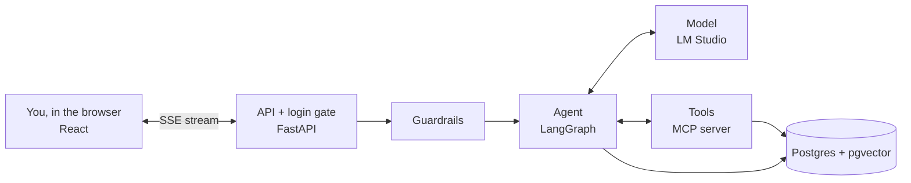

# ShopHelper AI Agent

A customer-support AI agent inside a small fictional shop, built as a learning project. You can browse products, fill a cart and
place an order. The agent answers questions about that order, explains store policy from documents (RAG), and submits refunds that
**pause for human approval**.

It runs **entirely on your machine**, and a **How it works** area shows every step the agent takes as it happens. Users sign in
at three access levels, and each customer's data is private to them. The same agent also deploys to AWS with Terraform, without
the shop.

> **Current status:** local stack working and tested. AWS infrastructure is torn down, and
> Bedrock's Claude models are waiting on the Anthropic use-case form.
> See [docs/next-steps.md](docs/next-steps.md).

## Quick start

You need [Docker Desktop](https://www.docker.com/products/docker-desktop/) and
[LM Studio](https://lmstudio.ai/) with `qwen/qwen3-30b-a3b-2507` and
`text-embedding-nomic-embed-text-v1.5` downloaded.

```bash
lms server start          # or use the Developer tab in LM Studio
docker compose up --build
```

| Open | For |
| --- | --- |
| <http://localhost:5173> | The shop. Browse as a guest, or use Sign in and click a demo account |
| <http://localhost:5050> | pgAdmin: browse the database, no login needed |
| <http://localhost:8000/docs> | The API, interactive |

Each level sees a different app:

| Level | Demo accounts | Can do |
| --- | --- | --- |
| Customer | Asha, Ravi, Kabir and others | Own orders and chats, request refunds |
| Support | Support | All orders, review refunds up to $200 |
| Admin | Admin | Review any refund, change levels, reset the demo |

Full guide: [docs/local-setup.md](docs/local-setup.md)

## How it works



**One message, step by step:**

1. The **login gate** works out who you are, and the **guardrail** checks your text. It blocks attacks and card numbers, and masks emails.
2. The **agent** asks the **model** what to do next, showing it the available tools.
3. If the model asks for a tool, the agent runs it through the **MCP server**: looking up an order,
   or searching policies with **RAG**.
4. The result goes back to the model. This repeats until it can answer.
5. A refund request **pauses** the agent and saves its state until a staff member decides.
6. Words and steps **stream** to your browser as they happen.

The most important idea: **the model only asks, and your code acts**. So a model that's wrong or
manipulated still can't move money, or read another customer's data. In testing, with the owner check removed, all 7
cross-user attacks succeeded. With it in place, none did.

Layer-by-layer detail: [docs/architecture.md](docs/architecture.md)

## Learn it

The [docs](docs/README.md) are a learning path. Each chapter explains why something exists, walks
through the real code, and ends with exercises in the running app.

| | |
| --- | --- |
| 1. [Agents and the loop](docs/learn/01-agents-and-the-loop.md) | 6. [Streaming](docs/learn/06-streaming.md) |
| 2. [Tools](docs/learn/02-tools.md) | 7. [The React frontend](docs/learn/07-frontend.md) |
| 3. [MCP](docs/learn/03-mcp.md) | 8. [Guardrails](docs/learn/08-guardrails.md) |
| 4. [RAG](docs/learn/04-rag.md) | 9. [Evals](docs/learn/09-evals.md) |
| 5. [Memory and human approval](docs/learn/05-memory-and-human-approval.md) | 10. [Local vs AWS](docs/learn/10-local-vs-aws.md) |
| | 11. [Accounts and isolation](docs/learn/11-accounts-and-isolation.md) |

## How this project is built

New features follow a spec-driven workflow: **Specify → Plan → Tasks → Implement → Verify**. Start a
feature with `/spec-new <name>` in Claude Code.

| File | What it holds |
| --- | --- |
| [Constitution](specs/constitution.md) | The project's rules, and what "done" means |
| [Memory](memory/MEMORY.md) | Current state: read this first in every session |
| [Learnings](memory/learnings.md) | Gotchas and non-obvious fixes |
| [Decisions](memory/decisions.md) | Why each choice was made |
| [Progress](memory/progress.md) | Session log, newest first |
| [Roadmap](specs/roadmap.md) | What's done and what's next |
| [Workflow](specs/workflow.md) | The five stages in full |

## Repository layout

```text
web/                  React + TypeScript UI
src/shophelper/       The backend
  api.py                HTTP routes and streaming
  service.py            One conversation turn, start to finish
  graph.py              The agent (LangGraph) and the refund approval step
  auth.py, auth_api.py  Accounts, sessions, the login gate
  catalog.py, cart.py   The shop: products, carts, checkout
  refunds.py            The staff review queue
  tools.py              What the tools do
  mcp_server.py         Tools exposed over MCP
  rag.py                Chunk, embed, store, search
  guardrails.py         Input and output checks
  raw_agent.py          The agent loop with no framework: read this first
knowledge/policies/   9 policy documents, the RAG source
docker-compose.yml    The local stack
evals/                33 real conversations with expected outcomes
tests/                Fast offline tests
infra/                Terraform for AWS
docs/                 Learning path and reference docs
specs/                Constitution, roadmap, and one folder per feature
memory/               Project memory: state, decisions, learnings, progress
```

## Local and AWS

Same code, different settings. AWS stays the default, so nothing local runs unless it's switched on.

| Role | Local | AWS |
| --- | --- | --- |
| Chat model | LM Studio: Qwen3 30B | Bedrock: Claude Haiku 4.5 |
| Embeddings | LM Studio: nomic | Bedrock: Titan v2 |
| Vector store | Postgres + pgvector | S3 Vectors via a Knowledge Base |
| Orders, history, state | Postgres | DynamoDB |
| Accounts | Built in, three levels | **None yet: the API has no login** |
| Shop | Catalogue, cart, checkout | **None: it needs accounts** |
| Tools | MCP over HTTP | MCP over stdio (ECS), in-process (Lambda) |
| Guardrails | Regex rules | Bedrock Guardrails |
| Runs on | Docker Compose | Lambda and ECS Fargate |

See [Local vs AWS](docs/learn/10-local-vs-aws.md) for how this works and what local can't prove.

## Test it

```bash
scripts/check.sh              # the fast gate: lint, 331 backend and 82 frontend tests, no services needed
scripts/evals_local.sh        # 33 real conversations and integration tests, through the running stack
```

Latest local eval: 33 of 33, one run. The faithfulness judge is the same Qwen model
locally, so treat its scores as a rough signal.

## Deploy to AWS

Not needed for anything above, and it costs money while running (ECS is about $1.5 a day). Accounts are local only,
so the deployed API has no login: don't host it publicly as it stands.

```bash
cp infra/terraform.tfvars.example infra/terraform.tfvars   # set alert_email
scripts/deploy.sh                 # Terraform, image, rollout; writes .env
RUN_EVALS=1 uv run pytest evals -v
scripts/teardown.sh               # remove everything
```

Before deploying, submit the Anthropic use-case form in the Bedrock console. The full list is in
[docs/next-steps.md](docs/next-steps.md), and day-to-day commands are in
[docs/runbook.md](docs/runbook.md). What each service does and costs is in
[docs/aws-services.md](docs/aws-services.md).

### AWS decisions

| Decision | Why | Trade-off |
| --- | --- | --- |
| **Terraform for all infra** | One tool, one state, one `destroy` | More verbose than SAM for Lambda |
| **DynamoDB checkpointer** | Serverless, $0 idle, TTL cleanup | 400 KB item limit |
| **S3 Vectors** (not OpenSearch Serverless) | Pay-per-use; OpenSearch costs about $12 a day idle | Fewer query features |
| **Guardrail via ApplyGuardrail** around the loop | Runs once per turn, works with any framework | Doesn't inspect tool outputs; tokens stream before the output check |
| **One image, two runtimes** | Identical code; a fair comparison | Container Lambdas cold-start slower than zip |
| **Lambda uses in-process tools, ECS uses MCP** | stdio adds about 3 s to a cold start | Two code paths |
| **Haiku agent, Sonnet judge** | Cheap agent; a different model reduces self-grading bias | Switch with `AGENT_MODEL_ID` |
| **CI deploys code, not infra** | Small OIDC role | Infra changes need a manual `terraform apply` |
| **No auth on the API** | Learning scope | Add Cognito or JWT for real use |

### Lambda vs ECS

Measured; see [docs/deployment-comparison.md](docs/deployment-comparison.md).

| | Lambda + API Gateway | ECS Fargate + ALB |
| --- | --- | --- |
| Cold start | About 4 s | None (always warm) |
| Warm `/health` | About 0.24 s | About 0.24 s |
| Streaming | Buffered, arrives all at once | True SSE streaming |
| Idle cost | $0 | About $1.5 a day |
| Max request time | 30 s | 120 s (ALB idle timeout) |
