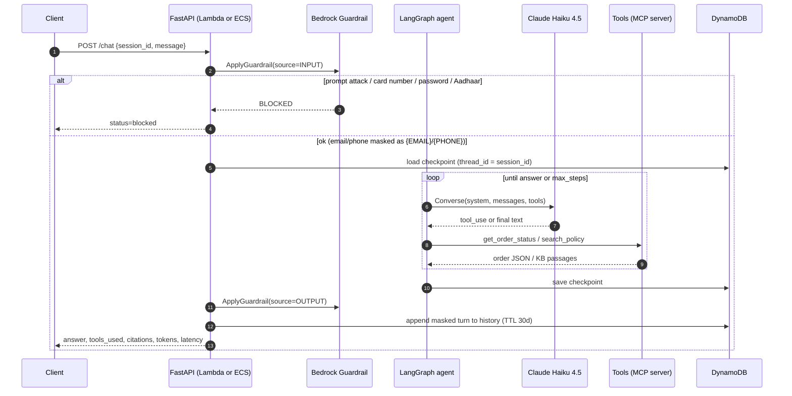
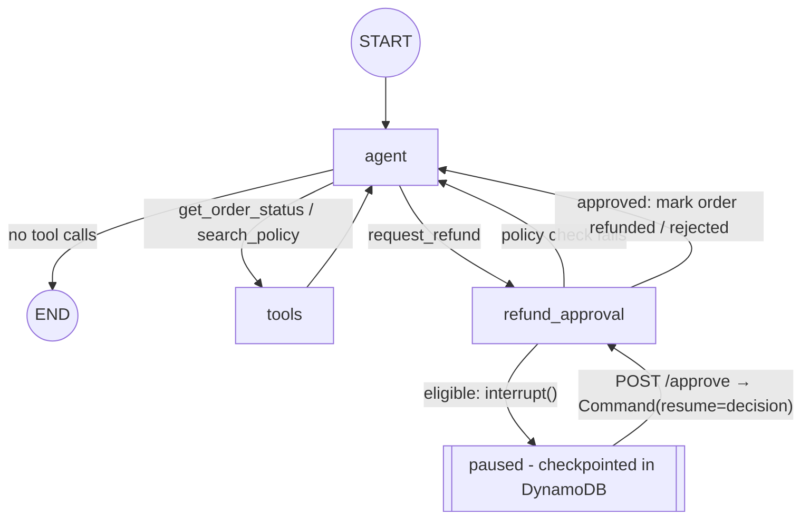

# Architecture

## Request flow (one `/chat` turn)

## The agent graph

* **`agent`** - Claude with tools bound (`ChatBedrockConverse`, temperature 0).
* **`tools`** - runs read-only tool calls; tool errors become `ToolMessage(status="error")`
  so the model can recover instead of the request crashing.
* **`refund_approval`** - the only node that can move money:
  1. deterministic eligibility (`orders.refund_eligibility`): delivered, ≤ 30 days, not already
     refunded, amount ≤ order total. Ineligible requests never reach a human.
  2. `interrupt({...})` pauses the graph. The payload (order, amount, reason,
     `needs_supervisor` if > $200) is returned to the client as `pending_refund`.
  3. On `/approve`, LangGraph re-runs the node from the top; `interrupt()` now returns the
     human's decision. The side effect (`mark_refunded`) is placed *after* `interrupt()` so it
     runs exactly once.
* **Max-steps guard** - `recursion_limit = 2 × MAX_STEPS + 1`; `GraphRecursionError` becomes a
  polite "couldn't finish" answer. The raw loop (`raw_agent.py`) enforces the same with a counter.
* While a refund is pending, new messages on that session get "waiting for approval" instead
  of starting a new run (a dangling tool call would make the next model call invalid).

## Code map

| Module | Responsibility |
| --- | --- |
| `raw_agent.py` | Step 1: the framework-free Converse tool loop (kept for comparison) |
| `api.py` | FastAPI: `/health`, `/chat`, `/chat/stream` (SSE), `/approve`, `/sessions/{id}/history`; builds the service in the lifespan |
| `service.py` | One turn: guardrails → graph → guardrails → history; streaming; approvals |
| `graph.py` | LangGraph state machine, refund node, checkpointer selection |
| `tools.py` | Tool implementations (orders, KB retrieve, offline keyword fallback) |
| `mcp_server.py` / `mcp_client.py` | FastMCP server (stdio or HTTP) and the persistent client session |
| `guardrails.py` | `ApplyGuardrail` wrapper; distinguishes BLOCKED from ANONYMIZED |
| `memory.py` | Chat history store (DynamoDB with TTL / in-memory) |
| `orders.py` | Order store (DynamoDB / in-memory from `data/orders.json`) and refund policy |
| `observability.py` | JSON turn logs for metric filters; LangSmith key from env or SSM |
| `config.py` | All settings from env / `.env` (pydantic-settings) |

Every AWS dependency has an in-memory or local fallback chosen by whether its setting is
empty, so the same code runs offline (unit tests), on a laptop against AWS, and deployed.

## Memory: two kinds

| | History table | Checkpoint table |
| --- | --- | --- |
| Written by | `service.py` | LangGraph `DynamoDBSaver` |
| Contents | Masked user/assistant text per turn | Full graph state incl. tool calls, pending interrupts |
| Key | `session_id` + ISO `ts` | `PK`/`SK` (library schema) |
| TTL | 30 days (`expires_at`) | 7 days (`ttl`) |
| Used for | Audit / support view, `/sessions/{id}/history` | Resuming conversations and paused refunds on any instance |

## Guardrail placement

The guardrail is applied with the standalone `ApplyGuardrail` API on the **user input before**
the loop and the **final answer after** it, instead of attaching `guardrailConfig` to every
model call. This costs 2 assessments per turn instead of 2 per model call, works with any
framework and lets the app decide what to do (block vs continue with masked text).
Not covered: intermediate tool outputs, and streamed tokens (they reach the client before
the output check - the final SSE event carries the guardrail-approved text).
