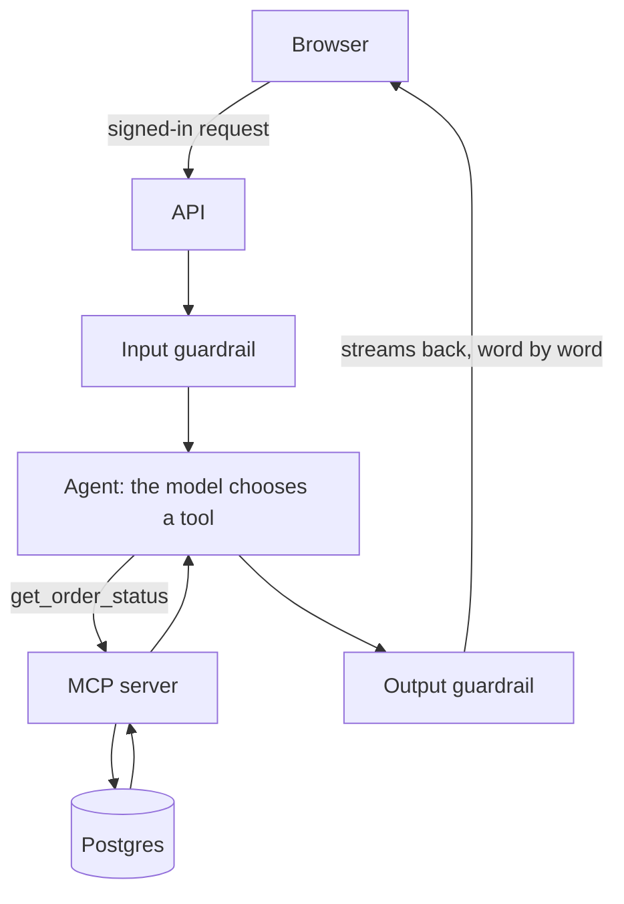

## What you'll learn

- What ShopHelper is, and what you can do with it
- The main parts of the system, and how they connect
- How to run it on your own machine
- Where each part lives in the code

## The simple explanation

ShopHelper is a small fictional online shop with an AI support agent inside it. You can browse products, buy things, and ask the agent about orders and policies. If you ask for a refund, it submits a request, and a staff member decides.

The shop is the excuse. The point is the agent, built with the same parts a real company would use, so you can open up each one.

Think of a restaurant. The customer sees a menu and a waiter. Behind them are a kitchen, a stock room and a manager who signs off refunds. This course walks you through the back of the house.

## An example

Follow one question, "Where is order 1001?":



1. The browser sends the question, with your session.
2. The API checks who you are.
3. A guardrail checks the message.
4. The model decides it needs the order, and asks for a tool.
5. The MCP server looks it up, only among *your* orders.
6. The model writes the answer from that result.
7. A guardrail checks the answer, and it streams back to you.

Each step has its own stage in this course.

## How ShopHelper does it

The code is organised by feature:

| Folder | What's in it | Stage |
| --- | --- | --- |
| `src/shophelper/agent/` | The agent loop, tools, memory, guardrails | 3 and 8 |
| `src/shophelper/mcp/` | The MCP server and client | 4 |
| `src/shophelper/rag/` | Policy search | 5 |
| `src/shophelper/api/` | The HTTP routes | 6 |
| `src/shophelper/accounts/` | Users and sessions | 6 |
| `src/shophelper/shop/` | Products, carts, orders, refunds | 6 |
| `web/src/features/` | The website you're using | 6 |
| `evals/` | Tests against the real model | 7 |
| `infra/` | Terraform for AWS | 9 |

To run it, start LM Studio's server, then Docker:

```bash
lms server start
docker compose up --build
```

The app is at http://localhost:5173. The [local setup guide](../../reference/local-setup.md) covers the details, including the demo accounts. Everything runs on your machine, with no cloud account.

## Try it

1. Sign in with a demo account from the setup guide, such as `asha@demo.shophelper.test`.
2. Open the chat and ask "Where is order 1001?".
3. Press **See how this was answered**, and match the steps to the list above.
4. Ask "Where is order 1002?". That's someone else's order, so the agent won't show it. You'll learn why in stage 6.

## Interview questions

### Walk me through your project's architecture.

**Strong answer:** A React frontend talks to a FastAPI backend. A request passes an input guardrail, then a LangGraph agent, which calls tools through an MCP server. Data lives in Postgres, with pgvector for policy search, and answers pass an output guardrail and stream back. Refunds pause for human approval. Identity never passes through the model: it comes from the session, so the model can't ask for someone else's data. Locally it's Docker and a local model, and the same code targets AWS with Terraform.

**Follow-up:** Which part would you scale first, and why?

### Why does the model not query the database directly?

**Strong answer:** Because the model only produces text, and I don't want it choosing what data it can reach. It asks for a named tool with limited arguments, and my code runs that tool. The tool applies the owner filter using identity from the session, which the model never sees. So even a successful prompt injection can't ask for another customer's order.

**Follow-up:** What could still go wrong with that design?

## Check yourself

### Where does the agent learn which customer is asking?

- [ ] From the customer's message — a message can say anything, so it can't be trusted.
- [ ] The model works it out — the model never sees identity at all.
- [x] From the signed-in session, in code — right: the model has no way to change it.

### Why does the answer pass a guardrail on the way out?

- [x] A model's output can contain something it shouldn't — right: the input check can't catch what the model writes.
- [ ] To make the text load faster — it adds a step, so it can't speed things up.
- [ ] To translate it — it checks content, and changes nothing else unless it must.
