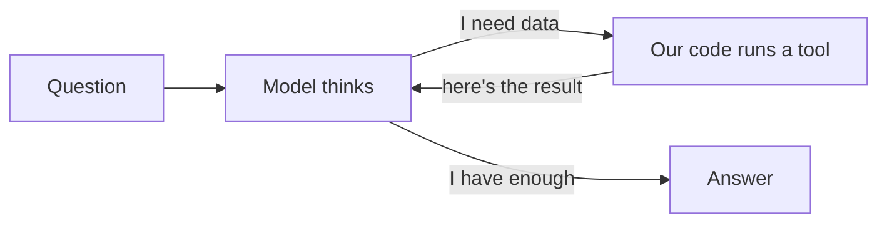

# 1. Agents and the loop

## What a language model does

A language model does one thing: given some text, it predicts what comes next. It has no memory
between calls, no access to your database and no way to take an action.

So a plain chatbot can't tell you where order 1002 is. It has never seen your orders. If you ask,
it will either admit that or, worse, invent a plausible answer. Inventing is called
**hallucination**, and it's the main problem this whole project is built to prevent.

## What makes an agent

An agent is a model inside a **loop**, where the model can ask for things to happen:



That's the entire idea. The model decides *what* to do, your code *does* it, and the result goes
back to the model. This repeats until the model has what it needs.

Here's a real exchange from this project, for "Where is order 1002?":

| Step | Who | What happens |
| --- | --- | --- |
| 1 | Model | Reads the question and replies: "call `get_order_status` with `order_id: 1002`" |
| 2 | Our code | Looks up order 1002 in Postgres and gets `status: shipped` |
| 3 | Model | Reads that result and writes: "Your keyboard has shipped..." |

The model ran **twice**. Each run is a fresh call that includes everything so far, because the
model itself remembers nothing.

## The loop with no framework

Open [raw_agent.py](../../src/shophelper/agent/raw_agent.py). It's the whole concept in about 40 lines,
written with no framework so nothing is hidden:

```python
for _ in range(settings.max_steps):
    response = client.converse(...)            # 1. ask the model
    message = response["output"]["message"]
    messages.append(message)

    if response["stopReason"] != "tool_use":   # 2. did it answer?
        return result                          #    yes: done

    for block in message["content"]:           # 3. no: run what it asked for
        output = fn(**call["input"])
        tool_results.append(...)
    messages.append({"role": "user", "content": tool_results})
                                               # 4. go round again
```

Read that before anything else. Every agent framework is a more capable version of this loop.

Notice `range(settings.max_steps)`. Without a limit, a confused model can loop forever and burn
money. Always cap your loops.

## Why use a framework, then?

The raw loop can't easily do the things real agents need:

| Need | Raw loop | LangGraph |
| --- | --- | --- |
| Pause for a human, resume hours later | Very hard | `interrupt()` |
| Survive a server restart mid-task | You build it | Checkpointers |
| Different paths for different actions | Growing `if` statements | Nodes and edges |
| Stream each step | You build it | `astream()` |

**LangGraph** models the agent as a graph. Nodes are functions, edges are the choices between
them, and a shared state flows through. Open [graph.py](../../src/shophelper/agent/graph.py):

```python
g = StateGraph(State)
g.add_node("agent", agent)                  # call the model
g.add_node("tools", tools_node)             # run read-only tools
g.add_node("refund_approval", refund_approval)
g.add_edge(START, "agent")
g.add_conditional_edges("agent", route, ["tools", "refund_approval", END])
g.add_edge("tools", "agent")                # after a tool, back to the model
```

Compare it with the raw loop: `agent → tools → agent` *is* the loop, and `route()` is the
`if` that checks whether the model asked for a tool.

## The system prompt

The system prompt is the standing instructions sent with every model call. See `SYSTEM_PROMPT` in
graph.py. Each rule there exists for a reason, and several came from watching this model fail:

| Rule | Failure it prevents |
| --- | --- |
| "Whenever a message names an order number, call get_order_status" | Answering about an order from memory after it changed |
| "Don't ask the customer to confirm first" | Asking "shall I go ahead?" instead of submitting the request |
| "Never say you will do something: call the tool now" | Writing "I'll start the refund" and then stopping |
| "{EMAIL} and {PHONE} mark contact details hidden for privacy" | Being confused by masked text and asking for the order number again |

A prompt is a request, not a guarantee. Anything that *must* hold, like "no refund without human
approval", is enforced in code instead. Chapter 5 shows how.

The "call the tool now" rule shows this. It seemed to work, then proved not to: one wording still got "A human will
review your refund" with nothing submitted, every time. So `agent()` in graph.py now checks in code. If the model promises
a refund and this turn never requested one, it gets one more try, and if it still doesn't, the customer gets an honest
message instead of a promise nobody will keep.

### When code decides before the model

ShopHelper Care showed a harder case. To the model, the name looks like a product it has never heard of, so it often skipped `search_policy`
and answered anyway: "I don't know what ShopHelper Care is", or a request for an order number. Two rewrites of the prompt didn't fix it:

| Measured on 3 rounds of each wording | Searched the policy |
| ------------------------------------ | ------------------- |
| With the stronger prompt, known wordings | 12 of 24 |
| With the stronger prompt, new wordings | 18 of 24 |
| With code searching first, all wordings | 48 of 48 |

Failures followed the wording, not chance: the same questions failed every round. So one passing test proved nothing.

Sending the model back, as the refund check does, wouldn't suit this. Tokens stream as the model writes, so the customer would watch an answer
appear and then vanish. Instead `agent()` looks at the question first. If it's about Care or a warranty, code writes the tool call itself and
the model never gets the chance to skip it:

```python
if _needs_policy_search(state["messages"]):
    return {"messages": [_search_first(state["messages"])]}
```

The rest of the loop can't tell the difference: `route` sees a tool call and runs it. That's the useful idea here. A tool call is only a
message, and code can write one as well as a model can.

It wasn't the whole fix. With the search guaranteed, the agent still called a laptop stand a lifestyle product, because the passage saying
"electronics only" arrived without the one defining electronics. [RAG](04-rag.md) explains why chunks arrive alone. Guaranteeing the input
doesn't guarantee the answer, so read the answers, not only the tool calls.

## Try it

1. Sign in, open **How it works** in the navbar, and click the **Tool call** example.
2. In **Under the hood**, find "Model call 1". Notice the model only *chose* a tool.
3. Count the model calls. Then ask "Hello!" and count again. One call, because no tool was needed.
4. Look at the token counts. The second call's input is larger, because it includes the first
   call and the tool result. That's the "fresh call with everything so far" in action.
5. Ask "What is ShopHelper Care?". The trace says "Model call 1: chose search_policy", but look at the tokens: 0 in, 0 out. No model ran. Code
   made that choice, and the trace labels it the same way as a model's.

Next: [Tools](02-tools.md)
