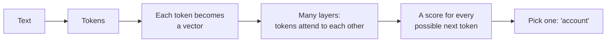

## What you'll learn

- What a model is actually doing when it writes
- What attention is, in plain words
- What a transformer is, and why it changed everything
- What the numbers on a model card mean

## The simple explanation

A language model does one job: given some text, predict the next token. Do that again and again, and you get a paragraph. Everything else comes from doing that one job extremely well.

To predict well, it has to understand context. Take the word "bank":

- "She sat on the river **bank**."
- "She paid the cheque into the **bank**."

Same word, different meaning. You know which because you looked at the other words. **Attention** lets a model do the same. For each token, it works out which other tokens matter, and blends in their meaning.

Think of reading a report with a highlighter. For each word, you highlight the others that help explain it. "River" gets highlighted for "bank". Attention does this for every token at once, with a strength for each pair.

A **transformer** is a design built on that idea. It stacks many layers, and each layer lets every token look at the others and update its own meaning. Early layers tend to pick up simple patterns, and later ones more abstract ideas, though nobody designed that by hand.

Older designs read text one word at a time, so they were slow to train and tended to lose track of distant words. The 2017 paper [Attention Is All You Need](https://arxiv.org/abs/1706.03762) dropped that for attention alone. Because all tokens can be processed together, training could use far more hardware at once. Modern language models are built on this design.

## An example

Here's how "The refund will reach your" becomes a next word:

1. The text becomes tokens, and each token becomes a vector, like the [embeddings](02-embeddings.md) you've met.
2. The model also records each token's position. Otherwise "dog bites man" and "man bites dog" would look the same.
3. Each layer updates every vector, using attention.
4. At the end, the model scores every token it knows.
5. One is chosen, added to the text, and the whole thing repeats.

A language model only looks backwards. When predicting a token, it can see what came before, but not what comes after. That's the point: there's no "after" yet.

## Not in ShopHelper

ShopHelper doesn't build or train a model. It uses one, so nothing in this project's code shows attention. But it's useful to read what you're running. Here's the [model card](https://huggingface.co/Qwen/Qwen3-30B-A3B-Instruct-2507) for the local model:

| Number | Value | What it means |
| --- | --- | --- |
| Parameters | 30.5 billion | The learned numbers inside the model |
| Activated parameters | 3.3 billion | How many are used per token |
| Layers | 48 | How many times tokens update each other |
| Attention heads | 32 | Each looks for different relationships, at the same time |
| Experts | 128, with 8 active | See below |
| Native context length | 262,144 tokens | The most it was designed to handle |

**Parameters** are what training produces, and the model's knowledge lives in them. More usually means more capable, but also more memory and more cost.

**Experts** explain how a 30-billion model runs on a home computer at a useful speed. It's a **mixture of experts**. Instead of using everything for every token, a small router picks 8 of 128 expert parts. So all 30.5 billion must fit in memory, but only 3.3 billion do the work each time. It's like a large firm where each question goes to a few specialists. That's what "A3B" in the name means: about 3 billion active.

Here it loads at 18.56 GB, and it runs with a context of 16,640 tokens, set in LM Studio to suit this machine. That's far below the 262,144 it was designed for, because a longer context needs more memory. The [context windows lesson](07-context-windows-and-prompt-caching.md) explains why.

## Interview questions

### Explain attention to someone non-technical.

**Strong answer:** When you read "she paid the cheque into the bank", you know which kind of bank it is from the words around it. Attention is how a model does that. For each word, it works out which others matter, and uses them to update its meaning. It does this for all the words at once, over many layers.

**Follow-up:** Why was this better than what came before?

### Why did transformers replace recurrent networks?

**Strong answer:** Recurrent networks handle tokens one at a time, so training can't be spread out well, and they struggle with distant relationships. Attention lets every token look directly at every other, and tokens can be processed in parallel during training. That made it practical to train much larger models on much more data. The trade-off is that attention's cost grows quickly with the length of the text.

**Follow-up:** How does that cost affect what you build?

### What's a mixture of experts model, and why would you run one?

**Strong answer:** Instead of using every parameter for every token, a router picks a few expert parts. My local model has 30.5 billion parameters but uses about 3.3 billion per token, picking 8 of 128 experts. So it's much faster than a dense model of that size. The catch is memory: all the parameters still have to be loaded. It's good when you have the memory and want speed.

**Follow-up:** How would you decide between that and a smaller dense model?

## Check yourself

### What's the one job a language model is trained to do?

- [ ] Look up facts in a database — it has no database.
- [x] Predict the next token — right: everything else comes from doing this well.
- [ ] Understand grammar rules — no rules are programmed in.

### What does attention let a token do?

- [x] Take in meaning from the other tokens — right: that's how "bank" gets its meaning.
- [ ] Remember past conversations — models keep nothing between calls.
- [ ] Search the internet — it only sees the text it's given.

### A model has 30.5 billion parameters, but 3.3 billion active. What does that mean?

- [ ] You only need memory for 3.3 billion — all of them must be loaded.
- [ ] The rest are unused and could be deleted — different tokens use different experts.
- [x] Each token uses a small part of the model — right: that's why it's fast for its size.
