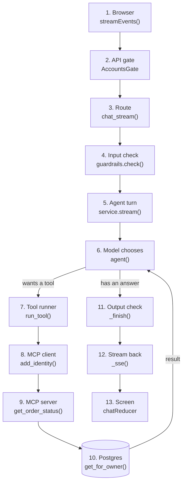

## What you'll learn

- Every step a message takes, from the browser to the model and back
- The real function at each step
- Where each safety check sits
- How to find which step is failing

## The simple explanation

Before going further, it helps to see the whole journey once. A message passes through many steps, and each one has a job.

Think of a posted letter. It goes in a box, gets sorted, travels, and reaches an office, where someone reads it, checks a file and writes a reply that travels back. If it goes missing, you find out by knowing the route.

An AI system is the same. "It's slow" or "it gave the wrong answer" could be any step. So knowing the route is how you debug.

Three ideas run through the journey:

- **Safety checks at both ends.** Check what comes in, and what goes out.
- **Identity travels separately from the message.** The model never handles it.
- **The reply streams back.** Words arrive as they're written.

## An example

Here's the journey of "Where is order 1001?" from a signed-in customer.



| Step | What happens | Where |
| --- | --- | --- |
| 1 | The browser posts the message, with its session cookie | `web/src/shared/api/sse.ts` |
| 2 | Every request is checked for a valid session | `src/shophelper/api/auth_routes.py` |
| 3 | The route confirms you own this conversation | `src/shophelper/api/app.py` |
| 4 | The message is checked, and personal details are masked | `src/shophelper/agent/guardrails.py` |
| 5 | The turn starts, and the message joins the history | `src/shophelper/agent/service.py` |
| 6 | The model reads everything, and asks for a tool | `src/shophelper/agent/graph.py` |
| 7 | Code runs the tool as the signed-in user | `src/shophelper/agent/graph.py` |
| 8 | The user's id goes into a signed header | `src/shophelper/mcp/client.py` |
| 9 | The server checks that signature | `src/shophelper/mcp/server.py` |
| 10 | The query filters by owner | `src/shophelper/shop/orders.py` |
| 6 again | The model reads the result, and writes the answer | `src/shophelper/agent/graph.py` |
| 11 | The answer is checked | `src/shophelper/agent/service.py` |
| 12 | Each step goes to the browser as an event | `src/shophelper/api/app.py` |
| 13 | The screen updates from those events | `web/src/features/chat/chatReducer.ts` |

## How ShopHelper does it

Here are the key moments in the code.

**The browser starts the stream.** It uses `fetch`, because the message has to be sent as a POST:

```ts file=web/src/features/chat/useChat.ts
await streamEvents('/api/chat/stream', { session_id: session, message }, (event) =>
```

**The route hands over to the service:**

```python file=src/shophelper/api/app.py
principal = await run_in_threadpool(_owned_by_caller, request, req.session_id)
stream = app.state.service.stream(req.session_id, req.message, principal)
```

`principal` says who's asking. It comes from the session, not from anything the customer typed.

**Identity is set where the model can't reach it.** The tool runs inside a block that records the user:

```python file=src/shophelper/agent/graph.py
with identity.acting_as(_user_id(config)):
return await t.ainvoke(call)  # a ToolCall in -> a ToolMessage out
```

**Each event is sent as text** in a simple format the browser can read as it arrives:

```python file=src/shophelper/api/app.py
yield f"event: {kind}\ndata: {json.dumps(payload)}\n\n"
```

So the customer's words pass through the model, but their identity takes a separate path around it. That's why asking the agent for someone else's order can't work, however the question is worded. [Accounts and isolation](../06-building-the-app/07-accounts-and-isolation.md) goes further.

**To find a problem, follow the route:**

| Symptom | Look at |
| --- | --- |
| Refused before any reply | Steps 2 to 4 |
| Slow first word | Steps 5 and 6 |
| Wrong tool, or no tool | Step 6 |
| "Not found" for a real order | Steps 8 to 10 |
| Right data, wrong words | Step 6 again |
| Reply changed at the last moment | Step 11 |

## Try it

1. Sign in, open **How it works**, and click the **Tool call** example.
2. Match each line of the trace to a step in the table above.
3. Note the times. Which step takes longest?
4. Ask for someone else's order, such as "Where is order 1002?". Which step stops it?

## Interview questions

### Walk me through what happens when a user sends a message.

**Strong answer:** The browser posts the message with its session cookie. A gate checks the session, and the route checks the conversation belongs to that user. A guardrail checks the input and masks personal data. Then the agent runs: the model reads the context and asks for a tool, code runs it with the user's identity, and the result goes back to the model. The answer passes an output guardrail and streams back as events. Identity never passes through the model.

**Follow-up:** Where would you add a cache?

### A user says the bot is slow. Where do you look first?

**Strong answer:** I'd trace one slow request step by step rather than guess. Each step in my system has timings, so I can see time to first token, each model call and each tool. Usually it's the number of model calls or a large prompt, and sometimes a slow tool. The fix depends on which, so I'd measure first.

**Follow-up:** How would you do that across thousands of requests?

## Check yourself

### Where does the customer's identity come from?

- [ ] The message they typed — anyone can type anything.
- [x] Their signed-in session — right: the model never handles it.
- [ ] The model works it out — it never sees it.

### Why check both the input and the output?

- [x] A model can produce something bad even from a clean message — right: each check catches different problems.
- [ ] To double the safety score — there's no such score.
- [ ] The output check replaces the input check — they do different jobs.

### Customers report "not found" for orders that exist. Where do you look?

- [ ] At the model's temperature — that doesn't affect a database lookup.
- [ ] At the frontend colours — that's nothing to do with it.
- [x] At the tool, the identity it received, and the owner filter — right: steps 8 to 10.
