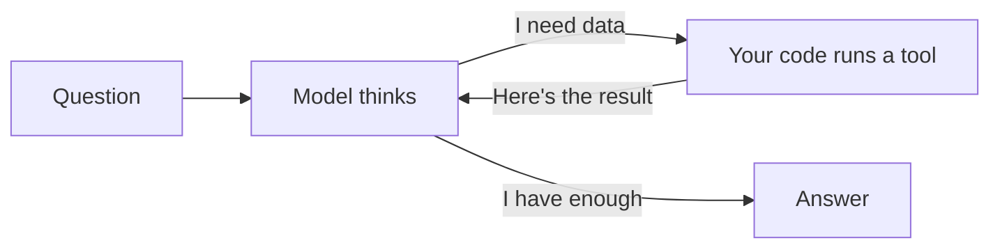

## What you'll learn

- Why a language model on its own can't look anything up
- The one idea behind every AI agent: a loop
- How to read a real agent in about 40 lines of code
- Why teams use a framework anyway
- What a prompt can't guarantee, and what to do about it

## The simple explanation

A language model does one thing: given some text, it predicts what comes next. It has no memory between calls, can't see your database, and can't do anything by itself.

So a plain chatbot can't tell you where order 1002 is. It has never seen your orders. It will either admit that or, worse, make up a likely answer. Making things up is called **hallucination**, and preventing it is much of what this project is about.

Think of the model as a very well-read adviser, locked in a room, who can only pass notes under the door. They can't open your filing cabinet. But if they write "please check order 1002", and you check and slide the answer back, they can finish the job.

That's an **agent**: a model in a loop, where it can ask for things and your code does them.



The model decides *what* to do. Your code *does* it. The result goes back to the model, and this repeats until it can answer. A **tool** here just means a function your code lets the model ask for.

## An example

Here's a real exchange from this project, for "Where is order 1002?":

| Step | Who | What happens |
| --- | --- | --- |
| 1 | Model | Reads the question and replies: "call `get_order_status` with `order_id: 1002`" |
| 2 | Your code | Looks up order 1002 in Postgres and gets `status: shipped` |
| 3 | Model | Reads that result and writes: "Your keyboard has shipped..." |

The model ran **twice**. Each run is a fresh call that includes everything so far, because the model itself remembers nothing. That's why a long conversation costs more: every call sends the whole history again.

## How ShopHelper does it

### The loop with no framework

Read this first. It's the whole concept, with nothing hidden:

```python file=src/shophelper/agent/raw_agent.py
for _ in range(settings.max_steps):
    response = client.converse(
    ...
    message = response["output"]["message"]
    messages.append(message)
    ...
    if response["stopReason"] != "tool_use":
        result.answer = "".join(b.get("text", "") for b in message["content"])
        return result
    ...
    tool_results = []
    for block in message["content"]:
    ...
        output = fn(**call["input"]) if fn else {"error": f"Unknown tool {call['name']}"}
    ...
    messages.append({"role": "user", "content": tool_results})
```

Four steps: ask the model, check whether it answered, run what it asked for, go round again. Every agent framework is a more capable version of this.

Notice `range(settings.max_steps)`. With no limit, a confused model can loop forever and keep costing money. Always cap your loops.

### Why use a framework, then?

The raw loop can't easily do what real agents need:

| Need | Raw loop | LangGraph |
| --- | --- | --- |
| Pause for a human, resume hours later | Very hard | `interrupt()` |
| Survive a server restart mid-task | You build it | Checkpointers |
| Different paths for different actions | Growing `if` statements | Nodes and edges |
| Stream each step | You build it | `astream()` |

**LangGraph** describes the agent as a graph: nodes are functions, edges are the choices between them, and a shared state flows through.

```python file=src/shophelper/agent/graph.py
g.add_node("agent", agent)
g.add_node("tools", tools_node)
g.add_node("refund_approval", refund_approval)
g.add_edge(START, "agent")
g.add_conditional_edges("agent", route, ["tools", "refund_approval", END])
g.add_edge("tools", "agent")
```

Compare it with the raw loop: `agent → tools → agent` *is* the loop, and `route()` is the `if` that checks whether the model asked for a tool.

### A prompt is a request, not a guarantee

The **system prompt** is the standing instructions sent with every call. See `SYSTEM_PROMPT` in `graph.py`. Several rules there came from watching this model fail:

| Rule | Failure it prevents |
| --- | --- |
| "Whenever a message names an order number, call get_order_status" | Answering about an order from memory after it changed |
| "Don't ask the customer to confirm first" | Asking "shall I go ahead?" instead of submitting the request |
| "Never say you will do something: call the tool now" | Writing "I'll start the refund" and then stopping |
| "{EMAIL} and {PHONE} mark contact details hidden for privacy" | Being confused by masked text and asking for the order number again |

Prompts reduce a failure. They don't end it. Anything that *must* hold, like "no refund without human approval", is enforced in code.

The "call the tool now" rule shows why. It seemed to work, then one wording still got "A human will review your refund" with nothing submitted, every time. So `agent()` now checks in code: if the model promises a refund and this turn never requested one, it gets one more try, and then the customer gets an honest message instead of a promise nobody will keep.

### When code decides before the model

ShopHelper Care showed a harder case. To the model, the name looks like a product it has never heard of, so it often skipped `search_policy` and answered anyway. Two rewrites of the prompt didn't fix it:

| Measured on 3 rounds of each wording | Searched the policy |
| --- | --- |
| With the stronger prompt, known wordings | 12 of 24 |
| With the stronger prompt, new wordings | 18 of 24 |
| With code searching first, all wordings | 48 of 48 |

Failures followed the wording, not chance: the same questions failed every round. So one passing test proved nothing.

Sending the model back, as the refund check does, wouldn't suit this. Words stream as the model writes, so the customer would watch an answer appear and then vanish. Instead `agent()` looks at the question first, and code writes the tool call itself:

```python file=src/shophelper/agent/graph.py
if _needs_policy_search(state["messages"]):
    return {"messages": [_search_first(state["messages"])]}
```

The rest of the loop can't tell the difference. That's the useful idea: a tool call is only a message, and code can write one as well as a model can.

It wasn't the whole fix. With the search guaranteed, the agent still called a laptop stand a lifestyle product, because the passage saying "electronics only" arrived without the one defining electronics. [Chunking](../05-rag/03-chunking.md) explains why. Guaranteeing the input doesn't guarantee the answer, so read the answers, not only the tool calls.

## Try it

1. Sign in, open **How it works** in the navbar, and click the **Tool call** example.
2. In the trace, find "Model call 1". Notice the model only *chose* a tool.
3. Count the model calls. Then ask "Hello!" and count again. One call, because no tool was needed.
4. Look at the token counts. The second call's input is larger, because it includes the first call and the tool result.
5. Ask "What is ShopHelper Care?". The trace says "Model call 1: chose search_policy", but look at the tokens: 0 in, 0 out. No model ran. Code made that choice, and the trace labels it the same way as a model's.

## Interview questions

### What's the difference between a chatbot and an agent?

**Strong answer:** A chatbot makes one model call and returns the text. An agent runs the model in a loop: the model can ask for a tool, my code runs it, and the result goes back until the model can answer. The model decides what to do, and code does it. In my project, "Where is order 1002?" takes two model calls with a database lookup between them.

**Follow-up:** How do you stop an agent looping forever?

### Would you use a framework or write the loop yourself?

**Strong answer:** I'd start from what the system needs. The loop itself is about 40 lines, and I wrote it by hand to understand it. But pausing for a human, surviving a restart and streaming each step are real work, so for those I use LangGraph. I'd avoid a framework for a simple single-tool flow, because it adds concepts and hides behaviour.

**Follow-up:** What does a framework cost you?

### A rule in your prompt works in testing but fails in production. What do you do?

**Strong answer:** I treat a prompt as a request, not a guarantee. First I'd measure it across different wordings with unrelated questions in between, because a cached or repeated prompt can make a rate look better than it is. In my project one wording failed every time while others passed. If the rule must always hold, I move it into code: a check after the model, or code that acts before the model runs.

**Follow-up:** When is a prompt rule good enough?

## Check yourself

### Why does a long conversation cost more per message?

- [ ] The model gets slower as it learns — the model doesn't learn during a conversation.
- [x] Each call sends everything so far — right: the model remembers nothing, so the whole history goes in every time.
- [ ] Tools charge more over time — tools aren't what grows here.

### In the agent loop, who actually runs a tool?

- [ ] The model — it can only ask, because it only produces text.
- [x] Your code — right: the model decides, and your code acts.
- [ ] The framework's cloud service — LangGraph runs in your own process here.

### What should you do with a rule that must never be broken?

- [ ] Write it in capitals in the prompt — that may reduce failures, but it can't guarantee anything.
- [ ] Repeat it several times in the prompt — same problem: it's still only a request.
- [x] Enforce it in code — right: code runs every time, whatever the model does.
