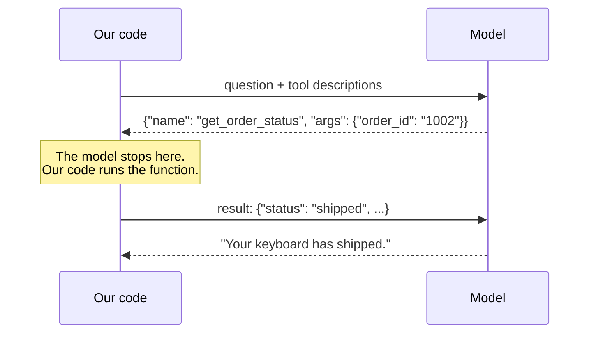

## What a tool really is

A tool is an ordinary function, plus a description the model can read.

The model never runs anything. It only produces text in a special format that means "please call
this function with these arguments". Your code reads that, runs the function, and sends back the
result. This is called **tool calling** or **function calling**.



This matters for safety. The model can only *ask*. Your code is always the one acting, so your
code can always refuse.

## What the model actually sees

For each tool, the model receives three things:

| Part | Example | Purpose |
| --- | --- | --- |
| Name | `get_order_status` | How it refers to the tool |
| Description | "Look up an order by its numeric order ID..." | How it decides *whether* to use it |
| Arguments | `order_id: string` | What it has to supply |

The model can't see your code. **The description is the entire interface**, so write it the way
you'd write instructions for a new colleague. A vague description means a tool that gets ignored
or misused.

The **Tools** page, under **How it works**, shows exactly what the model is given.

## This project's tools

| Tool | Does | Risk | Where it runs |
| --- | --- | --- | --- |
| `get_order_status` | Reads one order | Read-only | MCP server |
| `search_policy` | Searches the policy documents | Read-only | MCP server |
| `request_refund` | Asks for a refund | **Moves money** | A graph node |

The code is in [tools.py](../../../src/shophelper/agent/tools.py):

```python
def get_order_status(order_id: str) -> dict[str, Any]:
    """Look up an order by its numeric id (e.g. '1001')."""
    clean_id = order_id.strip().lstrip("#")
    ...
    order = get_order_repo().get_for_owner(clean_id, user_id)
    return order or {"error": f"No order found with id {order_id}"}
```

Two habits worth copying:

- **Clean the input.** `lstrip("#")` handles the model passing `#1002`. Models are inconsistent.
- **Return errors as data.** `{"error": ...}` goes back to the model, which can then tell the
  customer the order doesn't exist. Raising an exception would just crash the turn.

Notice that `user_id` isn't an argument. The model chooses only `order_id`, and who is asking comes from
elsewhere. [Chapter 11](../06-building-the-app/07-accounts-and-isolation.md) explains why that matters so much.

For the same reason, `run_tool` in [graph.py](../../../src/shophelper/agent/graph.py) catches exceptions and
turns them into a message the model can read. The model recovers instead of the request failing.

## Why `request_refund` is different

Look at how it's defined in graph.py:

```python
@tool
def request_refund(order_id: str, amount: float, reason: str) -> str:
    """Request a refund for a delivered order. A human support agent must approve it."""
    raise RuntimeError("Handled by the refund_approval node, never executed directly")
```

The function body is never run. It exists only so the model can *see* the tool. When the model
asks for it, the graph sends the request to the `refund_approval` node, which enforces the rules
in code.

The model has no path to money. Even a fully jailbroken model can only *ask*, and the deterministic
checks and a human still stand in the way.

**Rule of thumb:** give a model read access freely, and put anything that changes the world behind
something it can't talk its way past.

## What happens when a tool is wrong

Tools fail, and models misuse them. This project handles each case:

| Situation | Handling |
| --- | --- |
| Order doesn't exist | The tool returns `{"error": ...}` and the model says so |
| Tool throws an exception | `run_tool` returns the error to the model |
| Model invents a tool name | `run_tool` replies "Unknown tool" |
| Model loops forever | `recursion_limit` stops it, and the customer gets a polite message |

## Try it

1. Open **How it works**, then **Tools**, and read the descriptions as if you were the model.
2. Ask: "Where is order 9999?" In the trace, the tool *succeeds* and returns an error object. The
   model reads it and tells you.
3. Sign in as Arjun and ask for a refund on order 1004. The model asks for one, and the code refuses
   because the order is outside the 30-day window. No human was bothered, and the model explains why.
4. Edit a tool's docstring in [mcp_server.py](../../../src/shophelper/mcp/server.py) to something vague,
   like "Gets data". Save, run `docker compose restart api`, and see how the model behaves. Then
   change it back.

Next: [MCP](../04-mcp/01-mcp.md)
