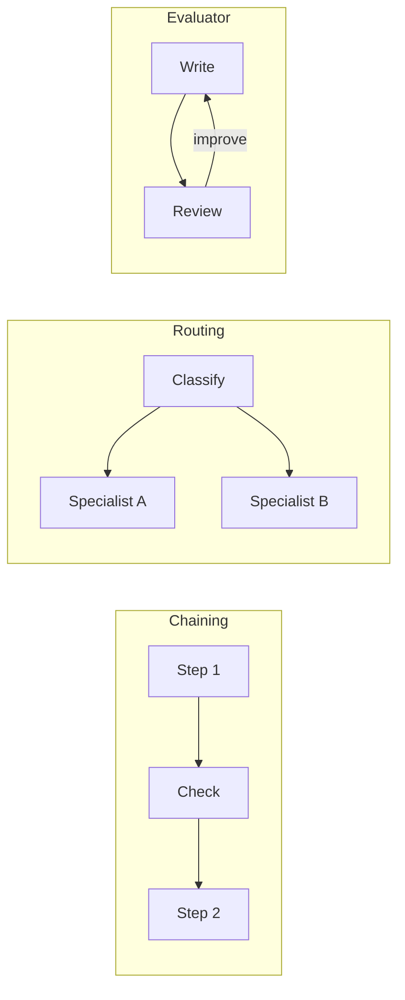

## What you'll learn

- The five common patterns for combining model calls
- What each is good for
- How to spot them in real systems
- How to choose one

## The simple explanation

When one model call isn't enough, you don't have to jump to a full agent. Anthropic's [Building effective agents](https://www.anthropic.com/engineering/building-effective-agents) names five workflow patterns. Learn these names, because interviews use them.

**1. Prompt chaining.** One step's output feeds the next, like an assembly line. You can add checks between steps.

**2. Routing.** Classify the input, then send it to a specialist. Like a hospital receptionist who sends you to the right department.

**3. Parallelisation.** Do things at once. Either split a job into parts, or run the same job several times and vote.

**4. Orchestrator and workers.** A lead model breaks a job down, hands out the parts, and combines the results. Unlike parallelisation, the parts aren't known in advance.

**5. Evaluator and optimiser.** One model writes, another reviews, and they loop. Like an author and an editor.



These all build on what Anthropic calls the **augmented LLM**: a model with retrieval, tools and memory.

## An example

Here's how each could help a support team:

| Pattern | Example | Why it fits |
| --- | --- | --- |
| Chaining | Summarise a complaint, check it, then draft a reply | Each step is simple and checkable |
| Routing | Send billing questions to one prompt, technical ones to another | Each prompt can focus |
| Parallelisation | Check a reply for tone, accuracy and policy at once | Faster, and each check stays simple |
| Orchestrator | Investigate a complaint across orders, emails and logs | Nobody knows the steps in advance |
| Evaluator | Draft a sensitive reply, then improve it against a rubric | Quality matters more than speed |

Each one costs more than a single call. Parallel calls cut the wait, but not the bill.

## How ShopHelper does it

ShopHelper is mainly an agent, but you can find several of these patterns in it.

**Routing, in code.** `route()` sends the turn down one of three paths:

```python file=src/shophelper/agent/graph.py
return "refund_approval" if any(c["name"] == "request_refund" for c in calls) else "tools"
```

That's a code decision, so it's free and exact. Routing doesn't need a model when a simple rule works.

**Chaining with checks.** A turn is a chain with a gate at each end: input guardrail, then agent, then output guardrail. And the refund path is a chain too: rule check, then a person, then the action.

**Evaluator, in the tests.** The evals use a model to judge whether an answer is supported by the passages:

```python file=evals/judge.py
def judge_faithfulness(question: str, passages: list[str], answer: str) -> dict:
```

That's the evaluator pattern, used for testing rather than in production. It isn't run on live answers, because it would add a model call to every reply.

**Not in ShopHelper:** parallelisation and the orchestrator pattern. Questions here are short lookups, so there's nothing to gain.

## In the market

Checked on 2026-11-06.

You don't need a framework for any of this: chaining is just calling a function, then another. Anthropic's advice is to [start with plain API calls](https://www.anthropic.com/engineering/building-effective-agents), because frameworks can add layers that hide what's happening.

If you do want one, [LangGraph](https://docs.langchain.com/oss/python/langgraph/overview) and [Microsoft Agent Framework](https://learn.microsoft.com/en-us/agent-framework/overview/agent-framework-overview) both express these as graphs of steps.

**How to choose:** start with one call. If it fails on some cases, ask why:

| Problem | Try |
| --- | --- |
| The task has separate steps | Chaining |
| Very different kinds of input | Routing |
| Several independent checks | Parallelisation |
| Steps can't be known in advance | Orchestrator |
| First drafts aren't good enough, and you can define "good" | Evaluator |

## Try it

1. Sign in, open **How it works**, and ask "How long do refunds take?".
2. In the trace, label each step: which are the chain? Where's the gate?
3. Ask for a refund on order 1001, and find the point where the route changes.

## Interview questions

### Name the common agent workflow patterns.

**Strong answer:** Prompt chaining, where steps feed each other. Routing, where you classify and dispatch. Parallelisation, by splitting a job or voting. Orchestrator and workers, where a lead model divides up work it can't plan in advance. And evaluator and optimiser, where one writes and another reviews in a loop. In my project routing is plain code, the turn is a chain with guardrails at each end, and the evals use an evaluator.

**Follow-up:** Which would you use to generate a report from many sources?

### You're asked to improve answer quality by adding a reviewer model. What do you consider?

**Strong answer:** It adds a call to every answer, so cost and delay go up, and it only helps if the reviewer can really spot problems. I'd measure it: does it catch failures my evals find? It may be better to run it only on risky cases, or in testing. I'd also check the reviewer isn't just approving everything, by testing it on known-bad answers.

**Follow-up:** How would you pick which cases are risky?

## Check yourself

### What's the difference between parallelisation and orchestrator and workers?

- [ ] They're the same — the orchestrator pattern has a lead model.
- [x] In the orchestrator pattern, the parts aren't known in advance — right: a lead model decides them.
- [ ] Parallelisation uses more models — both can use several calls.

### ShopHelper routes turns with an `if` in code. Why not a model?

- [x] A simple rule works, so it's free and exact — right: don't use a model when code will do.
- [ ] Models can't route — they can, and often do.
- [ ] LangGraph forbids it — it allows both.

### Parallel calls change what?

- [ ] They reduce the bill — you still pay for every call.
- [x] They cut the wait — right: the cost stays about the same.
- [ ] They improve accuracy automatically — only if you design for it.
