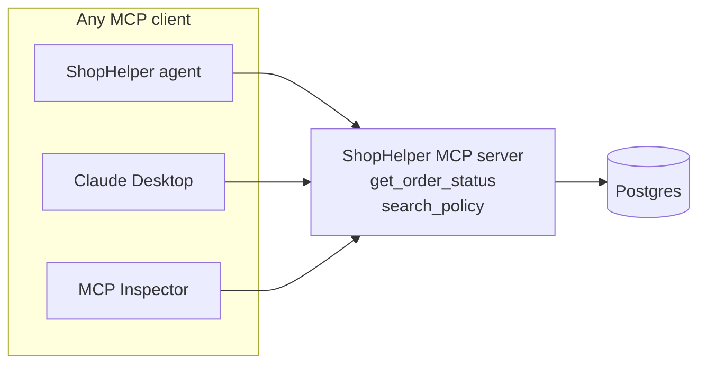
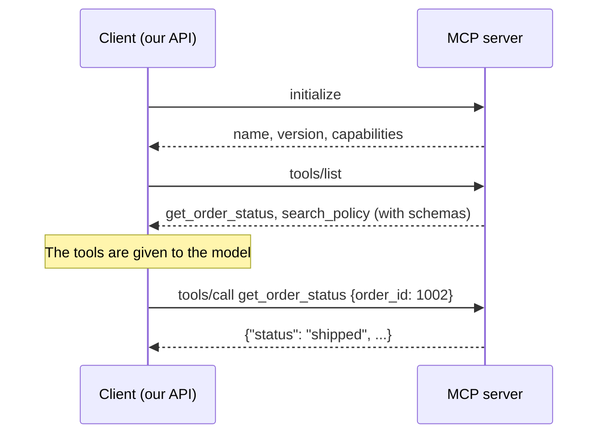

# 3. MCP

## The problem

Chapter 2's tools are Python functions inside this app. That works until someone else wants them.

Say your company has 5 AI apps and 10 data sources. Without a standard, each app needs custom code
for each source: up to 50 integrations, each with its own quirks.

**MCP, the Model Context Protocol**, is a standard way to expose tools. Build a tool server once,
and any MCP-compatible client can use it. People often compare it to USB-C: one plug instead of
one cable per device.



## The conversation

MCP is a small protocol built on JSON-RPC messages:



`tools/list` is the key step: **tools are discovered at runtime**. The client doesn't hard-code
them. Add a tool to the server, and every client finds it the next time it connects.

You can watch this happening:

```bash
docker compose logs -f mcp
```

Send a chat message and you'll see `ListToolsRequest` and `CallToolRequest` go by.

## Building a server

[mcp_server.py](../../src/shophelper/mcp_server.py) is the whole server. FastMCP turns ordinary
functions into MCP tools, using the type hints for the schema and the docstring for the description:

```python
mcp = FastMCP("shophelper", host=get_settings().mcp_host, port=8765)

@mcp.tool()
def get_order_status(order_id: str) -> dict[str, Any]:
    """Look up an order by its numeric order ID (e.g. '1001'): status, item, total and dates."""
    return tools.get_order_status(order_id)
```

The server only wraps [tools.py](../../src/shophelper/tools.py). That separation is deliberate: the
logic stays in one place, and MCP is a way of reaching it.

## Using a server

[mcp_client.py](../../src/shophelper/mcp_client.py) connects, then converts each MCP tool into a
LangChain tool. To the agent they look like any other tool, so the graph has no idea MCP is
involved. That's why switching transport needs no changes to the agent.

## Transports: how the messages travel

| | stdio | Streamable HTTP |
| --- | --- | --- |
| How | The client starts the server as a child process and talks over stdin/stdout | The server runs on its own, and clients connect over HTTP |
| Good for | Desktop tools, one client | Shared servers, many clients |
| Startup | A few seconds per process | None, it's already running |
| Used here | ECS on AWS | Local Docker |
| Gotcha | Never `print()` in the server: stdout *is* the protocol | Needs a port, and real auth in production |

Locally it runs as its own container for a learning reason: you can see it, restart it and connect
other clients to it.

On Lambda, tools run in-process with no MCP. A stdio subprocess added about 3 seconds to each cold
start, which wasn't worth paying. That's a good lesson: **MCP is for sharing tools across clients
and boundaries**. When one app uses its own tools in one process, plain function calls are simpler.

## A real bug MCP exposed

The MCP server is a **separate process**, which changes what "shared data" means.

Orders originally lived in a Python dictionary in memory. With MCP, there are two processes and so
two dictionaries. A refund approved by the API updated one, while `get_order_status` on the MCP
server read the other, and the order still looked `delivered`.

The fix was moving orders to Postgres, so both processes read the same data. Once you split a
system into processes, any state they share has to live outside them.

## Who is calling?

Once users have private data, a tool server has a new problem: `get_order_status` needs to know whose orders
to search, and it can't just believe whoever connects.

A tool argument won't do, because the model writes those. So the identity travels **outside the tool call**, in
an HTTP header:

```python
async def add_identity(request, handler):  # mcp_client.py
    headers = {"Authorization": f"Bearer {auth.issue_internal_token(user_id)}"}
    return await handler(request.override(headers=headers))
```

The server checks the signature, and FastMCP's `ctx` parameter gives it the header without adding anything to the
schema the model sees. No valid token means "No order found". `search_policy` stays open, because policies are
public. The full story is in [chapter 11](11-accounts-and-isolation.md).

This is also a real limit of stdio: a subprocess has no HTTP headers, so per-user identity needs another route
there. That's one reason shared servers use HTTP.

## Why `request_refund` isn't on the server

An MCP server is open to any client that can reach it. If refunds lived there, any client could
call them and skip the approval graph. So read-only tools are on the server, and the money-moving
action stays inside the graph. The **Tools** page shows this: `via mcp` against
`via graph node (never MCP)`.

## Try it

1. **Open the Inspector**, which is a UI for any MCP server:

   ```bash
   npx @modelcontextprotocol/inspector
   ```

   Choose **Streamable HTTP**, enter `http://localhost:8765/mcp`, and connect. List the tools. You're now a
   second client of the same server.
2. **Call a tool with no identity.** Call `get_order_status` with order `1001`. It answers `No order found`,
   even though the order exists, because you sent no token. Then call `search_policy`, which works for
   anyone.
3. **Call it with a token.** Create one, which lasts 60 seconds:

   ```bash
   docker compose exec mcp python -c "from shophelper import auth; s = auth.get_user_store(); print(auth.issue_internal_token(s.get_by_email('asha@demo.shophelper.test').user_id))"
   ```

   In the Inspector, add the header `Authorization: Bearer <token>`, reconnect, and call `get_order_status` for
   `1001` again. Now it returns Asha's order, but `1002` still doesn't exist as far as she's concerned.
4. **Add a tool.** Add this to mcp_server.py:

   ```python
   @mcp.tool()
   def store_hours() -> str:
       """The store's customer support hours."""
       return "9am to 6pm IST, Monday to Saturday."
   ```

   Run `docker compose restart api` so the client lists tools again, then check the **Tools** page.
   Ask the agent about support hours. You didn't change any agent code.
5. Remove it again when you're done.

Next: [RAG](04-rag.md)
