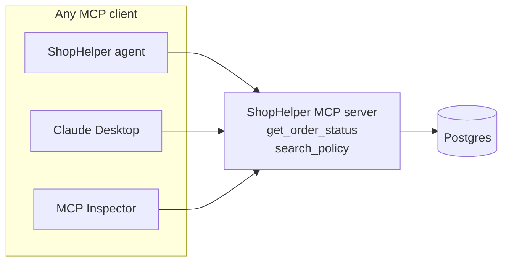

## What you'll learn

- The problem MCP solves
- How a client and a server talk
- How tools get discovered at run time
- When you don't need MCP at all

## The simple explanation

So far, tools have been Python functions inside this app. That works until someone else wants them.

Say your company has 5 AI apps and 10 data sources. Without a standard, each app needs custom code for each source: up to 50 integrations, each with its own quirks.

**MCP, the Model Context Protocol**, is a standard way to expose tools and data. Build a tool server once, and any MCP client can use it. People often compare it to USB-C: one plug instead of one cable per device.



There are three roles:

| Role | What it is | Here |
| --- | --- | --- |
| **Host** | The AI app the user runs | ShopHelper |
| **Client** | The connection inside it | `src/shophelper/mcp/client.py` |
| **Server** | The program offering tools | `src/shophelper/mcp/server.py` |

Messages use **JSON-RPC**, a simple format where each request has a method name and an id.

## An example

The key idea is discovery. The client doesn't have the tools written into it. It asks.

Here's a real exchange with this project's server, trimmed:

```text
Client:  {"method": "tools/list"}
Server:  {"tools": [{"name": "get_order_status",
                     "description": "Look up an order by its numeric order ID...",
                     "inputSchema": {"properties": {"order_id": {"type": "string"}}}}, ...]}

Client:  {"method": "tools/call",
          "params": {"name": "get_order_status", "arguments": {"order_id": "1001"}}}
Server:  {"content": [{"type": "text", "text": "{\"error\": \"No order found with id 1001\"}"}]}
```

Add a tool to the server, and every client finds it the next time it looks. That's why this works across companies: nobody has to agree on a list in advance.

That last reply says "No order found" although order 1001 exists, because this call had no identity attached. You'll see why in [Authorization and risks](04-authorization-and-risks.md).

## How ShopHelper does it

FastMCP turns ordinary functions into MCP tools, using the type hints for the schema and the docstring for the description:

```python file=src/shophelper/mcp/server.py
mcp = FastMCP("shophelper", host=get_settings().mcp_host, port=8765)
```

The server only wraps the real logic in `agent/tools.py`:

```python file=src/shophelper/mcp/server.py
def search_policy(query: str) -> dict[str, Any]:
...
return tools.search_policy(query)
```

That separation is deliberate: the logic stays in one place, and MCP is only a way of reaching it.

On the other side, the client connects, then turns each MCP tool into a LangChain tool. To the agent they look like any other tool, so the graph has no idea MCP is involved.

**A real bug MCP exposed.** The server is a separate process, which changes what "shared data" means. Orders used to live in a Python dictionary in memory. With MCP there were two processes, so two dictionaries. A refund approved by the API updated one, while `get_order_status` read the other, and the order still looked `delivered`. The fix was moving orders to Postgres. Once you split a system into processes, shared state has to live outside them.

**When MCP isn't worth it.** On Lambda, tools run in-process, with no MCP. A subprocess added about 3 seconds to each cold start, which wasn't worth paying. MCP is for sharing tools across clients and boundaries. When one app uses its own tools in one process, plain function calls are simpler.

## In the market

Checked on 2026-11-06.

MCP is the common standard for connecting agents to tools, and it's [supported by SDKs](https://blog.modelcontextprotocol.io/posts/2026-07-28/) in TypeScript, Python, Go and C#, with Rust in beta. The alternatives are simpler, and each has a place:

| Option | Good when |
| --- | --- |
| Plain functions in your app | One app, its own tools |
| A normal REST API, called by a tool | You own both sides, and want no new protocol |
| **MCP** | Many clients, or tools shared across teams and products |

MCP sits beside tool calling rather than replacing it: the model still does [tool calling](../02-talking-to-models/04-tool-calling.md), and MCP is how your app finds and reaches those tools.

## Try it

1. Watch the protocol: run `docker compose logs -f mcp`, send a chat message, and see `ListToolsRequest` and `CallToolRequest` go by.
2. Add a tool. Put this in [server.py](../../../src/shophelper/mcp/server.py), above the `if __name__` line:

   ```python
   @mcp.tool()
   def store_hours() -> str:
       """The store's customer support hours."""
       return "9am to 6pm IST, Monday to Saturday."
   ```

3. Run `docker compose restart mcp api`, then open **How it works**, then **Tools**. It's there, and you changed no agent code.
4. Ask the agent about support hours.
5. Remove the tool, and restart again.

## Interview questions

### What problem does MCP solve?

**Strong answer:** It's a standard way for AI apps to reach tools and data. Without it, every app needs custom code for every source. With it, you build a server once and any client can use it, and tools are discovered at run time. In my project the server exposes read-only tools, and I could connect a second client, like the MCP Inspector, without changing the server.

**Follow-up:** When wouldn't you use it?

### What's the difference between MCP and tool calling?

**Strong answer:** Tool calling is how a model asks for a function. MCP is how an application finds and reaches tools, wherever they run. They work together: my app lists tools over MCP, gives them to the model, and when the model asks for one, my app calls it over MCP. The model doesn't know MCP exists.

**Follow-up:** Does the model talk to the MCP server?

### You split your tools into a separate server, and now data looks stale. Why?

**Strong answer:** Separate processes don't share memory. That happened to me: orders were in a Python dictionary, so the API and the MCP server each had their own copy, and an approved refund wasn't visible to the tool. Shared state has to live outside the processes, so I moved it to Postgres.

**Follow-up:** What other problems appear when you split a process?

## Check yourself

### What does `tools/list` do?

- [x] Lets a client discover the tools at run time — right: nothing is hard-coded.
- [ ] Runs every tool — that's what `tools/call` does, one at a time.
- [ ] Trains the model on the tools — nothing is trained.

### Does the model talk to the MCP server?

- [ ] Yes, directly — it only produces text.
- [x] No: the app does, and the model only asks for tools — right: the model doesn't know MCP exists.
- [ ] Only for read tools — never directly.

### When is MCP not worth using?

- [x] One app using its own tools in one process — right: a plain function call is simpler.
- [ ] Tools shared across several apps — that's what it's for.
- [ ] Tools used by different teams — it fits this well.
