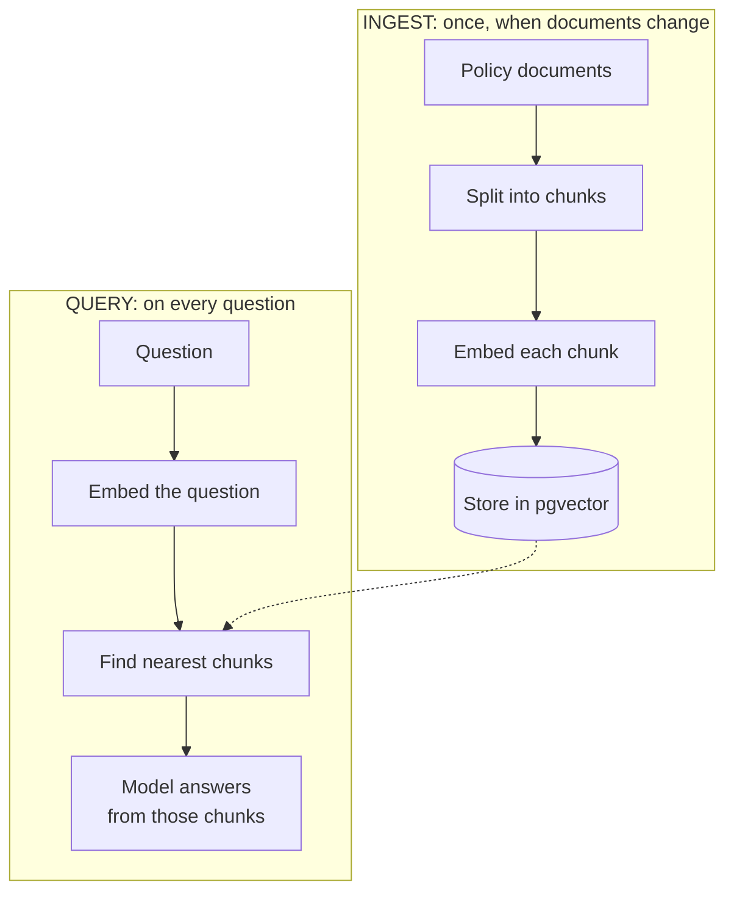
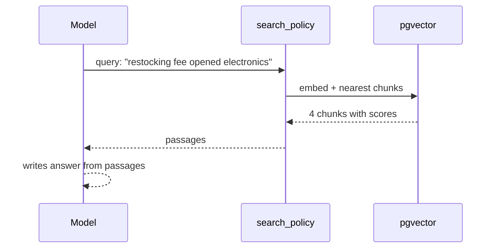

# 4. RAG

## The problem

The model doesn't know this store's return policy, and asking it anyway gets a confident invention.

You could paste every policy into every prompt. That works for 9 small documents, but it fails at
real scale. Every call pays for all that text, models have a limit on input size, and answers get
worse when the relevant sentence is buried in thousands of others.

**RAG, Retrieval-Augmented Generation**, is the alternative: find just the few relevant passages,
and give only those to the model.

| Word | Meaning |
| --- | --- |
| **Retrieval** | Find the relevant passages |
| **Augmented** | Add them to the prompt |
| **Generation** | The model writes an answer from them |

It's an open-book exam. The model doesn't memorise your policies, it looks them up.

## The two halves

RAG has two separate pipelines. All the code for both is in
[rag.py](../../src/shophelper/rag/pipeline.py).



## Step 1: Chunking

**Why split at all?** You search for *passages*, not documents. A small, focused chunk represents
one idea well. A whole document blurs many ideas together, so it matches everything weakly.

Chunk size is a trade-off:

| Too small | Too large |
| --- | --- |
| Loses context: "within 30 days" of what? | Blurred meaning, and wastes prompt space |

`chunk_markdown()` makes two choices, both visible in the code:

```python
def chunk_markdown(text, max_chars=350):
    ...
    title = lines[0]            # e.g. "# Refund Policy"
    ...
    for line in body:           # whole lines only
        if current and len(...) > max_chars:
            chunks.append("\n".join([title, *current]))
```

1. **Split on line boundaries.** Each bullet here is a complete rule, so a rule is never cut in half.
2. **Repeat the title on every chunk.** Alone, "must be within 30 days" could be about anything.
   With "# Refund Policy" above it, both the embedding and the model know the subject.

Our 9 documents become 20 chunks.

## Step 2: Embeddings

This is the idea that makes RAG work.

An **embedding** turns text into a list of numbers that captures its *meaning*. Our model,
nomic-embed-text, produces 768 numbers for any text.

Think of it as coordinates on a map. A city's location takes 2 numbers, and nearby cities have
similar numbers. Meaning takes more dimensions, but it works the same way: **texts with similar
meaning get similar numbers**, even when they share no words.

| Text A | Text B | Shared words | Close in meaning? |
| --- | --- | --- | --- |
| "Can I send this back?" | "Returns are accepted within 30 days" | None | **Yes** |
| "Is my card safe?" | "We never store full card numbers" | "card" | **Yes** |
| "How long is the warranty?" | "How long does shipping take?" | "How long" | Not very |

This is why it beats keyword search. Keyword search would miss the first row entirely.

No single number means anything alone. The meaning is in the overall pattern.

### Query and document prefixes

```python
DOCUMENT_PREFIX = "search_document: "
QUERY_PREFIX = "search_query: "
```

A question and an answer are different kinds of text, and this model was trained to expect a
label saying which it's looking at. Leaving these out quietly lowers search quality, with no error.
It's specific to nomic, so check the model card of any embedding model you use.

The most important rule: **embeddings from different models can't be compared**. Each model has its
own "map". Change your embedding model, and you must re-embed everything.

## Step 3: Storing vectors in Postgres

A **vector database** stores embeddings and finds the nearest ones quickly. Here that's plain
Postgres with the **pgvector** extension. See [schema.sql](../../src/shophelper/core/schema.sql):

```sql
CREATE EXTENSION IF NOT EXISTS vector;

CREATE TABLE policy_chunks (
    ...
    content   TEXT NOT NULL,
    embedding VECTOR(768) NOT NULL   -- must equal the model's dimensions
);
```

**Why pgvector?** It's a normal database that also does vector search. You can use SQL, join to
other tables, and browse it in pgAdmin. Dedicated vector databases like Pinecone or Qdrant go
further at very large scale, but you rarely need that to start.

### The index

```sql
CREATE INDEX ... USING hnsw (embedding vector_cosine_ops);
```

Comparing a question to every row is fine for 20 rows, and too slow for 20 million. **HNSW** is an
index that finds *nearly* the nearest vectors far faster, by hopping through a graph of neighbours.
It trades a little accuracy for a lot of speed.

Honest note: with 20 rows this index does nothing useful, and Postgres will likely just scan the
table. It's here so you can see how real systems are set up.

## Step 4: Search

Here's the whole search, from `search()`:

```sql
SELECT source, chunk_index, content AS text,
       1 - (embedding <=> %s) AS score
FROM policy_chunks
ORDER BY embedding <=> %s
LIMIT 4
```

`<=>` is pgvector's **cosine distance** operator. Cosine measures the angle between two vectors:
pointing the same way means similar meaning, whatever their length.

- **Distance:** 0 means identical. Lower is better, so we `ORDER BY` it.
- **Score:** `1 - distance`. Higher is better, and this is what the UI shows.

### Reading the scores

Scores are relative, not absolute. Real results from this project:

| Question | Top result | Score |
| --- | --- | --- |
| Can I return an opened laptop stand? | returns.md | 0.718 |
| How long is the warranty on my keyboard? | warranty.md | 0.720 |
| Do you offer gift wrapping? (not in any policy) | payments.md | 0.542 |

Look at that last row. There's no gift wrapping policy, yet the search still returned something.
**Vector search always returns the nearest results, even when nothing is relevant.** With this
model, even unrelated text scores around 0.5, so a score near 0.5 here doesn't mean "half relevant".

That's why the system prompt says "If the passages don't answer the question, say you don't know".
The model is the last check on relevance. For the gift wrapping question, it correctly said it
couldn't find anything.

It's also why the UI says **Retrieved from** next to the file names, not "Source". Those files were
*searched*, which doesn't mean the answer *used* them.

## Step 5: Generation

Retrieval plugs into the agent as a tool, which makes this **agentic RAG**. The model decides when
to search, and writes its own query:



In simple RAG, every question triggers a search. Here, "Hello" searches nothing, and a
complicated question can search twice. The cost is one extra model call.

Notice that the model's query isn't the customer's exact words. It rewrites the question into
search terms, often improving the match. The trace shows you what it chose.

## Common ways RAG goes wrong

| Symptom | Likely cause | Fix |
| --- | --- | --- |
| Right document, wrong detail | Chunks too large | Smaller chunks |
| Fragments with no context | Chunks too small, no titles | Add context to each chunk |
| Relevant chunk isn't found | Different wording, or too few results | Raise `top_k`, or add keyword search (hybrid) |
| Exact codes or names are missed | Embeddings are fuzzy about exact strings | Hybrid search |
| Confident answer that's not in the docs | Model ignoring context | Tighten the prompt, measure with evals |
| Good results that later get worse | Docs changed and weren't re-ingested | Automate ingestion |

## How AWS does the same thing

On AWS, a **Bedrock Knowledge Base** does all of the above as a managed service. It reads from S3,
chunks, embeds with Titan, and stores in S3 Vectors. You call one `Retrieve` API.

| Step | Local (you can see it) | AWS (managed) |
| --- | --- | --- |
| Chunk | `chunk_markdown()` | Knowledge Base setting |
| Embed | nomic, 768 dimensions | Titan v2, 1024 dimensions |
| Store | pgvector | S3 Vectors |
| Search | SQL you can read | `Retrieve` API |

Managed saves you work, and hides how it works. Building it yourself once means you'll know what the
managed service is doing, and what to check when it misbehaves.

## Try it

1. **How it works, then RAG explorer:** search for "Can I send this back?", which shares no words with the
   document. Notice it still finds the returns policy.
2. Search for "gift wrapping" and "pizza recipe". Compare the scores to a real question to see the
   floor described above.
3. Open **What's stored** and read the chunks. Check that each one starts with its title.
4. **pgAdmin:** run the "most similar" query from [local-setup.md](../local-setup.md). The refunds
   chunk's nearest neighbour is the *cancellation* policy, at 0.898. They really are close in meaning.
5. **Change the knowledge:** edit a fact in `knowledge/policies/returns.md`, such as the restocking
   fee. Run `docker compose up setup`. The log shows only that one document re-embedded, because of
   the content hash. Ask the agent about it. You changed what it knows without touching any code or
   retraining anything. That's the whole appeal of RAG. Change it back afterwards. (The shop shows a copy of this one file, at
   `web/src/shop/returns-policy.md`, and `scripts/check.sh` fails if the two differ. Keep both in step for a lasting change.)
6. **Change the chunk size:** set `MAX_CHUNK_CHARS` to 1000 in rag.py, then run
   `docker compose down -v && docker compose up`. Compare chunks and scores.

Next: [Memory and human approval](05-memory-and-human-approval.md)
