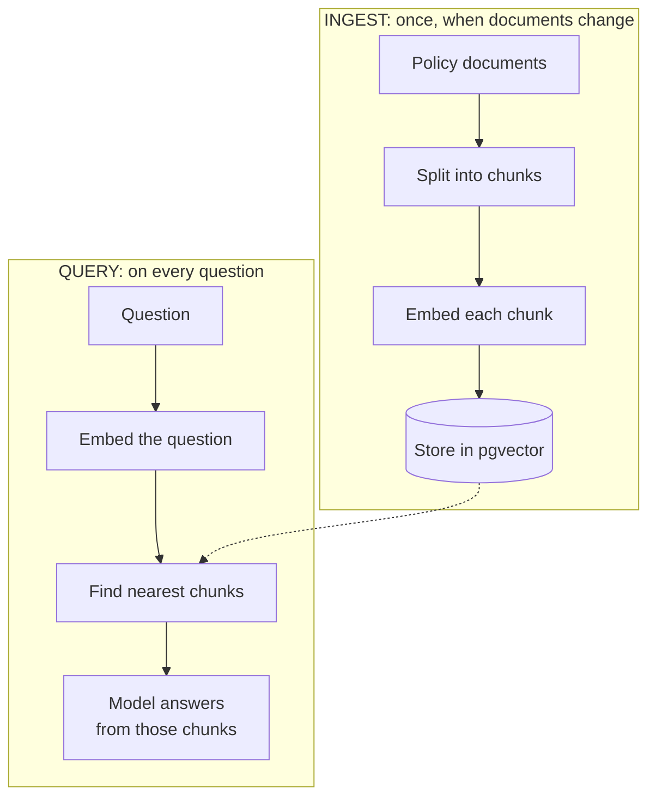
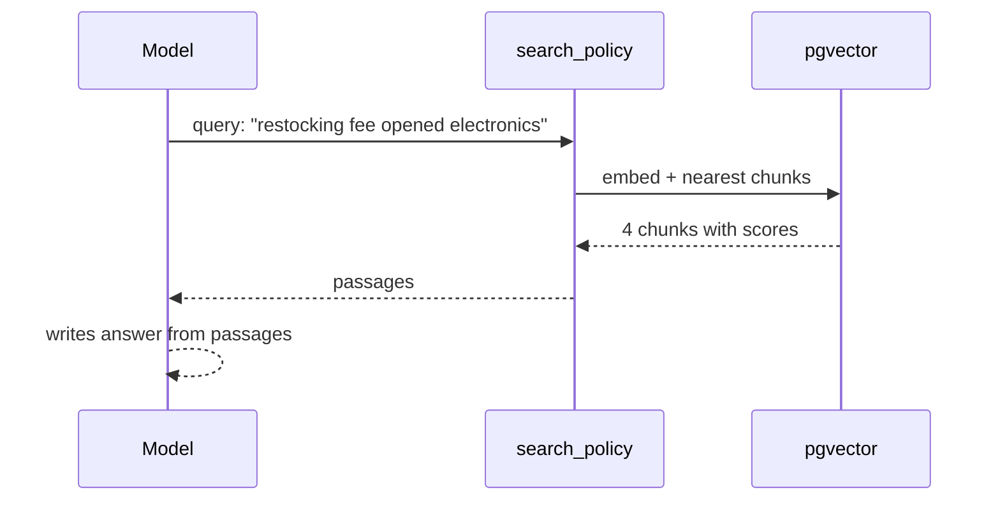

## What you'll learn

- The problem RAG solves
- The two pipelines every RAG system has
- How search plugs into an agent
- Why a search result isn't the same as an answer

## The simple explanation

The model doesn't know this store's return policy, and asking it anyway gets a confident invention.

You could paste every policy into every prompt. That works for 9 small documents, but it fails at real scale. Every call pays for all that text, models have a limit on input size, and answers can get worse when the relevant sentence is buried among thousands.

**RAG, Retrieval-Augmented Generation**, is the alternative: find the few relevant passages, and give only those to the model.

| Word | Meaning |
| --- | --- |
| **Retrieval** | Find the relevant passages |
| **Augmented** | Add them to the prompt |
| **Generation** | The model writes an answer from them |

It's an open-book exam. The model doesn't memorise your policies. It looks them up.

RAG has two separate pipelines:



The rest of this stage goes through them piece by piece.

## An example

Follow "How long do refunds take?":

1. **Embed the question.** It becomes 768 numbers.
2. **Find the nearest chunks.** The top result, scoring 0.82, is this:

```text
# Refund Policy
- Approved refunds go back to the **original payment method** within **5-7 business days**...
```

3. **Generate.** The model reads the passage and answers, naming 5-7 business days.

The fact came from the document, not from the model's memory. So change the document, and the answer changes, with no retraining. That's the real appeal.

## How ShopHelper does it

Ingest is `ingest()`, and it only re-embeds what changed, using a hash of each file:

```python file=src/shophelper/rag/pipeline.py
digest = hashlib.sha256(text.encode()).hexdigest()
```

Search is one SQL query:

```python file=src/shophelper/rag/pipeline.py
"SELECT source, chunk_index, content AS text, 1 - (embedding <=> %s) AS score "
"FROM policy_chunks ORDER BY embedding <=> %s LIMIT %s",
```

`<=>` is pgvector's **cosine distance**. 0 means identical, so we order by it. `1 - distance` gives a score where higher is better.

**Agentic RAG.** Retrieval plugs into the agent as a tool, so the model usually decides when to search, and writes its own query. "Hello" searches nothing, and a complicated question can search twice. The cost is an extra model call.



The model's query often isn't the customer's exact words: it rewrites them into search terms. The trace shows what it chose.

**Search always returns something.** Vector search finds the nearest results, even when nothing is relevant. Measured here:

| Question | Best score |
| --- | --- |
| How long do refunds take? | 0.82 |
| Do you offer gift wrapping? (not in any policy) | 0.64 |
| pizza recipe | 0.53 |

So the system prompt says "If the passages don't answer the question, say you don't know". The model is the last check on relevance. That's also why the UI says **Retrieved from** beside file names, not "Source": those files were *searched*, which doesn't mean the answer used them.

## In the market

Checked on 2026-11-06.

You can build this yourself, as here, or use a managed service. On AWS, a [Bedrock Knowledge Base](https://docs.aws.amazon.com/prescriptive-guidance/latest/choosing-an-aws-vector-database-for-rag-use-cases/vector-db-options.html) does it for you. It reads from S3, chunks, embeds, stores, and offers one `Retrieve` API. This project's AWS setup uses that:

| Step | Local (you can see it) | AWS (managed) |
| --- | --- | --- |
| Chunk | `chunk_markdown()` | Knowledge Base setting |
| Embed | nomic, 768 dimensions | Titan v2, 1,024 dimensions |
| Store | pgvector | S3 Vectors |
| Search | SQL you can read | `Retrieve` API |

Managed saves work, and hides how it works. Building it yourself once means you'll know what to check when a managed service misbehaves.

## Try it

1. Open **How it works**, then **RAG explorer**. Search for "Can I send this back?", which shares no words with the document. It still finds the returns policy.
2. Search for "gift wrapping" and "pizza recipe". Compare the scores with a real question.
3. **Change the knowledge.** Edit a fact in `knowledge/policies/warranty.md`, such as the price of Care. Run `docker compose up setup`. The log shows only that one document re-embedded. Ask the agent. You changed what it knows without touching any code. Then change it back, and run `setup` again.

## Interview questions

### Explain RAG to a product manager.

**Strong answer:** It's an open-book exam. Instead of hoping the model remembers our policies, we search them for the passages relevant to each question, and hand those to the model with the question. It answers from what it's given, and we can show the source. When a policy changes, we update the document, and answers change immediately, with no retraining.

**Follow-up:** What can still go wrong?

### What are the steps in a RAG pipeline?

**Strong answer:** Two pipelines. Ingest runs when documents change: split them into chunks, embed each one, and store the vectors. Query runs on every question: embed the question, find the nearest chunks, and give them to the model. In my project the ingest step skips unchanged documents using a hash, and retrieval is a tool, so the agent decides when to search.

**Follow-up:** What happens if a document is deleted?

### What does a good RAG system do when nothing relevant is found?

**Strong answer:** It should say it doesn't know. Vector search always returns something: in my tests "pizza recipe" still scored 0.53. So a high-enough-looking result doesn't mean relevance. I tell the model to answer only from the passages and say when they don't help, and I test that with questions that have no answer. A score threshold can help too, but it has to be measured.

**Follow-up:** How would you choose that threshold?

## Check yourself

### What does the "R" in RAG do?

- [x] Finds the relevant passages — right: then they're added to the prompt.
- [ ] Retrains the model on your documents — nothing is retrained.
- [ ] Rewrites the customer's question — that can help, but it isn't what the R means.

### You change a policy document. What do you need to do?

- [ ] Retrain the model — RAG avoids that.
- [x] Re-embed that document — right: then answers change.
- [ ] Nothing at all — the stored vectors would be out of date.

### What does vector search return if nothing is relevant?

- [ ] Nothing — it always returns the nearest results.
- [x] The nearest results anyway — right: so something else has to judge relevance.
- [ ] An error — no error is raised.
