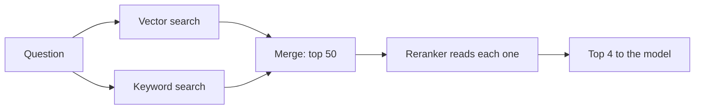

## What you'll learn

- What keyword search does better than vectors
- How hybrid search combines the two
- What a reranker is, and why it works so well
- How these did on this project's real data

## The simple explanation

Vector search understands meaning, but it's fuzzy about exact things. Search for an order code or a product number, and it may return something merely *similar*.

**Keyword search** does the opposite. It finds the exact words, but misses "money back" when the text says "refund". The classic method is **BM25**, which scores chunks by how often your words appear, giving rare words more weight.

So use both. **Hybrid search** runs the two together and merges the results.

Merging is tricky, because the scores aren't comparable. A common fix is **Reciprocal Rank Fusion (RRF)**, which ignores scores and uses positions: a chunk near the top of either list does well.

```text
score = 1 / (k + rank in list A) + 1 / (k + rank in list B)
```

Then there's a second idea. Comparing vectors is fast because each text was embedded separately, without seeing the other. A **reranker** is slower but smarter: it reads the question and a passage *together*, and judges how well they fit.

Think of hiring. First a recruiter scans thousands of CVs for keywords, then a hiring manager reads the best 10 properly. Fast and wide, then slow and careful.



## An example

We tested these on this project's 24 chunks with 20 real questions.

| Method | Right chunk first | Right chunk in top 4 |
| --- | --- | --- |
| Vector | 17 of 20 | 20 of 20 |
| Keyword | 15 of 20 | 19 of 20 |
| Hybrid (RRF) | 17 of 20 | 19 of 20 |
| Vector, then a reranker | **20 of 20** | n/a |

Three honest points:

**Hybrid didn't help here.** It lost one, because "My item broke after a week, who pays for shipping it back?" shares few words with the answer, so the keyword list pulled it down. Hybrid helps when keywords carry real signal. These are natural questions on a tiny collection.

**Exact strings are where keywords win.** Searching for an exact phrase with vectors alone:

| Search | Rank of the chunk containing it |
| --- | --- |
| `$5.99` | 1 |
| `$19.99` | 2 |
| `$12.99` | 3 |
| `5-7 business days` | **6** |

That last one falls outside the top 4 the agent reads, though a simple text match finds it at once. So customers typing product codes or error numbers are the case for hybrid.

**The reranker fixed all 3 misses.** We used the local Qwen model to pick the best of the top 8. For example, "How long is the warranty on a laptop stand?" had the right chunk in third place. Reading them together put it first. It's a small test, and not a dedicated reranker, but the direction is clear.

The cost: that was one more model call per question, reading 8 passages.

## Not in ShopHelper

ShopHelper uses vector search only. The numbers above came from a separate experiment on its real data.

On 24 chunks, top 4 already contains the answer for all 20 questions, so neither is needed yet. The model reads all 4 and finds the right one. If the collection grew to thousands of chunks, I'd add them in this order:

1. **A reranker**, since it gave the biggest gain.
2. **Hybrid search**, if customers search by code or name.

Postgres can do the keyword half without a new database, which is what the experiment used:

```sql
SELECT source, ts_rank(to_tsvector('english', content), to_tsquery('english', 'refund | take')) AS rank
FROM policy_chunks
WHERE to_tsvector('english', content) @@ to_tsquery('english', 'refund | take')
ORDER BY rank DESC;
```

The [pgvector docs](https://github.com/pgvector/pgvector) suggest exactly this: combine it with full-text search, using RRF or a cross-encoder reranker.

## In the market

Checked on 2026-11-06.

| Tool | Hybrid support |
| --- | --- |
| [pgvector](https://github.com/pgvector/pgvector) | Combine with Postgres full-text search yourself |
| [Qdrant](https://qdrant.tech/documentation/search/hybrid-queries/) | Built-in queries using RRF |
| [Weaviate](https://docs.weaviate.io/weaviate/concepts/search/hybrid-search) | Runs vector and BM25 together, and fuses the scores |
| [Pinecone](https://docs.pinecone.io/guides/search/reciprocal-rank-fusion) | Documents RRF as a step you do on the client |

Rerankers come as hosted APIs or open models, and the usual kind is a **cross-encoder**: a model that reads the question and passage together. Test on your own data, because gains vary.

Anthropic [reported](https://www.anthropic.com/news/contextual-retrieval) that adding reranking took its failure rate from 2.9% to 1.9%, on top of contextual retrieval and BM25. That's its own test, but it fits what we saw.

## Try it

1. Sign in, open **How it works**, then **RAG explorer**.
2. Search `5-7 business days`, with **Top** set to 4. Is `refunds.md` there?
3. Set **Top** to 8. Where does the refund chunk land?
4. Search "how long do refunds take". Where does it land now?

## Interview questions

### What's hybrid search, and when does it help?

**Strong answer:** It runs keyword and vector search together and merges them, often with Reciprocal Rank Fusion, which uses ranks rather than scores. Vectors catch meaning, and keywords catch exact terms like codes and names. It helps when exact strings matter. In my tests it didn't help natural questions on a small set, and it lost one. But an exact phrase ranked 6th with vectors alone, outside what the agent reads. So I'd measure on real traffic rather than assume.

**Follow-up:** Why rank fusion rather than adding the scores?

### What does a reranker do, and what does it cost?

**Strong answer:** Vector search compares texts that were embedded separately, which is fast but rough. A reranker reads the question and each passage together, so it's more accurate, but slower. So I retrieve wide, then rerank a small set. In my test a model reranking the top 8 took right-first from 17 of 20 to 20 of 20. The cost is delay and a model call per question.

**Follow-up:** How many candidates would you rerank?

### Retrieval quality is poor. What do you try, and in what order?

**Strong answer:** First measure it, with a test set of real questions and known answers, and look at what comes back. Then fix the cheap things: chunking and titles. Next raise how many results I retrieve, and add a reranker, since that gave me the biggest gain. Add hybrid if exact terms matter. Then consider contextual retrieval. And change one thing at a time.

**Follow-up:** What if the documents themselves are the problem?

## Check yourself

### What does keyword search do better than vector search?

- [x] Finding exact strings, such as codes — right: vectors are fuzzy about exact terms.
- [ ] Understanding paraphrases — that's what vectors are good at.
- [ ] Working without an index — both benefit from one.

### Why does Reciprocal Rank Fusion use ranks?

- [ ] Ranks are faster to calculate — the reason is comparability.
- [x] Scores from different methods can't be compared — right: positions can.
- [ ] Scores are unavailable — both methods produce them.

### In our test, what gave the biggest gain?

- [ ] Hybrid search — it lost one.
- [ ] Removing the prefixes — that changed nothing.
- [x] A reranker — right: 17 of 20 became 20 of 20.
