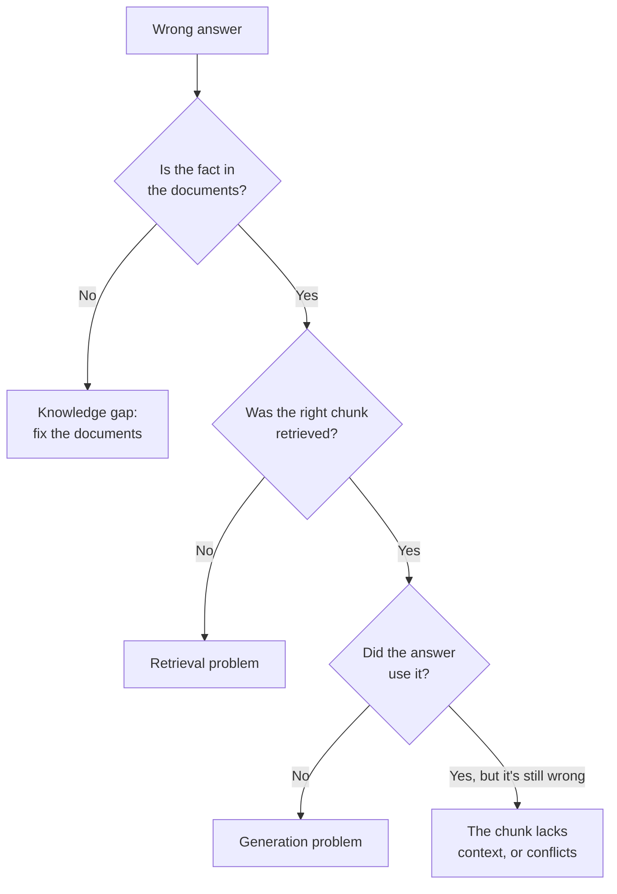

## What you'll learn

- A step-by-step way to find why a RAG answer is wrong
- How to tell retrieval problems from generation problems
- The common causes, and their fixes
- How to stop the same bug coming back

## The simple explanation

"The AI got it wrong" isn't a diagnosis. A RAG answer passes through several steps, and each can fail. So don't change anything yet: find the step first.

Think of a doctor. They don't prescribe on hearing "I feel ill". They run tests and narrow it down.

One question splits the problem in half:

**Was the right passage in what the model received?**



Then:

| Step | Check | If it fails |
| --- | --- | --- |
| 1. Knowledge | Is the fact written down anywhere? | Add it. No search can find what isn't there |
| 2. Ingest | Is the current version stored? | Re-ingest |
| 3. Query | What did the search actually look for? | Fix the query |
| 4. Retrieval | Is the right chunk in the results? | Chunking, top k, hybrid, reranking |
| 5. Context | Does the chunk make sense alone? | Fix the chunk |
| 6. Generation | Does the answer follow the passages? | Prompt, model |

## An example

Here's a real bug from this project, followed through those steps.

**The symptom.** Asked "How much is ShopHelper Care for a laptop stand?", the agent said Care wasn't available, because a stand "is not an electronic product". That's wrong.

**Step 1: knowledge.** The policy said Care is for electronics, and it defined electronics. Pass.

**Step 2: ingest.** The chunks were current. Pass.

**Step 3: query.** The trace showed a sensible search. Pass.

**Step 4: retrieval.** Printing the passages showed the Care rule came back first. Pass, or so it seemed.

**Step 5: context.** Reading what came back found it. The Care chunk said "electronics only", and the chunk that *defines* electronics wasn't there. The model had a rule with an undefined word, and guessed. **Fail.**

**The fix.** The Care line now names the categories. All 16 test wordings were then right.

Notice what would have happened with a guess. "The model is too weak" would have meant a bigger model, at more cost. "The prompt needs work" would have meant more rules. The real cause took a few minutes to find, by printing what the model saw.

## How ShopHelper does it

The tools for each step are already here:

| To check | Use |
| --- | --- |
| What's stored | **RAG explorer**, under **What's stored** |
| What a search returns | **RAG explorer** search |
| What query the agent used | The trace on **How it works** |
| What the model received | The `search_policy` step in the trace |
| Whether an answer is supported | The faithfulness judge in the evals |

Every answer also lists where it came from:

```python file=src/shophelper/agent/service.py
for src in re.findall(r'"source":\s*"([^"]+)"', str(m.content)):
```

Common problems:

| Symptom | Likely cause | Fix |
| --- | --- | --- |
| Right document, wrong detail | Chunks too large | Smaller chunks |
| Fragments with no context | Chunks too small, no titles | Add context to each chunk |
| Relevant chunk isn't found | Different wording, or too few results | Raise `top_k`, or add hybrid search |
| Exact codes or names are missed | Embeddings are fuzzy about exact strings | Hybrid search |
| Confident answer that's not in the documents | Model ignoring context | Tighten the prompt, and measure with evals |
| Good results that later get worse | Documents changed, and weren't re-ingested | Automate ingestion |
| Search not run at all | The model chose not to | Force it in code, as with [Care questions](../03-agents/02-the-agent-loop.md) |

**Then stop it coming back.** Once fixed, add the failing question to your evals. This project did exactly that: the Care wordings that failed became permanent test cases.

## In the market

Checked on 2026-11-06.

At scale you can't read every trace by hand, so teams use tools that record each step and score answers. [Stage 7](../07-evals-and-testing/01-why-testing-ai-differs.md) covers evals, and stage 10 covers tracing in production.

The useful habit is to measure the two halves separately. One [interview guide](https://prachub.com/resources/ai-engineer-interview-questions-2026-rag-agents-evals-and-production-systems) puts it directly: measure retrieval and generation separately.

## Try it

1. Sign in, open **How it works**, and ask "How long is the warranty on a laptop stand?".
2. Open the `search_policy` step, and read every passage.
3. Is the fact there? Which passage has it? Was it first?
4. Now ask something the policies don't cover, such as "Do you offer gift wrapping?". Follow the flowchart. Where does it stop?

## Interview questions

### A RAG answer is wrong, even though the right document exists. How do you debug it?

**Strong answer:** I find the failing step before changing anything. Is the current version stored? What query ran? Was the right chunk retrieved? I print exactly what the model received. If the chunk isn't there, it's retrieval: chunking, top k, hybrid or reranking. If it's there and the answer's wrong, it's generation, or the chunk lacks context. That was my real bug: a rule said "electronics only", but the definition was in a different chunk, so the model guessed. Then I add the case to my evals.

**Follow-up:** What if it only fails sometimes?

### The system worked last month, and now answers are worse. What do you check?

**Strong answer:** What changed. Documents may have changed without being re-ingested, or new ones may compete with the old. The model or embedding model may have changed, or the prompt, or user questions may have shifted. I'd compare stored chunks with the source, re-run my evals against last month's results, and look at failing questions from production.

**Follow-up:** How would you catch that automatically?

### How do you know if a failure is retrieval or generation?

**Strong answer:** I look at whether the right passage reached the model. If it didn't, generation never had a chance, so it's retrieval. If it did and the answer doesn't follow it, it's generation. That's why I log the retrieved passages with each answer, and measure the two separately, such as context recall for retrieval and faithfulness for generation.

**Follow-up:** Which do you fix first?

## Check yourself

### What's the first thing to do with a wrong answer?

- [ ] Rewrite the prompt — you don't know the cause yet.
- [ ] Switch to a bigger model — that may hide the real problem.
- [x] Find which step failed — right: start by reading what the model received.

### The right chunk reached the model, but the answer ignored it. What kind of problem is that?

- [x] A generation problem — right: retrieval did its job.
- [ ] A retrieval problem — the chunk was found.
- [ ] A knowledge gap — the fact exists.

### What should you do after fixing a bug?

- [ ] Nothing: it's fixed — it can come back.
- [x] Add the failing question to your evals — right: then it can't return unnoticed.
- [ ] Delete the document — that would lose the policy.
