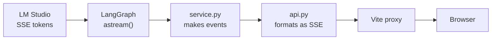

## Why stream

A full agent turn here takes 3-5 seconds, sometimes more. With an ordinary request, the screen sits
still the whole time, and people assume it's broken.

Streaming sends each piece as soon as it exists. The total time doesn't change, but the *perceived*
wait drops, because something is always happening. For an agent there's a second benefit: the user
sees each step, so the wait makes sense.

## Choosing a technology

| Option | Direction | Good for | Why (not) here |
| --- | --- | --- | --- |
| Polling | Client asks repeatedly | Slow changes | Laggy and wasteful |
| **Server-Sent Events** | Server → client | Streaming responses | **Chosen.** Exactly this job |
| WebSockets | Both ways | Chat apps, games, collaboration | More machinery, and we don't need two-way |

The traffic here is one-way: the client sends one request, then only receives. That's precisely
what **SSE** does. It's plain HTTP, so proxies, load balancers and browser dev tools all understand
it. Most LLM APIs stream this way too, including OpenAI's, Anthropic's and LM Studio's.

If we needed the server and client to talk freely during a turn, WebSockets would be right.

## What SSE looks like

SSE is a text format. Each event is a couple of lines, ended by a blank line:

```text
event: tool_start
data: {"id": "call_1", "name": "search_policy", "args": {"query": "restocking fee"}}

event: token
data: "There"

event: token
data: " is a"

event: final
data: {"status": "answered", "answer": "There is a 10% restocking fee."}
```

See it raw, with no UI involved. The API needs a login, so curl keeps the session in a cookie file, and a
conversation has to exist first:

```bash
curl -c jar.txt http://localhost:8000/auth/login -H 'content-type: application/json' \
  -d '{"email":"ravi@demo.shophelper.test","password":"shophelper-demo"}'

curl -b jar.txt -X POST http://localhost:8000/conversations   # copy the id it returns

curl -N -b jar.txt http://localhost:8000/chat/stream -H 'content-type: application/json' \
  -d '{"session_id":"PASTE-THE-ID","message":"Where is order 1002?"}'
```

`-N` turns off curl's buffering, so you see each event as it arrives. Delete `jar.txt` afterwards: it's a live
session.

## The events

Every step of a turn is one event type:

| Event | Sent when | Data |
| --- | --- | --- |
| `guardrail` | Input or output has been checked | stage, action, reasons |
| `model_step` | A model call finished, or code chose a tool itself (0 tokens, see [chapter 1](../03-agents/02-the-agent-loop.md)) | tools chosen, tokens, time |
| `tool_start` | The model asked for a tool | name, args |
| `tool_end` | The tool finished | result, time |
| `token` | The model wrote more of its answer | text |
| `interrupt` | The graph paused for approval | refund details |
| `final` | The turn is over | the complete response |
| `error` | Something failed | message |

A typical order:

```text
guardrail → model_step → tool_start → tool_end → token... → model_step → guardrail → final
```

Clients can ignore events they don't recognise. So adding an event doesn't break older clients.

## The server side

The path is four layers, each one passing events up:



The main part is in `_stream_graph` in [service.py](../../../src/shophelper/agent/service.py):

```python
async for mode, payload in self.graph.astream(
    graph_input, config, stream_mode=["messages", "updates"]
):
```

LangGraph offers two views of the same run at once:

- **`messages`:** model output as it's generated, which gives us `token` events.
- **`updates`:** the result of each node as it finishes, which gives us the step events.

[api.py](../../../src/shophelper/api/app.py) turns each one into SSE text. Because `events()` is an async
generator, each `yield` goes out on the wire immediately:

```python
yield f"event: {kind}\ndata: {json.dumps(payload)}\n\n"
```

`json.dumps` matters. A token can contain a newline, which would otherwise break the line-based
format. In JSON, it's safely escaped.

## Streaming and safety

Streaming creates a real problem. **Tokens reach the user before the output guardrail has seen the
full answer**, because the guardrail needs the complete text.

This project's answer: the `final` event carries the guardrail-approved text, and the client
replaces whatever it displayed. The unsafe text may flash on screen briefly. That's a trade-off,
and it's why `/chat`, which doesn't stream, still exists for when it isn't acceptable.

Other options: buffer sentence by sentence and check each, or don't stream at all.

## Things that break streaming

Something between you and the client may hold onto your data until the response finishes:

| Where | What happens | Fix |
| --- | --- | --- |
| API Gateway + Lambda | Buffers everything, so it all arrives at once | Use the ALB, or Lambda response streaming |
| nginx | Buffers by default | `proxy_buffering off` |
| Compression | Waits to fill blocks | Disable it for `text/event-stream` |
| Browser `EventSource` | Can only send GET | Use `fetch` (next chapter) |

If your stream arrives all at once, look for the buffer in the middle. The curl command above is the
way to find it: try it against each hop.

## Try it

1. Run the curl commands above and watch the events arrive.
2. Open browser dev tools, then **Network**. Send a chat message and click the `stream` request.
   Depending on your browser, an **EventStream** or **Response** tab shows the events.
3. In the trace, compare the times. Find the gap between the last tool finishing and the first
   token. That's time the model spends reading the prompt.
4. Send a message containing your email. The trace shows the guardrail masked it.

Next: [The React frontend](04-the-frontend.md)
