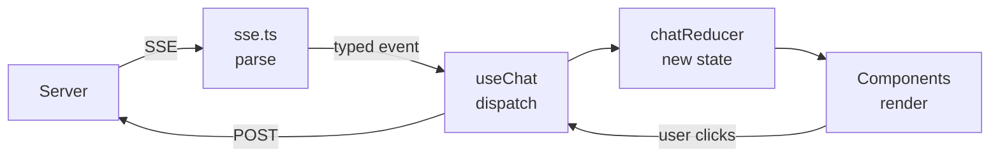

## What you'll learn

- How a chat UI reads a stream, and why a reducer helps
- Why state sits above the pages
- How to keep users apart in one browser
- Why the browser is never trusted with a price

## The simple explanation

A chat that streams is harder than a normal page, because dozens of events arrive in a few seconds and each one changes the screen.

If each event updates the screen in its own place, the logic gets scattered, and bugs are hard to find. So use one pure function, a **reducer**:

```text
(current state, event) → new state
```

Think of a bank statement. Your balance isn't edited directly. Every transaction goes through in order, and the balance follows. If something looks wrong, you can replay the list.

The data flows one way:



The second big idea: **the browser isn't yours.** Anyone can open the console and change anything. So the frontend is for showing things. Prices, permissions and rules live on the server.

## An example

Here are some real cases the reducer handles:

| Event | What happens |
| --- | --- |
| `token` | Adds to the current message |
| `final` | **Replaces** the text, because the guardrail may have changed it |
| `model_step` with tool calls | Clears the text, so "Let me check" doesn't run into the answer |
| `tool_end` | Finds its `tool_start` by id, so parallel tools stay paired |
| `tool_end` with no start | Happens on a resumed turn: the tool started before the pause |
| `final` with a pending refund | Remembers it, so the chat shows "Waiting for review" |

Because the reducer is pure, a test can replay a list of events and check the result, with no server or browser. There's one place to read, too.

Here's a measurement that changed a design. The spec said the chat button must never cover an Add to cart. The plan was a bar fixed to the bottom of the screen:

| Layout | Overlaps, over about 1,300 scroll positions |
| --- | --- |
| A bar fixed over the page | **105** |
| A bar below the scrolling page | **0** |

Anything fixed over a scrolling page has content sliding under it. So the page now scrolls in its own region above a normal bar. The cost is that browsers only restore scroll for the window, so a small hook does that for Back.

## How ShopHelper does it

**The stack:** React 19, strict TypeScript, Vite, React Router, TanStack Query, Tailwind CSS, and `eventsource-parser`. Code is grouped by feature in `web/src/features/`, with the API client and layout in `web/src/shared/`.

**Reading the stream.** `fetch` can read a response as it arrives:

```ts file=web/src/shared/api/sse.ts
const reader = response.body.pipeThrough(new TextDecoderStream()).getReader()
for (;;) {
const { done, value } = await reader.read()
if (done) return
parser.feed(value)
```

Why a parser, and not splitting on blank lines? **Network chunks don't line up with events.** One read can hold half an event, or three. Hand-written versions usually pass in testing, then fail on a slow connection.

**Types for the stream.** `StreamEvent` is a discriminated union. Once code checks `event.event === 'token'`, TypeScript knows what `data` is. Add an event without handling it, and the reducer's `switch` stops compiling, so the mistake appears in your editor and not in production.

**State above the pages.** The chat hook runs in `ChatProvider`, above the router. State lives as long as the component holding it. If it lived in a page, moving to another page would throw away a running conversation.

**Two kinds of data.** Chat turns use the reducer. Everything else, such as products, orders and chunks, uses TanStack Query for caching. When a turn ends, it might have refunded something, so this refreshes the orders page:

```ts file=web/src/features/chat/useChat.ts
queryClient.invalidateQueries({ queryKey: ['orders'] })
```

**Keeping users apart.** The server can't protect you from your own memory. If Asha logs out and Ravi logs in on the same tab, anything held in JavaScript would show her data to him. Three things prevent that:

```tsx file=web/src/App.tsx
<ChatProvider key={user?.id ?? 'guest'} user={user}>
```

1. **The `key`.** When it changes, React throws the component away and builds a new one, so chat state can't carry over.
2. **Clearing the cache.** `useAuth` calls `queryClient.clear()` on login and logout.
3. **Per-user storage.** The stored conversation id is keyed by user.

The account menu shows links by level. That's a convenience, not security, because the server enforces the same rules.

**A cart in two places.** A guest's cart is ids and quantities in `localStorage`. A signed-in cart is in the database. `POST /checkout` takes no body at all, and reads the cart and prices from the database, so a tampered price has nowhere to go.

Signing in merges the two. The code takes the guest's items out of storage *before* calling the server. That order matters: React runs effects twice in development, and the first version doubled quantities.

**Sign-in redirects.** The sign-in link carries `?next=/where/you/were`, and anyone can craft that link. So [next.ts](../../../web/src/features/auth/next.ts) asks the browser's URL parser where it really points. A plain "starts with `/`" check isn't enough, because `//evil.example` starts with `/`.

**Loading only what's needed.** Heavy pages use `lazy()`, so a shopper's first page doesn't download the Markdown renderer or this course. The main bundle is about 340 KB.

**No CORS needed.** The browser talks only to one address, and Vite forwards `/api/*` to FastAPI. As far as the browser knows there's one origin. In production, a reverse proxy or CDN rule does this job.

## In the market

Checked on 2026-11-06.

| Need | Used here | Alternative |
| --- | --- | --- |
| Chat UI | Our own reducer | [Vercel AI SDK](https://ai-sdk.dev/docs) |
| Server data | [TanStack Query](https://tanstack.com/query/latest) | SWR |
| Framework | React with Vite | [Next.js](https://nextjs.org/) |

**Why not the Vercel AI SDK?** It suits standard chat well, but it has its own stream format and hides the mechanics. Our stream has custom events like `tool_start` and `interrupt`, and the aim here is learning. For a product that only needs a chat box, it'd be a sensible choice.

## Try it

1. Add `console.log(event)` inside the callback in `useChat.ts`. Send a message, and read the events in the browser console. Remove it afterwards.
2. Add a test to `chatReducer.test.ts`, for a sequence you think might break. Run `npm test` in `web/`.
3. **Follow a cart.** As a guest, add something, then read `shophelper.guest-cart` in the browser's storage panel. It holds ids and quantities only. Sign in, and the key disappears.
4. **Try to pay less.** Add something to your cart while signed in. In the browser console, run this. The `total` in the reply is the real one, because your 0.01 had nowhere to go.

```js
await (await fetch('/api/checkout', {
  method: 'POST',
  headers: { 'content-type': 'application/json' },
  body: JSON.stringify({ total: 0.01 }),
})).json()
```

## Interview questions

### How would you build a chat UI for a streaming agent?

**Strong answer:** I'd read the stream with `fetch` and a proper SSE parser, because network chunks don't line up with events. Every event goes through one pure reducer, so all the logic is in one testable place, and tests replay event lists with no server. The state sits above the router, so moving between pages doesn't lose a running turn. Event types are a discriminated union, so a new event breaks the build until it's handled.

**Follow-up:** How do you handle the user sending a message mid-stream?

### What must never be trusted from the browser?

**Strong answer:** Anything that decides money or access. In my shop, checkout takes no body, and reads the cart and prices from the database. Menus are hidden by level, but the server enforces every rule, because anyone can send the request directly. Redirect targets are checked too, since anyone can craft the link. The browser shows things, and the server decides.

**Follow-up:** Can a user read anything sensitive from the bundle?

### One person logs out and another logs in on the same tab. What can go wrong?

**Strong answer:** Anything held in JavaScript can leak between them, and the server can't help. So I rebuild the signed-in part of the app with a React `key` on the user id, clear the query cache on login and logout, and key local storage by user. The session cookie is `HttpOnly`, so scripts never see it.

**Follow-up:** How would you test that?

## Check yourself

### Why put all the stream logic in one reducer?

- [x] It's easy to test and reason about — right: replay events, and check the result.
- [ ] Reducers make the network faster — it has no effect on that.
- [ ] React requires it — it's a choice.

### Why use a parser for SSE, and not split on blank lines?

- [ ] Parsers are shorter — that isn't the reason.
- [x] One read can hold half an event, or three — right: the parser buffers.
- [ ] Blank lines aren't used in SSE — they end each event.

### Where does the checkout total come from?

- [ ] The browser sends it — that could be tampered with.
- [ ] The model works it out — never for money.
- [x] The server reads the database — right: the request has no body.
