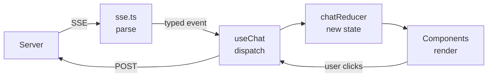
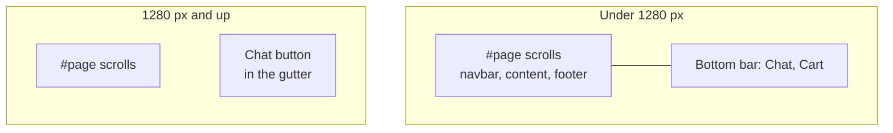

The frontend is a small shop with the agent inside it. Anyone can browse and fill a cart. The chat is a widget on every page, and
**How it works** in the navbar keeps the learning tools. This chapter covers how the chat streams, then what it took to turn a
dashboard into a real shop.

## The stack, and why

| Tool | Job | Why this one |
| --- | --- | --- |
| **React 19** | UI components | The standard, with the largest ecosystem |
| **TypeScript** (strict) | Types | Catches mismatches with the API at build time |
| **Vite** | Dev server and build | Fast hot reload, and a built-in proxy |
| **React Router** | Real URLs | Back, reload and shared links work without hand-written routing |
| **Fontsource** | Self-hosted font | The font ships with the app, so no page calls another site |
| **eventsource-parser** | Reads SSE | Handles the fiddly parts of the format, in a tiny library |
| **TanStack Query** | Ordinary data fetching | Caching and refreshing, without hand-written effects |
| **Tailwind CSS** | Styling | Styles sit next to the markup they affect |
| **react-markdown** | Renders model output | Models write Markdown, and this doesn't inject raw HTML |
| **Vitest** | Tests | Shares Vite's setup |

**Why not the Vercel AI SDK?** It's excellent for standard chat, but it expects its own stream
format and hides the mechanics. Our stream has custom events like `tool_start` and `interrupt`,
and the aim here is learning. Reading 30 lines of your own stream code teaches more. For a product
that only needed a chat box, it would be a sensible choice.

## How the code is arranged

```text
web/src/
  api/
    types.ts            Every API shape, including the stream events
    sse.ts              Reads the stream: bytes in, typed events out
    client.ts           Ordinary requests: orders, RAG search, system info
  auth/
    useAuth.ts          Who is signed in; login, sign-up, logout
    AuthPage.tsx        Sign in and create account
    next.ts             Where to go after signing in, checked for safety
    RequireAuth.tsx     Sends guests to sign in; checks the level
  cart/
    cartLogic.ts        Add, change and total. Pure, no React
    useCart.tsx         One cart for guests and signed-in shoppers
    CartPage.tsx, CheckoutPage.tsx
  chat/
    chatReducer.ts      All the stream logic. Pure, no React
    chatReducer.test.ts Replays event sequences
    useChat.ts          Connects the stream to React
    ChatProvider.tsx    Holds the chat above every page
    ChatLauncher.tsx    The button, in its own space
    ChatPanel.tsx       The chat itself, loaded on first use
    ChatNudge.tsx       One quiet line on a product page
    starters.ts         Questions matched to the page
  components/
    MessageBubble.tsx   One message
    ConversationList.tsx  Your own conversations
    TracePanel.tsx      The "Under the hood" timeline
  layout/               Navbar, menus, page frame, not found
  shop/                 Landing, category and product pages, the grid
  views/                Orders, staff pages, How it works
  App.tsx               Every URL, in one list
```

Data flows one way:



## Step 1: reading the stream

The browser has a built-in `EventSource` for SSE, but it can only make **GET** requests with no
body. Our endpoint is a POST with JSON, so we use `fetch`, which can also read a response as it
arrives. See [sse.ts](../../../web/src/shared/api/sse.ts):

```ts
const reader = response.body.pipeThrough(new TextDecoderStream()).getReader()
for (;;) {
  const { done, value } = await reader.read()
  if (done) return
  parser.feed(value)
}
```

Why a parser, instead of splitting on blank lines? **Network chunks don't line up with events.** One
`read()` might return half an event, or three at once. The parser buffers until a whole event has
arrived. Hand-written versions usually work in testing, then fail on a slow connection.

## Step 2: types for the stream

[types.ts](../../../web/src/shared/api/types.ts) uses a **discriminated union**:

```ts
export type StreamEvent =
  | { event: 'token'; data: string }
  | { event: 'tool_start'; data: ToolStartData }
  | { event: 'final'; data: ChatResponse }
  ...
```

When code checks `event.event === 'token'`, TypeScript knows `data` is a string. Add a new event
without handling it, and the `switch` in the reducer stops compiling. Mistakes show up in your
editor rather than at runtime.

These types are written by hand to match the Python. If the API grows, you could generate them from
FastAPI's OpenAPI schema, although that schema doesn't describe SSE events.

## Step 3: a reducer for all the logic

Streaming UIs get messy when each event updates state in its own place. So every event goes through
one pure function in [chatReducer.ts](../../../web/src/features/chat/chatReducer.ts):

```text
(current state, event) → new state
```

No React, no network, no timers. That gives two advantages:

- **It's easy to test.** [chatReducer.test.ts](../../../web/src/features/chat/chatReducer.test.ts) replays a list
  of events and checks the result, with no server or browser.
- **It's easy to reason about.** To understand any behaviour, there's one place to read.

Some of the real logic it handles:

| Case | Behaviour |
| --- | --- |
| `token` | Appends to the current message |
| `final` | **Replaces** the text, because the output guardrail may have changed it |
| `model_step` with tool calls | Clears the text. Models sometimes write "Let me check" first, and it shouldn't run into the real answer |
| `tool_end` | Finds its `tool_start` by id, so parallel tools stay paired |
| `tool_end` with no start | Happens on a resumed turn: the tool started before the pause |
| `final` with a pending refund | Remembers it, so the chat shows "Waiting for review" |

## Step 4: connecting to React

[useChat.ts](../../../web/src/features/chat/useChat.ts) is the bridge. It starts the stream and dispatches each
event:

```ts
await streamEvents(path, body, (event) =>
  dispatch({ type: 'event', event, at: performance.now() }),
)
```

Note where the hook is called: in `ChatProvider`, above the router, not in a page. State lives as long as the component
holding it. If it lived in a page, moving to another page would throw away a running conversation. You can see that
for yourself: mount the provider inside one page, send a message, move away, and the answer never arrives.

The open conversation's id is kept in `localStorage`, one entry per user, and its messages are reloaded from the
API on start. So you can refresh the page and keep your place. `localStorage` holds only an id, and the server
decides who may open it.

While a refund waits for staff, the hook checks every 4 seconds, so the outcome appears without sending a message.
That's plain polling. It's fine at this scale, and it's what SSE or WebSockets would replace in a busier app.

## Keeping users apart in the browser

The server can't protect you from your own memory. If Asha logs out and Ravi logs in on the same tab, anything still
held in JavaScript would show her data to him. Three things prevent that:

```tsx
<ChatProvider key={user?.id ?? 'guest'} user={user}>
```

1. **The `key`.** When a key changes, React throws the whole component away and builds a new one, so every hook
   inside starts empty. Chat state can't carry over.
2. **Clearing the cache.** `useAuth` calls `queryClient.clear()` on login and logout, so cached orders go too.
3. **Per-user storage.** The stored conversation id is keyed by user.

The cookie itself is `HttpOnly`, so this code never sees it. It only knows whether `/auth/me` succeeds, and any 401
makes the app treat this browser as signed out.

The account menu shows links by level, and `RequireAuth` turns people away from staff pages. That's a convenience, not
security: the server enforces the same rules.

## Two kinds of data

| | Streaming | Everything else |
| --- | --- | --- |
| Examples | Chat turns | Products, cart, orders, chunks, system status |
| Tool | `useChat` + reducer | TanStack Query |

TanStack Query handles caching and refreshing. When a turn ends, it might have refunded an order, so
this one line refreshes the orders page:

```ts
queryClient.invalidateQueries({ queryKey: ['orders'] })
```

## From tabs to pages

The first version of this app kept the current tab in a `useState`. That's fine for a dashboard, but a shop needs **URLs**:
the back button, reload and a shared link all depend on them. [App.tsx](../../../web/src/App.tsx) now lists every page in one place.

Two details are worth knowing:

- **Sign-in sends you back.** The Sign in link carries `?next=/where/you/were`. Anyone can craft that link, so
  [next.ts](../../../web/src/features/auth/next.ts) asks the browser's URL parser where it really points. A plain "starts with `/`" check
  isn't enough: `//evil.example` starts with `/`, and browsers also read `/\evil.example` the same way.
- **Pages load when needed.** How it works and the chat panel use `lazy()`, so a shopper's first page doesn't download the
  Markdown renderer. That keeps the main bundle at about 340 KB, not 470 KB.

## A cart that lives in two places

| | Guest | Signed in |
| --- | --- | --- |
| Stored in | `localStorage`, as ids and quantities | The `cart_items` table |
| Survives | Reload, closing the browser | Any browser |
| After logout | Nothing is left | Nothing is left |

**The browser never holds a price it's trusted with.** A guest's cart page reads names and prices from the catalogue, and
`POST /checkout` takes no body at all. It reads the cart and the prices from the database, so a tampered price has nowhere to go.

**Signing in merges the two.** [useCart.tsx](../../../web/src/features/cart/useCart.tsx) takes the guest's items out of storage *before* calling
`POST /cart/merge`. That order matters: in development React runs every effect twice, and the first version doubled the quantities.
It hid well, too, because quantities stop at 10: only an item well under the limit showed it.

Anything that changed is reported, such as "the limit is 10, so your cart has 10". Nothing is dropped silently.

## Why the page scrolls in its own region

The spec says the chat button must never cover an Add to cart, at any scroll position. The plan was a bar fixed to the bottom of
the screen. It sounds fine, but measuring it told a different story:

| Layout | Overlaps, over about 1,300 scroll positions |
| --- | --- |
| A bar fixed over the page | **105** |
| A bar below the scrolling page | **0** |

Anything fixed over a scrolling page has content sliding under it. So the app is a column, with the page scrolling in its own region
above a normal bar. See [Layout.tsx](../../../web/src/shared/layout/Layout.tsx). From 1280 px wide there's no bar: the button sits in the
gutter beside the page, which is why the page is narrower below 1440 px.



It has a cost. Browsers only restore scroll positions for the window, so `useScrollMemory` in Layout.tsx does it for Back.

## The chat as a widget

The chat's rules come from research into shop chat widgets, kept only where they respect the shopper:

- **Starters match the page**, and each one has been asked to the live agent. See [Evals](../07-evals-and-testing/01-evals.md) for what that found.
- **The nudge is one quiet line**, at most once per session, and it never moves or opens anything by itself.
- **"See how this was answered"** links a reply to its trace, so the shop doesn't hide what this project teaches.

## The proxy: why there's no CORS

The browser talks only to Vite at `:5173`. In [vite.config.ts](../../../web/vite.config.ts), Vite
forwards `/api/*` to FastAPI:

```ts
proxy: {
  '/api': {
    target: process.env.API_PROXY_TARGET ?? 'http://localhost:8000',
    rewrite: (path) => path.replace(/^\/api/, ''),
  },
},
```

Browsers block a page from calling a different origin unless that server opts in, which is CORS. As
far as the browser knows there's just one origin here, so no CORS setup is needed. In production,
a reverse proxy or a CDN path rule does this job.

## Try it

1. Change a colour in [index.css](../../../web/src/index.css) and save. The page updates without losing
   your conversation. That's hot reload.
2. Add a `console.log(event)` inside the callback in useChat.ts. Send a message and read the raw
   events in the browser console. Remove it afterwards.
3. Add a new test to chatReducer.test.ts, for a sequence you think might break. Run `npm test` in
   `web/`.
4. Add a new event from the backend: yield `("note", "hello")` in `stream()` in service.py. It's
   ignored, because nothing handles it. Then add it to `StreamEvent` and let the compiler show you
   each place that needs updating.
5. **Follow a cart.** As a guest, add something, then read `shophelper.guest-cart` in the browser's storage panel. It holds
   ids and quantities only. Sign in, and the key disappears. In pgAdmin, run `SELECT * FROM cart_items;`.
6. **Try to pay less.** Add something to your cart while signed in. In the browser console, run:

   ```js
   await (await fetch('/api/checkout', {
     method: 'POST',
     headers: { 'content-type': 'application/json' },
     body: JSON.stringify({ total: 0.01 }),
   })).json()
   ```

   The `total` in the reply is the real one. Your 0.01 had nowhere to go.
7. **Watch an Add to cart slide under a fixed bar.** Narrow the window to phone width. In
   [ChatLauncher.tsx](../../../web/src/features/chat/ChatLauncher.tsx), add `fixed inset-x-0 bottom-0 z-30` to the first `className`. Scroll
   a product list slowly and watch the buttons pass underneath. Then undo it.

Next: [Guardrails](../08-security/04-guardrails.md)
