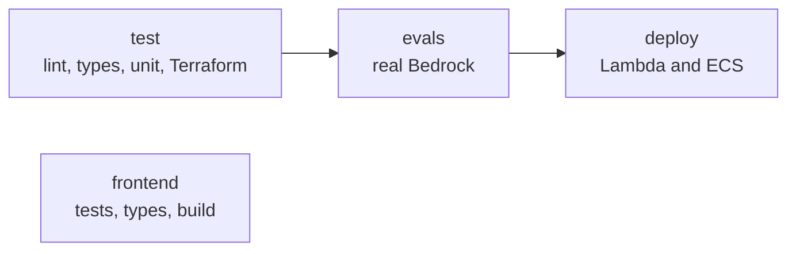

## What you'll learn

- How evals gate a deployment
- What evals cost per run
- How to deal with results that vary
- What's automated in this project, and what isn't

## The simple explanation

**CI, continuous integration**, runs your checks automatically on every change, so a bad one can't slip through because someone forgot.

Think of an aeroplane. Pilots go through a checklist before every flight, however good they are. It's not there because they're careless. It's there because memory fails, and the cost of a miss is high.

Evals are harder to automate than unit tests, for three reasons:

| Problem | Why | Common answer |
| --- | --- | --- |
| **Cost** | Each run calls a real model | Run a small set on pull requests, and everything before release |
| **Time** | Minutes, not seconds | Run it in parallel, or nightly |
| **Variation** | The same code can pass and fail | Use a threshold, or repeat what failed |

And there's a fourth: evals need **secrets**, such as a model key, so you have to be careful about which code can run them.

## An example

What does one full run cost? The last run here used 46,493 input and 2,475 output tokens, across 37 cases.

| Model | Price per million, in / out | One run |
| --- | --- | --- |
| Local Qwen | Free, on your own machine | $0 |
| Claude Haiku 5.5 | $0.10 / $0.50 | Under $0.01 |
| Claude Sonnet 5.5 | $2 / $10 | About $0.12 |

Those are [list prices](https://platform.claude.com/docs/en/about-claude/models/overview), and they leave out the judge's calls. So even at 50 pull requests a day, the Sonnet bill would be about $6.

For a small suite, **the cost is mostly time, not money**. That changes with bigger suites, repeats and slow agents. Running 1,000 cases, three times each, on every pull request, is another matter. So measure before you decide what to cut.

## How ShopHelper does it

Here's the pipeline in [ci.yml](../../../.github/workflows/ci.yml):



The deploy job can't start unless the evals pass:

```yaml file=.github/workflows/ci.yml
needs: evals
```

So a prompt change that breaks refunds never reaches customers. That's what "evals as a gate" means.

The evals only run on `main`, and only when AWS is switched on:

```yaml file=.github/workflows/ci.yml
if: github.ref == 'refs/heads/main' && vars.AWS_DEPLOY_ENABLED == 'true'
```

That's why this project's pull requests show those jobs as skipped. **Be honest about what that means:** AWS is torn down, so the eval and deploy jobs aren't running at all right now. Evals run locally, by hand, with `scripts/evals_local.sh`. GitHub's servers have no LM Studio, and using a paid model on every change was left for later.

The report is saved even if the run fails, because that's when you need it:

```yaml file=.github/workflows/ci.yml
path: evals/report.json
```

**Credentials.** The workflow gets AWS access through a short-lived role, not a stored key:

```yaml file=.github/workflows/ci.yml
role-to-assume: ${{ vars.AWS_ROLE_ARN }}
```

So there's no long-lived secret to leak.

**The gate is strict.** One failed case stops a deployment. With 37 cases, that's fine. With variation and a big suite, it would be a problem, and that leads to the next section.

## In the market

Checked on 2026-11-06.

**Handling variation.** Options, from simple to more careful:

| Approach | Good | Risk |
| --- | --- | --- |
| Every case must pass | Simple and strict | Random failures block work |
| Retry failed cases | Clears random noise | Hides rare real bugs |
| A pass-rate threshold | Allows for variation | A real bug can hide under it |
| Compare with the last run | Catches real drops | Needs history |

A good mix: **attacks and money cases must always pass, and softer quality checks use a threshold.** If you retry, log it, so that a case that keeps needing retries gets looked at. As an [earlier lesson](01-why-testing-ai-differs.md) showed, an intermittent failure can be a real bug.

**Secrets and forks.** Pull requests from strangers shouldn't get your keys, or they could send them anywhere. GitHub [doesn't pass secrets to workflows from forks](https://docs.github.com/en/actions/concepts/security/secrets) by default. Don't work around that.

**What triggers a run.** Some teams run evals only when prompts, tools or knowledge files change, using path filters. This is the same idea as [test levels](02-test-levels.md): docs changes don't need the agent tested.

**Pin what you can.** If your model provider updates a model under the same name, results can change with no change on your side. Use a fixed version where offered, and run evals on a schedule to spot drift.

**After release.** CI checks known cases. Production brings new ones. So evals don't replace monitoring, which stage 10 covers, and each feeds the other.

## Try it

1. Open `.github/workflows/ci.yml`, and follow the `needs:` lines from `test` to `deploy`.
2. Open a recent pull request on GitHub. Find the skipped jobs, and say why they were skipped.
3. Work out the cost of one run with your own numbers: cases, tokens per case, and a model's price.
4. Decide which of the 37 golden cases you'd run on every pull request, if you could only afford 10. Why those?

## Interview questions

### How would you put evals into a CI/CD pipeline?

**Strong answer:** Fast checks on every commit, then a small eval set on pull requests that touch prompts, tools or knowledge, and the full set before deployment, as a gate. In my project the deploy job needs the evals job, and the report is uploaded even on failure. I'd keep attack and money cases as hard failures, and use thresholds for softer quality. I should be clear that my AWS pipeline is switched off now, so evals run locally by hand.

**Follow-up:** Why not run the full set on every pull request?

### How do you stop random failures blocking the team?

**Strong answer:** I separate must-pass cases from quality ones. Attacks and money always have to pass. Quality checks use a threshold, or a comparison with the last run. If I retry, I log it, so a case that keeps retrying gets investigated, because a rare failure can be a real bug. Mine was: a refund case that failed once turned out to fail 20 of 20 times when mixed with other questions.

**Follow-up:** How do you set the threshold?

### What does an eval run cost, and how do you control it?

**Strong answer:** I work it out from tokens. My last run used about 46,000 input and 2,500 output tokens, so on Sonnet at $2 and $10 per million that's about 12 cents, before judge calls. For a small suite, time matters more than money. To control it at scale I'd use a small set on pull requests, path filters, a cheaper judge where it's been calibrated, and prompt caching.

**Follow-up:** What happens to cost with a multi-step agent?

## Check yourself

### What does `needs: evals` do?

- [ ] Runs evals after deployment — it's before.
- [x] Stops the deploy unless evals pass — right: that's the gate.
- [ ] Makes evals faster — it only sets the order.

### Why doesn't this project's CI run evals on pull requests?

- [x] They need a model, and AWS is switched off — right: they run locally, by hand.
- [ ] Evals can't run in CI — the job exists.
- [ ] GitHub bans them — it doesn't.

### A case fails once in 20 runs. What should happen?

- [ ] Retry it silently — that hides it.
- [ ] Delete the case — then you've lost the warning.
- [x] Log it, and find out why — right: it may be a real bug.
