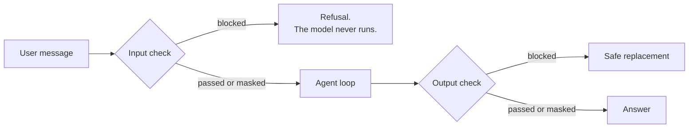

## What you'll learn

- What a guardrail is, and where it runs
- When to block and when to mask
- Why regular expressions aren't real protection
- Where private data ends up in an AI app

## The simple explanation

A **guardrail** is a check that runs outside the model. A system prompt can say "never do X", but it's only a request, and the same model that received it is the thing being attacked. A guardrail is separate code that doesn't depend on the model cooperating.

Think of airport security. It sits at the entrance, and it doesn't ask passengers whether they have anything dangerous. It looks.



Not all private data deserves the same response:

| Data | Action | Reason |
| --- | --- | --- |
| Card numbers, passwords, Aadhaar | **Block** the whole message | Never needed for support |
| Prompt attacks | **Block** | There's nothing legitimate to answer |
| Email, phone | **Mask** as `{EMAIL}`, `{PHONE}` | Harmless to the request, so continue without storing it |

With masking, the model and the stored history only ever see the placeholder.

## An example

Three real things happened with these guardrails.

**Masking confused the model.** Given "My email is {EMAIL}, where is order 1003?", Qwen asked for the order number. One line in the system prompt fixed it:

```python file=src/shophelper/agent/graph.py
- {EMAIL} and {PHONE} mark contact details hidden for privacy. Ignore them and answer the rest \
```

A safety layer changes what the model sees, so test them together.

**Regex missed things.** "my password is X" is blocked, but "please remember X as my password" isn't, and that text then reaches the model, the chat history and the checkpoints. A filter can't tell whether a word in free text is a password.

**Regex blocked things it shouldn't.** The card rule matches any 13 to 19 digits, so a long reference number is refused as a card number. The trace shows why, which is how this was found.

So a filter fails both ways: it lets bad things through, and it stops good things. Every guardrail has that trade-off, and tightening one usually worsens the other.

## How ShopHelper does it

There's a check at each end, and not on every model call. A turn may call the model three times, but only the first input and final output cross the boundary with the user. That costs less, and works with any framework. The catch is that tool results aren't checked, as [prompt injection](02-prompt-injection.md) showed.

| | Local rules | Bedrock Guardrail |
| --- | --- | --- |
| How | Regular expressions | Trained classifiers plus patterns |
| Catches | Exact, obvious patterns | Paraphrases, and harmful content |
| Cost | Free, instant | Per text unit, plus a network call |
| Set up in | `guardrails.py` | [infra/guardrail.tf](../../../infra/guardrail.tf) |

The same `check()` runs either one:

```python file=src/shophelper/agent/guardrails.py
def check(text: str, source: Literal["INPUT", "OUTPUT"], client: Any = None) -> GuardResult:
```

The local rules exist so you can watch the block-and-mask flow. **They aren't real protection.** They stopped 1 of 10 new attacks in our test. We haven't run those attacks against the Bedrock guardrail, so we can't say how it would do.

**Where private data goes.** This is often forgotten. A single message can reach:

| Place | Protected here by |
| --- | --- |
| The model provider | Masking first. Locally, nothing leaves the machine |
| Chat history | Stored after masking |
| Agent checkpoints | Stored after masking |
| Logs | Ids and sizes, not message text |
| Traces | LangSmith is off locally |
| Eval files | Fake demo customers only |

Guardrails only help for what they catch. So the first rule of private data is **don't collect it**: the prompt says never to ask for card numbers, and the checkout never handles real ones.

**Retention** matters too. The privacy policy says chat transcripts are deleted after 30 days. On AWS, DynamoDB's expiry setting does that. The local Postgres history has no such job, so the promise only holds on one of the two. A policy needs code behind it.

## In the market

Checked on 2026-11-06.

| Tool | Kind | Used for |
| --- | --- | --- |
| [Amazon Bedrock Guardrails](https://docs.aws.amazon.com/bedrock/latest/userguide/guardrails.html) | Managed | Content filters including prompt attacks, denied topics, word filters, sensitive data, grounding checks |
| [NeMo Guardrails](https://docs.nvidia.com/nemo/guardrails/latest) | Open source | A framework to combine rails, including Presidio and Llama Guard |
| [Presidio](https://microsoft.github.io/presidio/) | Open source | Finding and masking private data |
| [Llama Guard](https://www.llama.com/docs/model-cards-and-prompt-formats/llama-guard-4/) | Open model | Classifying unsafe input and output |

These fit together more than they compete. Bedrock's docs also offer **contextual grounding checks**, which look for answers not supported by the source, and could help with what the judge does in our evals.

The `ApplyGuardrail` API runs a Bedrock guardrail without calling a model, and that's how this project uses it.

**The cost of guardrails.** Each check adds delay, and false alarms annoy real customers. So measure both: how much bad content is caught, and how many good messages are refused.

**Laws.** India's DPDP Act, Europe's GDPR and card rules like PCI DSS set real duties. A learning project can ignore them, and a product can't. Ask for legal advice early, not at launch.

## Try it

1. Open **How it works**, and click the **Guardrail** example. The trace shows `blocked`, in about 0.01 s and 0 tokens. The model never ran.
2. Send "my password is hunter2". It's blocked before the model.
3. Sign in as Meera, and send "My email is me@example.com, where is order 1003?". The trace shows `masked`. In pgAdmin, `chat_history` holds `{EMAIL}`, not your address.
4. Add a pattern to `_BLOCK_PATTERNS`, such as your own test keyword. Add a case to `tests/core/test_local_stack.py`, and run `uv run pytest`.

## Interview questions

### Where do you put guardrails in an agent?

**Strong answer:** On the boundary with the user: one check on input, and one on the final output. That's cheaper than checking every model call, and works with any framework. The gap is tool results, which aren't checked, and my poisoned-document test went through that gap. For an agent reading untrusted content, I'd check tool results too. And a filter is one layer: what must hold goes in code.

**Follow-up:** What's the latency cost?

### How do you handle private data in an LLM app?

**Strong answer:** First, don't collect it. Then block what's never needed, like card numbers, and mask what isn't needed, like emails, before the model or storage sees it. I map where a message goes: provider, history, checkpoints, logs, traces, evals. Masking can confuse the model, which happened to me, so I test the two together. And retention needs code: my policy says 30 days, which DynamoDB's expiry handles on AWS, but my local Postgres has no deletion job.

**Follow-up:** What about private data in embeddings?

### Why not rely on regular expressions?

**Strong answer:** They match characters, not meaning. Mine blocks "my password is X", and misses "please remember X as my password". It also blocks long reference numbers as card numbers. New attack wordings got past it 9 times out of 10. It's fine for a demo, or for fixed formats. For real use I'd use a trained classifier as one layer, and measure both misses and false alarms.

**Follow-up:** How do you measure false alarms?

## Check yourself

### When is masking better than blocking?

- [ ] For card numbers — those are blocked.
- [x] When the data isn't needed, but the request is still fine — right: continue with a placeholder.
- [ ] Always — some things must stop the message.

### Why is a system prompt not a guardrail?

- [ ] It's too short — length isn't why.
- [ ] Models ignore all prompts — they mostly follow them.
- [x] It's a request to the thing under attack — right: a guardrail runs outside the model.

### What's the first rule of private data?

- [x] Don't collect it — right: what isn't there can't leak.
- [ ] Encrypt it all — useful, but it comes later.
- [ ] Use a bigger model — that's unrelated.
