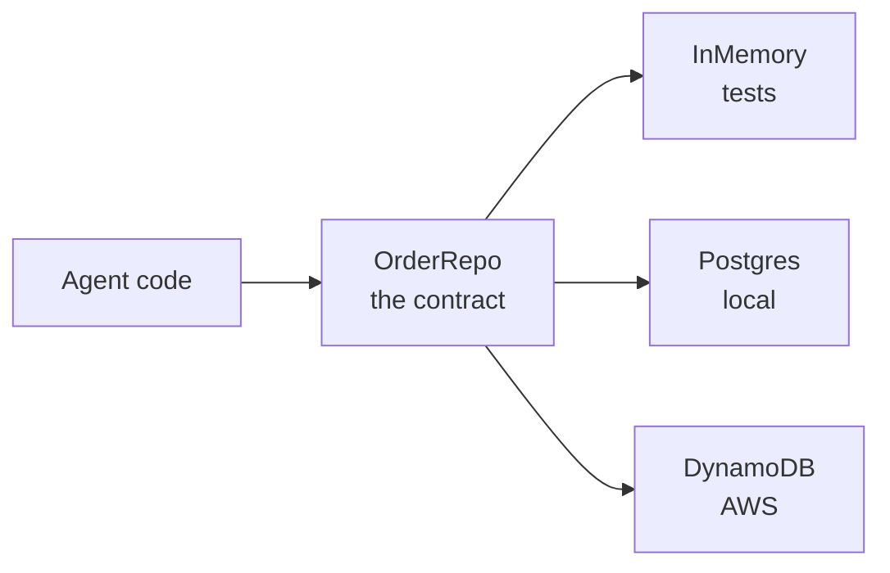

## What you'll learn

- How to start the whole project on your machine
- How one codebase runs both locally and on AWS
- Which settings switch between them
- What a local run can't prove

## The simple explanation

Before anything goes to the cloud, it should run on your own machine, for free, with one command.

Think of a theatre rehearsal. Same script, same actors, cheaper hall. If a scene fails in rehearsal, you've saved the opening night. But a rehearsal doesn't prove the stage lights work.

The rule here is that local development runs **the same code** as production. The code doesn't fill up with `if local:`. Instead, each outside dependency has one contract and several implementations, and a setting picks one.



## An example

Here's the full run guide. **Nothing here touches AWS or costs money.**

You need [Docker Desktop](https://www.docker.com/products/docker-desktop/) and [LM Studio](https://lmstudio.ai/), with two models downloaded: `qwen/qwen3-30b-a3b-2507` for chat, and `text-embedding-nomic-embed-text-v1.5` for embeddings. LM Studio stays outside Docker because it needs direct access to your GPU.

```bash
lms server start          # 1. start the model server
docker compose up --build # 2. start everything else
```

The first run takes a few minutes. Then open http://localhost:5173. Sign in with a demo account, such as `asha@demo.shophelper.test`, with the password `shophelper-demo`. On **How it works**, two green dots mean LM Studio and Postgres are connected.

| Service | Address | Job |
| --- | --- | --- |
| `web` | http://localhost:5173 | The React app |
| `api` | http://localhost:8000/docs | FastAPI and the agent |
| `mcp` | `localhost:8765` | The tool server |
| `postgres` | `localhost:5432` | All data |
| `pgadmin` | http://localhost:5050 | Browse the database |
| `setup` | none | Creates tables, seeds orders, embeds policies, then exits |

Everyday commands:

```bash
docker compose ps           # what's running
docker compose logs -f api  # follow one service's logs
docker compose restart api  # restart one service
docker compose down         # stop everything, keep the data
docker compose up setup     # re-embed the policies after editing them
```

`docker compose down -v` also **deletes the data**, so use it on purpose.

| What you see | Fix |
| --- | --- |
| `setup` says it can't reach LM Studio | `lms server start`, then `docker compose up` |
| "Cross-site request refused" at login | Use `localhost`, not `127.0.0.1` |
| The page fails with `Failed to resolve import` | `docker compose up --build -V web` |
| You changed a policy, but answers didn't change | `docker compose up setup` |

The [full setup guide](../../reference/local-setup.md) has the rest.

## How ShopHelper does it

The contract is a Python `Protocol`:

```python file=src/shophelper/shop/orders.py
class OrderRepo(Protocol):
def get(self, order_id: str) -> dict[str, Any] | None: ...
```

One function chooses, based on settings:

```python file=src/shophelper/shop/orders.py
def get_order_repo() -> OrderRepo:
if settings.database_url:
return PostgresOrderRepo()
if settings.orders_table:
return DynamoOrderRepo(settings.orders_table, settings.aws_region)
return InMemoryOrderRepo()
```

The rest of the code only knows `OrderRepo`, so `graph.py` works unchanged everywhere. This is **dependency inversion**, and it's also what makes offline tests possible.

| Setting | Default (AWS) | In Docker | Switches |
| --- | --- | --- | --- |
| `LLM_PROVIDER` | `bedrock` | `openai_compatible` | Claude to LM Studio |
| `DATABASE_URL` | unset | Postgres URL | DynamoDB and Knowledge Base to Postgres, and turns accounts on |
| `TOOLS_TRANSPORT` | `local` | `mcp` | In-process tools to MCP |
| `LOCAL_GUARDRAILS` | `false` | `true` | No rules to regex rules |
| `SEED_DEMO_USERS` | `false` | `true` | Creates the demo accounts |

The defaults are the AWS path, and a test pins that. So a new local feature can't quietly change what's deployed.

LM Studio works so easily because it speaks the OpenAI API, which has become a common standard. Any compatible server works by changing the base URL.

**Keeping AWS safe:**

| Protection | How |
| --- | --- |
| Same image | Compose builds the Dockerfile that ships to AWS |
| Local packages stay unloaded | `psycopg` is imported inside functions |
| Local routes are hidden | `/orders` and `/auth/*` return 404 unless accounts are on |
| Demo accounts stay local | Their password is public, so seeding needs a setting |

**What local can't show you:**

| Only on AWS | Why it matters |
| --- | --- |
| IAM permissions | The most common "works locally, fails deployed" |
| Lambda cold starts, and the 30 s limit | Local has neither |
| API Gateway buffering streams | Streaming behaves differently |
| DynamoDB's 400 KB item limit | Large checkpoints could fail |
| Real Bedrock Guardrails | Very different from regex |
| Claude's behaviour | A different model fails differently |

And **the shop itself is local only.** Accounts exist only on the local stack, and the shop depends on them. On AWS, those routes return 404. The system prompt and policies *are* shared, though, so they reach AWS on the next deploy, and they've only been tested on Qwen so far.

## In the market

Checked on 2026-11-06.

Other ways to run models locally include [Ollama](https://ollama.com/) and [vLLM](https://docs.vllm.ai/en/latest/). This setup is close to the idea of **dev/prod parity**, from the [Twelve-Factor App](https://12factor.net/dev-prod-parity): keep the gap between development and production small. It's also why config lives in the environment.

## Try it

1. Read `docker-compose.yml`, and find each setting from the table.
2. Read `test_defaults_are_the_aws_path` in `tests/core/test_local_stack.py`. What would it catch?
3. Run `uv run pytest tests/shop -k accounts_off`. Each test turns accounts off, and checks that a shop route returns 404. That's the AWS behaviour, proved without AWS.
4. Pick chat history in `src/shophelper/agent/memory.py`, and find its implementations.

## Interview questions

### How do you run the same code locally and in the cloud?

**Strong answer:** Each outside dependency has one interface and several implementations, and a setting chooses. In my project orders have in-memory, Postgres and DynamoDB versions, and the agent only knows the interface. The defaults are the cloud path, and a test pins them, so local features can't change production. Compose builds the same Dockerfile that ships.

**Follow-up:** Where does this pattern cost you something?

### What can't a local environment tell you?

**Strong answer:** Permissions, cold starts, timeouts, and anything the managed services do differently. In my project API Gateway buffers streams, Lambda has a 30-second limit, and the model is different: Qwen locally, Claude on AWS. So a local pass says the logic works. It doesn't say the deployment does, and evals have to be run again there.

**Follow-up:** How would you catch IAM problems earlier?

## Check yourself

### What decides which `OrderRepo` is used?

- [ ] An `if local:` in the agent — the agent doesn't know.
- [x] Settings, in one function — right: the rest of the code only sees the contract.
- [ ] The Docker image — it's the same image.

### What does `docker compose down -v` do?

- [ ] Restarts the API — that's `restart`.
- [x] Stops everything, and deletes the data — right: use it on purpose.
- [ ] Shows the logs — that's `logs`.

### Your agent passes all evals locally. What's proved about AWS?

- [x] Not much: the model, limits and permissions differ — right: run them there too.
- [ ] Everything: it's the same code — the environment differs.
- [ ] That guardrails work — Bedrock's are different from regex.
