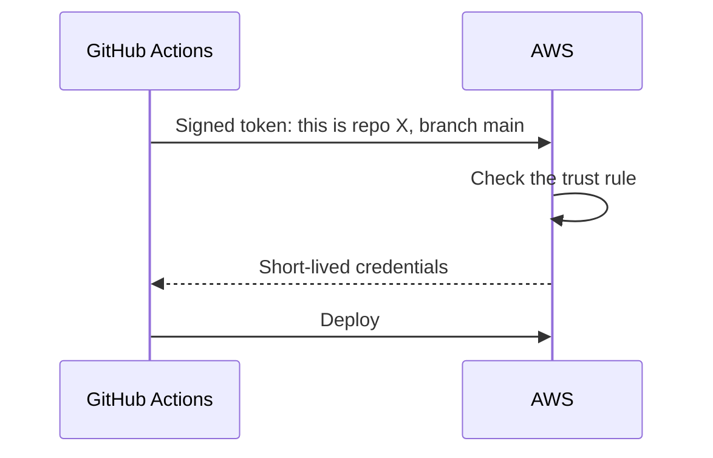

## What you'll learn

- What CI and CD each mean
- How this project's pipeline works, step by step
- How GitHub gets AWS access with no stored keys
- What makes a deployment safe to repeat

## The simple explanation

**CI, continuous integration:** every change is checked automatically.
**CD, continuous delivery or deployment:** a change that passes can reach users with little or no manual work.

Think of a factory line. Every item passes the same inspections, in the same order, and it doesn't matter who's working that day. A person at the end doesn't "just quickly" skip a station.

A pipeline replaces memory with a process. Nobody has to remember to run the tests, and nobody deploys from their laptop with something uncommitted.

The usual stages:

| Stage | Does | Stops on |
| --- | --- | --- |
| **Check** | Lint, types, tests | Any failure |
| **Build** | Makes one image | A build error |
| **Evaluate** | Real behaviour | A failed eval |
| **Deploy** | Rolls out that image | A failed health check |
| **Verify** | Smoke test | The service isn't healthy |

Build once, and deploy that same thing everywhere. If each environment builds its own, you haven't tested what you're shipping.

## An example

Follow one change, as this project's pipeline was designed:

1. You open a pull request. Tests and frontend checks run.
2. You merge to `main`.
3. Evals run against real Bedrock.
4. If they pass, the deploy job builds an image, tagged with the commit.
5. That image goes to Lambda and ECS.
6. A smoke test calls `/health` on both.

Here's the smoke test, the last check:

```yaml file=.github/workflows/ci.yml
curl -fsS "${{ vars.API_GATEWAY_URL }}/health"
```

**Right now, only step 1 runs.** AWS is torn down, so `AWS_DEPLOY_ENABLED` is off, and the eval and deploy jobs show as skipped. The design was tested on 2026-11-01, without any real Claude call.

## How ShopHelper does it

**No stored AWS keys.** The old way is to paste a long-lived key into GitHub, where it can leak and never expires. [OpenID Connect](https://docs.github.com/en/actions/concepts/security/openid-connect) replaces that. GitHub proves who it is, and AWS hands out credentials that last a short time.



The trust rule names one repository and one branch. A workflow on another branch can't get the role:

```hcl file=infra/github_oidc.tf
# Only workflows on the main branch of var.github_repo can assume the role.
```

**Least permissions.** The workflow starts with read-only access, and only the jobs that need it ask for more:

```yaml file=.github/workflows/ci.yml
id-token: write
```

**Immutable images.** Each image is tagged with its commit, and tags can't be overwritten:

```hcl file=infra/ecr.tf
image_tag_mutability = "IMMUTABLE" # every deploy is a new tag (git SHA)
```

So "what's running?" always has an exact answer, and going back means pointing at an older tag. Images are scanned on push, too.

**Safe to re-run.** If the image already exists, `release.sh` reuses it. A script you can run twice without harm is called **idempotent**, and it's what you want when a job fails halfway.

**Never cancel halfway.** Two pushes shouldn't deploy at once, and a running deploy shouldn't be killed:

```yaml file=.github/workflows/ci.yml
cancel-in-progress: false # never cancel a deploy half-way
```

**Locked inputs.** CI installs with `uv sync --frozen`, so it fails if the lock file is out of step, and the image uses hashes. So you get what you tested.

**The local gate matches.** `scripts/check.sh` runs the same checks as CI, and pre-commit catches lint before a commit.

**Turning deploys on.** These steps change a live pipeline, so they're for after a deployment, and only when you mean it:

| Step | Command | Effect |
| --- | --- | --- |
| After `scripts/deploy.sh` | `scripts/set_github_vars.sh` | Sets the variables, and turns on deploys. **Every push to `main` then deploys** |
| When finished | `scripts/teardown.sh` | Removes it all, and turns deploys off |

## In the market

Checked on 2026-11-06.

| Tool | Notes |
| --- | --- |
| [GitHub Actions](https://docs.github.com/en/actions) | Used here. Close to your code |
| GitLab CI | The same idea, for GitLab |
| AWS CodePipeline | Inside AWS |
| Argo CD | Pulls changes into Kubernetes, known as GitOps |

**Environments.** This project goes straight to one. Real teams add staging, a copy of production for final checks, and often a manual approval before production.

**What's different for AI?** Three things can change behaviour besides your code: prompts, models and documents. A policy edit changes answers with no code change. So those need the same care. Here, prompts live in code and go through this pipeline. Policies do too, though the Knowledge Base needs its own ingestion step.

**Supply chain.** Pin actions and dependencies. A common hardening step is pinning third-party GitHub Actions to a commit, not a tag. This project uses version tags, so that's a possible improvement.

## Try it

1. Open `.github/workflows/ci.yml`. Draw the jobs and their `needs:` lines.
2. Open `infra/github_oidc.tf`, and find the condition that limits the branch.
3. Read `scripts/release.sh`. Which step makes it safe to run twice?
4. Find a pull request on GitHub, and open the logs of `Lint, unit tests, Terraform checks`.

## Interview questions

### Walk me through your CI/CD pipeline.

**Strong answer:** Every pull request runs lint, types, unit tests, Terraform checks and a frontend build. On `main`, evals run against the real model, and deploy needs them to pass. It builds one image tagged by commit, rolls it out to Lambda and ECS, then runs a smoke test. It authenticates with OIDC, so there are no stored AWS keys. To be honest, AWS is torn down at the moment, so only the checks run, and evals run locally.

**Follow-up:** How would you add staging?

### How does GitHub deploy to AWS without storing keys?

**Strong answer:** OIDC. GitHub signs a token saying which repo and branch is running. AWS has a trust rule for that exact repo and branch, and returns short-lived credentials for a role. There's nothing long-lived to leak. The role can only do what deployment needs. In my project, it can roll out an image, and it can't change networks.

**Follow-up:** What would you check if the role can't be assumed?

### What's different about CI/CD for AI systems?

**Strong answer:** Behaviour can change without a code change: prompts, models, documents and the provider's own updates. So evals become a deploy gate, and those inputs should be versioned and go through review. Costs and variation matter too, so I'd run a small set on pull requests and the full set before release. And I'd keep watching after release, since CI only knows known cases.

**Follow-up:** How do you roll back a prompt?

## Check yourself

### Why build the image once?

- [x] So what you tested is what you ship — right: rebuilding could differ.
- [ ] To save disk space — that's minor.
- [ ] Docker only allows one — it doesn't.

### What does OIDC replace?

- [ ] Docker — that's unrelated.
- [ ] The test stage — it doesn't test.
- [x] Long-lived AWS keys in GitHub — right: credentials are short-lived.

### What does idempotent mean?

- [ ] It runs very fast — that's not it.
- [x] Running it twice does no harm — right: useful when a job fails halfway.
- [ ] It runs only once — it can run many times.
