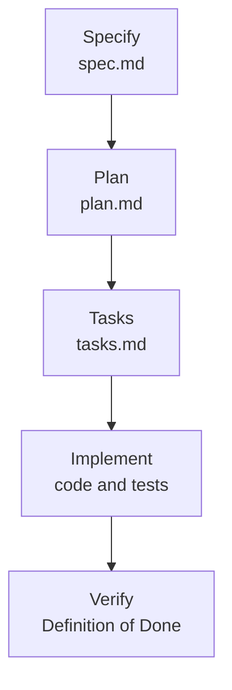

## What you'll learn

- What spec-driven development is, and the problem it solves
- The five stages this project uses
- How a requirement stays connected to its proof
- When it's worth the effort, and when it isn't

## The simple explanation

Spec-driven development means agreeing what to build, in writing, before any code exists. The written spec then guides the agent, and proves the work is finished.

Think of building a house. You could tell a fast builder "make me a nice house", and come back to find four bedrooms when you wanted two. Or you could agree the drawings first, then check the house against them. The faster the builder, the more the drawings matter, because a wrong turn gets a long way before you notice.

It solves three problems that AI coding makes worse:

| Problem | How a spec helps |
| --- | --- |
| The agent builds something reasonable, but not what you meant | You review a page of text, before the code exists |
| Each session starts with no memory | The files hold what was decided and why |
| "Done" is whatever the agent says | Each requirement names the test that proves it |

The main idea is that **your review moves earlier**. Reading a short spec is much cheaper than reading a large diff and finding it solves the wrong problem.

## An example

Here's a real requirement from this course, followed through the stages.

**Spec: what and why.** It needs a number you can check, and it names the type of proof:

> **AC-9:** A code example taken from this project names its file, and a test fails if that code no longer exists there. _(unit)_

**Plan: how.** Each acceptance criterion maps to a test:

```markdown file=specs/features/022-learning-website/plan.md
| AC-9 | `tests/test_course.py`: each `file=` snippet's lines exist in that file | unit |
```

**Tasks: small steps.** Test tasks come first, and each must fail before its code exists.

**Implement: the code.** This test now runs on every check:

```python file=tests/test_course.py
def test_code_examples_still_match_the_project():
```

**Verify: the proof.** It paid off. While stage 1 was being written, this test caught a misquoted schema comment. A wrong line in a lesson failed the check instead of reaching a reader.

So one sentence became a test that keeps working long after the session that wrote it. That chain is the point of the method.

## How ShopHelper does it

Every feature moves through five stages, and each produces a file in `specs/features/NNN-name/`:



| Stage | Says | Gate |
| --- | --- | --- |
| Specify | What and why, never how | A person approves it, with no open questions left |
| Plan | How: files, risks, a test for every criterion | Passes the constitution check, and a person approves it |
| Tasks | Small ordered steps, each with its proof | Every criterion is covered |
| Implement | One task at a time, test first | `scripts/check.sh` passes before a task is ticked |
| Verify | Every gate, run for real | Each criterion is ticked only with proof |

Around these sit three more things:

- **A constitution:** `specs/constitution.md` holds the principles that outrank everything else, and the Definition of Done.
- **Commands:** `/spec-new`, `/spec-plan` and the rest are prompts that run each stage the same way, and stop where a person must decide.
- **Memory:** `memory/` is committed, and holds the current state, the decisions and the gotchas. A new session reads it first. This is what lets work carry on across sessions with no shared memory.

The first rule is short:

```markdown file=specs/constitution.md
No feature code is written without an approved spec in `specs/features/NNN-name/`.
```

**Plans change, and that's allowed.** The rule is that the spec changes first, so it never quietly goes out of date. Every feature here has a Changelog, and real ones include:

- This course's order file became `course.json`, not `course.yaml`, to avoid a package (D-021).
- The owner moved the stepper to the right after seeing it.
- Feature 020's status was reverted from Implemented when an eval failed, and set again after the fix.

**What it costs.** Specs and memory are part of every change, so a feature takes more text and more stops for review. This project skips the process where it adds nothing: a bug fix or a refactor that doesn't change behaviour needs no spec, only a line in the progress log.

**Where it falls short.** A spec only covers what you thought of. Feature 030 passed its criteria and still closed with a known warranty refund bug, because the agent's wording failed in a way nobody specified. The owner chose to record it and ship (D-023). A spec makes that a visible decision, but it can't prevent the surprise.

## In the market

Checked on 2026-11-07. These are young tools that change quickly, and we've only used the last one.

| Option | What you get | Stages |
| --- | --- | --- |
| [GitHub Spec Kit](https://github.com/github/spec-kit) | Open source commands and templates, for use with coding agents | `/speckit-constitution`, `/speckit-specify`, `/speckit-plan`, `/speckit-tasks`, `/speckit-implement`, `/speckit-converge` |
| [Kiro](https://kiro.dev/docs/specs/) | An editor built around specs | `requirements.md` (or `bugfix.md`), `design.md`, `tasks.md` |
| [A single `SPEC.md`](https://code.claude.com/docs/en/best-practices) | Claude Code's docs show the light version: Claude interviews you, writes the file, and a fresh session builds from it | One file |
| A custom workflow | What this project has: plain files and 5 commands | Five stages, as above |

**How to choose:**

| Your situation | Good fit |
| --- | --- |
| One small feature, working alone | A single `SPEC.md` |
| You want a ready-made process | Spec Kit |
| You want it built into the editor | Kiro |
| You have your own rules and want to shape every step | A custom workflow, which you then maintain |

The trade-off is depth against portability. Plain Markdown works with any tool, and a built-in product gives you more with less setup, but ties you to it. All of them share the same core: requirements, then design, then tasks.

**Is this just waterfall?** It's a fair question. The difference is size: a spec here covers one feature, not a whole product. Each feature ships and then shapes the next, and this course landed in slices so each part was usable early.

## Try it

Run these from the project root.

1. Follow a requirement through the files: `grep -n 'AC-9' specs/features/022-learning-website/*.md`. You should see the same criterion in the spec, the plan and the tasks.
2. Check no spec has an unanswered question: `grep -rn 'NEEDS CLARIFICATION' specs/features --include=spec.md`. It should print nothing, because a plan can't start while one remains.
3. Find the next piece of work, as a new session would: `grep -n -m1 '^- \[ \]' specs/features/022-learning-website/tasks.md`.
4. Open `.claude/commands/spec-new.md`, and find the step that stops it. Why does a command that drafts a spec forbid writing a plan?
5. Write a three-line spec for "customers can cancel an order": one user story, and two acceptance criteria with a number or a test type. Which question would you need answered first?

## Interview questions

### What is spec-driven development, and why use it with AI?

**Strong answer:** You agree what to build in writing, then plan, split it into tasks, implement and verify against that spec. It suits agents because they're fast and start each session with no memory. A wrong assumption gets a long way before you notice, so I review a page of text instead of a huge diff. In my project every acceptance criterion names the test that proves it, so "done" isn't just the agent's word.

**Follow-up:** How do you stop the spec going out of date?

### Isn't this just waterfall?

**Strong answer:** The order looks similar, but the size is very different. A spec covers one feature, not a whole product, and it can change. My rule is to update the spec first and log why. My course landed in four slices, and the owner's review after the first changed the design for the rest. Waterfall's problem was late feedback, and this gets feedback earlier.

**Follow-up:** When would you skip the spec?

### What are the downsides?

**Strong answer:** It's more text and more stops, so it's wasted on a small fix, and my project lets those skip it. It can also give false confidence, because a spec only covers what you thought of. One of my features passed every criterion and still shipped with a known refund bug, in wording nobody specified. The spec made that a recorded decision, but evals and real use found it.

**Follow-up:** How would you introduce this to a team that resists process?

## Check yourself

### When does spec-driven development move your review?

- [ ] To after the release — that's later, not earlier.
- [x] To before the code exists — right: reading a page is cheaper than reading a wrong diff.
- [ ] It removes review — a person still approves each stage.

### The code has to differ from the approved spec. What do you do?

- [ ] Change the code and move on — then the spec quietly stops being true.
- [x] Update the spec and its Changelog first — right: the record stays honest.
- [ ] Start the feature again — the plan can change without that.

### What makes an acceptance criterion useful?

- [ ] It's long and detailed — length doesn't prove anything.
- [ ] It names the files to change — that's the plan's job.
- [x] It can be proved by a named test or measurement — right: then "done" isn't an opinion.
