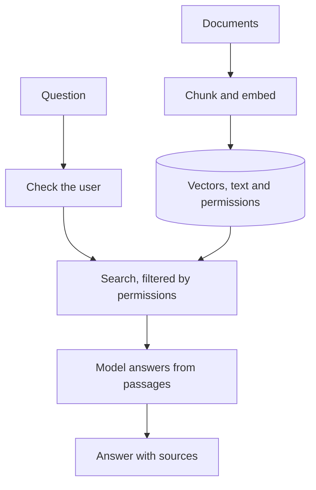
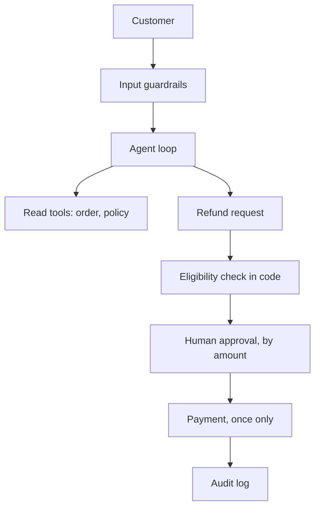
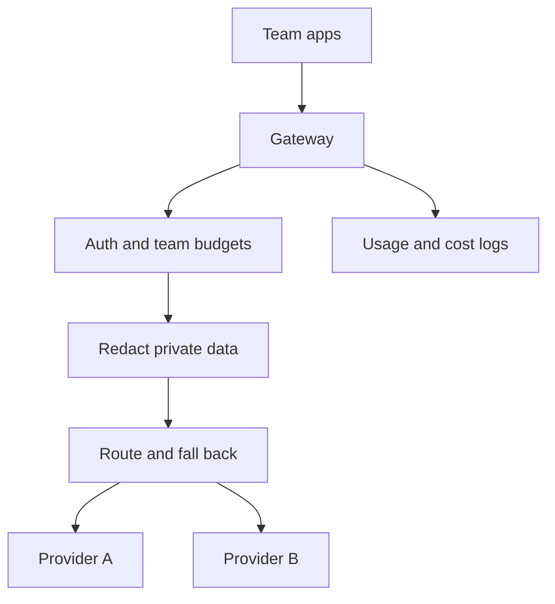

## What you'll learn

- A seven-step method for any AI system design question
- How to estimate size, speed and cost in your head
- Three full walkthroughs: a RAG system, an agent that acts, and a shared platform
- What separates a strong design from a list of parts

## The simple explanation

A system design interview gives you a vague goal and limited time. There's no single right answer. The interviewer wants to watch you think: what you ask, what you choose, and what you do about failure.

Think of planning a wedding. Nobody starts by booking a band. You ask how many guests, what the budget is, and what happens if it rains. Then you make choices that fit. Candidates who jump to "I'd use Pinecone" have booked the band first.

For AI systems, three things matter more than in normal system design. The core component is sometimes wrong, each call costs money, and a model can be attacked through its input. So quality, cost and safety belong in the design from the start. One prep guide calls the strong move treating ["cost and guardrails as first-class design constraints"](https://careerservices.upenn.edu/blog/2026/06/25/45-ai-engineer-interview-questions-answers-2026-guide/).

## An example

Use these seven steps every time. The minutes are our suggestion for practice, in a 45-minute round. Ask how long yours is.

| Step | Ask yourself | Minutes |
| --- | --- | --- |
| **Clarify** | Who's it for, what does success mean, and what's out of scope? | 5 |
| **Estimate** | How much data and traffic? What will it cost? | 5 |
| **Design** | What's the simplest thing that works? Draw it | 10 |
| **Go deep** | What's the hardest part of this one? | 10 |
| **Failures** | What breaks, and what does the user see? | 5 |
| **Measure** | How would I know it's good, before and after launch? | 5 |
| **Trade-off** | What did I give up, and what would change my mind? | 5 |

**Estimating is simpler than it looks.** You need rough numbers, and three facts cover most of it:

- An English word is roughly 1.3 tokens.
- A turn in this project used 1,469 input and 79 output tokens on average, measured over 66 real turns. Input far outweighs output.
- Prices below are [Anthropic's list prices](https://platform.claude.com/docs/en/about-claude/pricing), checked on 2026-11-07, per million tokens: Sonnet 5.5 at $2 in and $10 out, and Haiku 5.5 at $0.10 in and $0.50 out.

All traffic figures in the walkthroughs are **assumptions for practice**. In a real interview, state yours aloud and ask if they're reasonable.

## Walkthrough 1: A policy assistant for staff

*"Design an assistant that answers staff questions from our 5,000 internal documents."* Reported prompts like "design a production RAG system" have this shape.

**Clarify:** Who asks, and may everyone see everything? This is the key question. If HR files are restricted, permissions shape the whole design. Assume 20,000 staff, answers must cite a source, and it doesn't take actions. A wrong answer about pay is costly, so "I don't know" must be allowed.

**Estimate:** 5,000 documents of 10 pages and 500 words is about 33 million tokens. In 500-token chunks that's about 67,000 chunks. At 1,024 numbers per vector, that's under 300 MB. **It fits in Postgres with pgvector, so no special database is needed.** Assume 5,000 questions a day, or 110,000 a month, at 4,000 tokens in and 300 out. Sonnet costs about $1,210 a month, and Haiku about $61. Peak is near 31 questions a minute: easy.

**Design:** Two paths, one for loading and one for answering.



**Go deep:** Permissions. Filter inside the search query, using the user's groups. Never retrieve first and filter afterwards, and never ask the model to hide things: anything in the prompt can leak. Store the permissions with each chunk, and sync them when they change. ShopHelper applies the same idea to [orders](../06-building-the-app/07-authorization-and-isolation.md).

**Failures:** No good passage: say so, and point to a person. A stale document: show its date, and re-embed on change using a hash. Poisoned content: treat passages as data, as in [prompt injection](../08-security/02-prompt-injection.md). Model down: show search results alone.

**Measure:** Separate retrieval from generation, as in [RAG evals](../07-evals-and-testing/04-rag-evals.md). Build a golden set from real questions, and track hit rate and faithfulness. After launch, watch thumbs-down, "no answer" rate, and cost per question.

**Trade-off:** Start with Haiku if evals allow, since it's 20 times cheaper. Add hybrid search or a reranker only if measured retrieval misses. I gave up some answer quality for simplicity, and I'd change that if evals showed real misses.

## Walkthrough 2: A support agent that gives refunds

*"Design a customer service agent that can issue refunds."* This is ShopHelper's problem at larger scale.

**Clarify:** Which actions can it take, and up to what amount? Who's liable if it's wrong? Assume 10,000 conversations a day, refunds up to $500, and a human team available. The agent must never promise something that didn't happen.

**Estimate:** Assume 4 turns a conversation and 2 model calls a turn, at 3,000 tokens in and 150 out per call. That's 24,000 in and 1,200 out per conversation. On Sonnet that's about $0.06, or $18,000 a month. On Haiku it's about $0.003, or $900 a month. Agents multiply cost, because each call re-sends the conversation. Prompt caching would cut this further, since the system prompt repeats.

**Design:** The model proposes, and code decides.



**Go deep:** Making the action safe. Three layers, none relying on the prompt. First, the user's identity comes from the session, never from the model, so it can't be talked into another customer's order. Second, the rules run in code:

```python file=src/shophelper/shop/orders.py
def refund_eligibility(order: dict[str, Any], amount: float) -> tuple[bool, str]:
```

Third, the graph stops and waits for a person, surviving restarts:

```python file=src/shophelper/agent/graph.py
decision = interrupt({
```

At this scale you'd add an **idempotency key** to the payment call, so a retry can't pay twice. ShopHelper doesn't have one, because it has no real payment provider. It checks the order's status, and allows one open refund request per conversation.

**Failures:** Payment times out: retry with the same key, then check the result. The approval queue backs up: set a time limit, and tell the customer honestly. The model promises a refund it didn't request: check that in code, as [ShopHelper does](../11-building-with-ai/04-how-this-project-was-built.md). An attack on another customer's data: the [cross-user evals](../07-evals-and-testing/03-golden-sets.md) test this. Stuck loop: cap the steps, then hand to a human.

**Measure:** Attack cases and refund cases in the evals, at zero tolerance. After launch: resolution rate, escalation rate, wrong refunds per thousand, and time waiting for approval.

**Trade-off:** Human approval is slow and costs staff time. I'd keep it for every refund at first, then auto-approve small, clear cases once the numbers justify it. Speed is the price of safety here.

## Walkthrough 3: A shared AI platform

*"30 teams want to use LLMs. Design what they should share."* ShopHelper has nothing like this, so this one is concept only.

**Clarify:** What's the pain: cost, security or duplicated work? Are there rules about where data may go? Assume cost and data control matter most, and each team keeps its own prompts and evals.

**Estimate:** Assume a peak of 200 requests a minute per team. That's 6,000 a minute, or 100 a second, which is modest for a web service. At 2,000 tokens each it's 12 million tokens a minute, which is the real limit. **Provider quota is the bottleneck, not your servers**, as in [scaling and rate limits](../09-cloud-deployment/07-scaling-and-rate-limits.md).

**Design:** One gateway, so every call passes through a single place.



**Go deep:** Fair sharing. One team's batch job mustn't starve another's live chat. Give each team a quota in tokens, not requests, because requests vary hugely in size. Put interactive traffic ahead of batch, and send work that can wait to a [batch API](https://platform.claude.com/docs/en/about-claude/pricing), which Anthropic lists at half price. Streaming must pass straight through, or you'd ruin time to first token.

**Failures:** The gateway is now a single point of failure, so run several copies, and keep the code path thin. Provider outage: fall back, but only to a model that passed that team's evals, because a model swap changes behaviour. Retry storms: back off with jitter, and respect `retry-after`. Logs holding private data: redact first, and limit retention.

**Measure:** Added latency at p95, cost per team, rate of limit errors, and fallback count. Quality stays with each team, so the platform should make it easy to run their evals on a model change.

**Trade-off:** Build or buy. Buying is faster, but you depend on a vendor for every call. A gateway also slows teams that want a new feature first. I'd buy or adopt one to start, and offer a paved road, not a wall: easiest to use, with the rules built in.

## How ShopHelper does it

The second walkthrough is this project, so you can defend it from real experience. The first is close: ShopHelper has RAG, but its 24 chunks are public, so there's no permission filtering. The third isn't built at all.

Parts you can point to:

| Idea | Lesson with the real code |
| --- | --- |
| Identity from the session | [Authorization and isolation](../06-building-the-app/07-authorization-and-isolation.md) |
| Rules in code | [Human approval](../03-agents/05-human-approval.md) |
| Testing retrieval separately | [RAG evals](../07-evals-and-testing/04-rag-evals.md) |
| Tokens logged on every turn | [Cost](../09-cloud-deployment/08-cost.md) |

Be careful about scale. ShopHelper's local throughput stopped at about 44 turns a minute, on one machine with a local model. It proves the design works, not that it handles 10,000 conversations a day.

## In the market

Checked on 2026-11-07. For the third walkthrough, you don't have to build a gateway:

| Option | What it is | Fits when |
| --- | --- | --- |
| [LiteLLM proxy](https://docs.litellm.ai/docs/simple_proxy) | Self-hosted gateway to many providers, with per-key budgets, rate limits, fallbacks and logging | You want control, and can run it |
| [Cloudflare AI Gateway](https://developers.cloudflare.com/ai-gateway/) | Hosted, with caching, rate limits, retries, fallback and logging | You'd rather not run it |
| Your own | Full control | You have rules nothing else meets |

For the first walkthrough, see [vector databases](../05-rag/05-vector-databases.md). A prep site's sample design questions, such as [PracHub's](https://prachub.com/resources/ai-engineer-interview-questions-2026-rag-agents-evals-and-production-systems), make good practice, and it aims for "the smallest system that meets quality, safety, latency, and cost constraints". That's the right target.

## Try it

1. Check the estimate against reality. Run this, and compare with the 1,469 and 79 above:

   ```bash
   docker compose logs api --no-log-prefix | grep chat_completed | grep -o '"input_tokens": [0-9]*' | awk '{s+=$2; n++} END {print n, "turns, average", s/n}'
   ```

2. Redo walkthrough 1's cost at 10 times the traffic, on both models. Then say what you'd change, if anything.
3. Find the real refund path: `grep -n 'refund_eligibility\|interrupt(' src/shophelper/agent/graph.py`. Follow it, then draw walkthrough 2 from memory.
4. Set a 45-minute timer, and do this prompt out loud with all seven steps: *"Design an assistant that reads insurance claims and suggests a decision."* What did you run out of time for?

## Interview questions

### Design a production RAG system.

**Strong answer:** First I'd ask who uses it, how sensitive the data is, and what a wrong answer costs. Then I'd size it: a few thousand documents often fit in Postgres with pgvector, so I wouldn't start with a special database. There are two paths: loading, which chunks and embeds, and answering, which filters by permissions, retrieves, and generates with sources. I'd spend most time on permissions and on saying "I don't know". I'd measure retrieval and generation separately with a golden set, and add reranking only if the numbers justify it.

**Follow-up:** How would you handle documents that change every hour?

### How do you let an agent take real actions safely?

**Strong answer:** The model proposes, and code decides. Identity comes from the session, never from the model. Eligibility rules run in code before anyone's asked. Risky actions pause for a person, and the pause survives a restart. Payments need an idempotency key, so a retry can't pay twice. Everything is logged. My project does most of this for refunds, although it has no real payment provider, so that key is something I'd add.

**Follow-up:** When would you remove human approval?

### Why put a gateway in front of LLM providers?

**Strong answer:** One place for keys, budgets, logging, redaction and fallback, so 30 teams don't each rebuild them. The cost is a new single point of failure and some added latency, so I'd keep it thin and run several copies. I'd set quotas in tokens, not requests, and put live traffic ahead of batch. I'd try an existing gateway before building one.

**Follow-up:** A provider fails. Why not just fall back to any other model?

## Check yourself

### What should you do before drawing anything?

- [ ] Pick a vector database — that's booking the band first.
- [x] Clarify the users, success and limits, then estimate — right: the answers shape the design.
- [ ] List every tool you know — a list isn't a design.

### 5,000 documents come to about 300 MB of vectors. What does that suggest?

- [ ] You need a distributed vector database — that's far more than this needs.
- [x] Postgres with pgvector is probably enough — right: the estimate saved you a system.
- [ ] RAG won't work at this size — it works well.

### Where should permissions be applied in RAG?

- [ ] In the system prompt — anything in the prompt can leak.
- [ ] After the model answers — it's already seen the data.
- [x] Inside the search query — right: the model never sees what the user can't.
