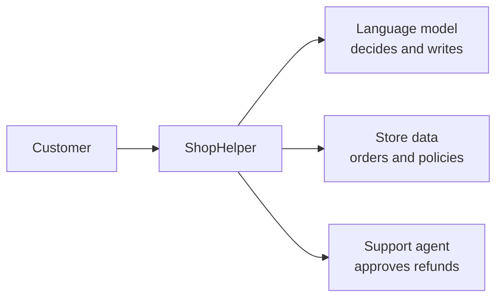
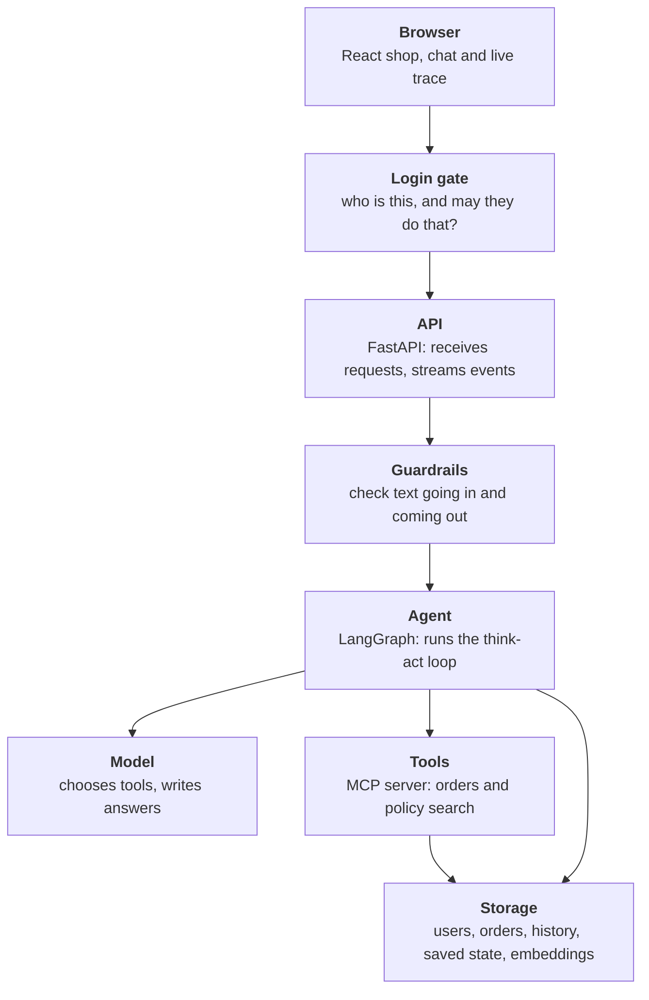
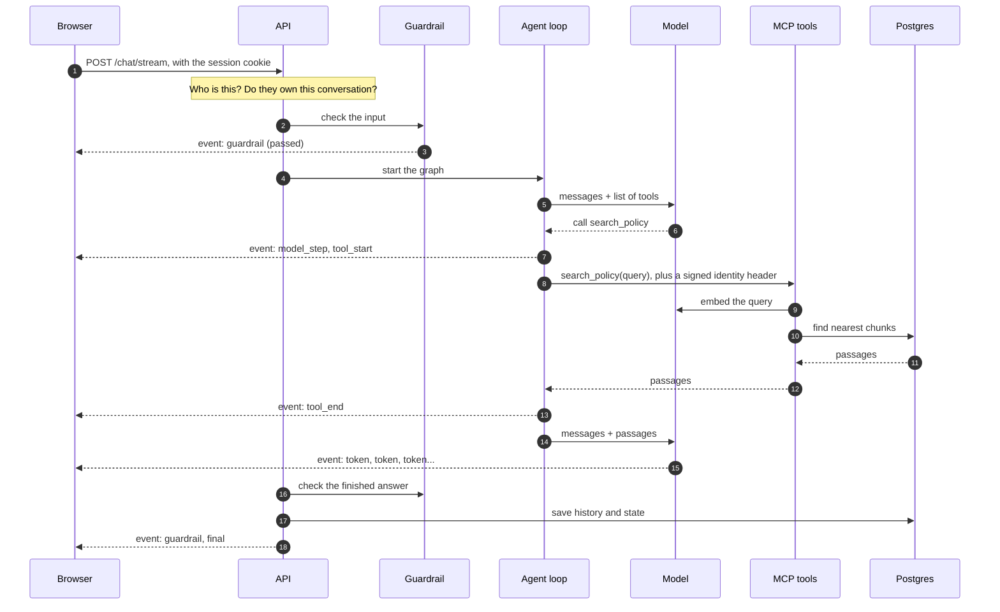
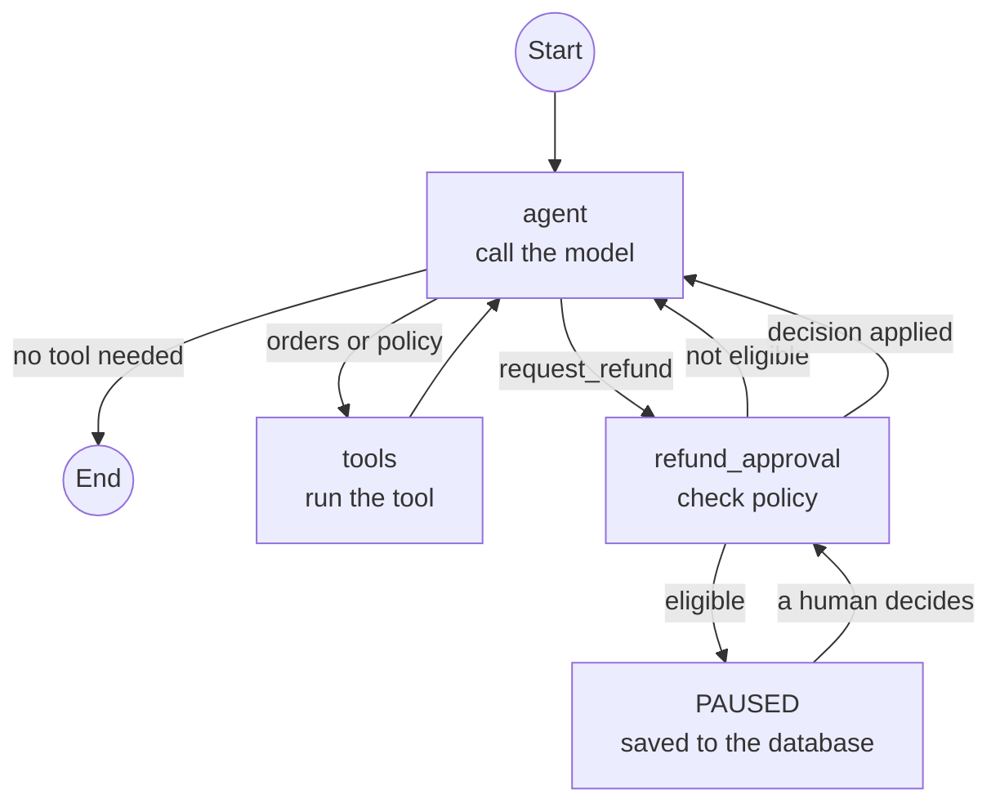
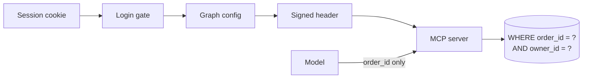
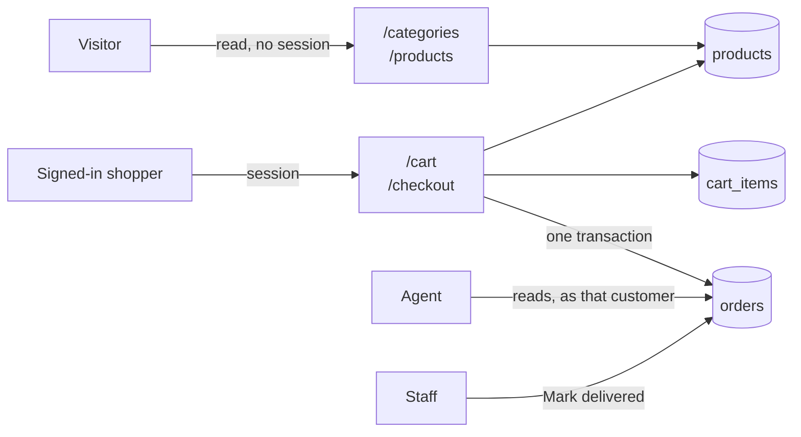
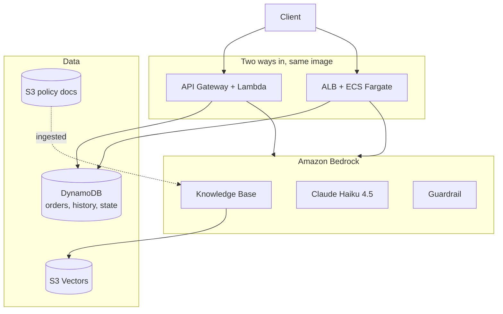

# Architecture

This page starts with the simplest picture and adds detail one layer at a time. Stop at whichever
level answers your question.

## Level 1: the idea

A customer asks a question. A language model decides what's needed, our code does the work, and
the model writes the answer.

The model never touches the data directly. It asks, and our code decides whether to do it. That
split is the most important idea in this project. It's also what keeps each customer's data private: the model
never decides whose data it reads.

## Level 2: the layers

| Layer | Its one job | Why it's separate | Code |
| --- | --- | --- | --- |
| Browser | Show the shop, the conversation and what the agent is doing | Runs on the user's device | [web/src/](../../web/src) |
| Login gate | Stop anyone without a session, except for reading the catalogue, and name who's left | Every route is protected by default | [auth_api.py](../../src/shophelper/api/auth_routes.py), [auth.py](../../src/shophelper/accounts/auth.py) |
| API | Turn HTTP into calls to the agent | The agent shouldn't know about HTTP | [api.py](../../src/shophelper/api/app.py) |
| Guardrails | Stop unsafe text | Must not depend on the model behaving | [guardrails.py](../../src/shophelper/agent/guardrails.py) |
| Agent | Decide the next step | This is the "brain stem": the loop and its rules | [graph.py](../../src/shophelper/agent/graph.py) |
| Model | Choose and write | Swappable: Qwen locally, Claude on AWS | `default_llm()` in graph.py |
| Tools | Do real work | Reusable by any MCP client | [mcp_server.py](../../src/shophelper/mcp/server.py) |
| Storage | Remember | Survives restarts | [orders.py](../../src/shophelper/shop/orders.py), [memory.py](../../src/shophelper/agent/memory.py), [rag.py](../../src/shophelper/rag/pipeline.py) |

[service.py](../../src/shophelper/agent/service.py) holds these together. It runs one turn from start to
finish: guardrail, agent, guardrail, save.

## Level 3: what happens in one message

Here's "Is there a restocking fee?" from start to finish. You can watch these same steps in the
UI's **Under the hood** panel.

The `search_policy` steps are RAG, and the whole loop that starts when the agent calls the model is the agent. The model runs twice: once to
decide and once to write.

## Level 4: the agent graph

The agent is a small state machine. Each box is a function, and each arrow is a decision.

Why refunds get their own node, and how pausing works, is covered in
[Memory and human approval](../learn/03-agents/05-human-approval.md).

## Level 5: keeping users apart

The signed-in user reaches the database by a path the model can't touch. It chooses only `order_id`.

Someone else's order and a missing one get the same reply. Refund approval is a separate staff job, and the agent
resumes as the customer. See [Accounts and isolation](../learn/06-building-the-app/07-authorization-and-isolation.md).

## Level 6: the shop around the agent

The shop is ordinary web code, and the agent has no part in it. They meet at one point: a placed order is an ordinary row in
`orders`, so the existing tools, refund checks and staff queue all work on it unchanged.

| Rule | How it's enforced |
| --- | --- |
| Prices come only from `products` | `POST /checkout` takes no body |
| A double click places one order | `DELETE ... RETURNING` claims the cart, so a second request finds it empty |
| A failed order loses nothing | The emptied cart and the new order commit together |
| A cart belongs to one person | Every statement filters on the session's user, and no route takes a user id |
| The agent gained no power | Checkout is user-driven, and nothing was added to the MCP server |

## Where things live: local and AWS

The code above is identical in both places. Only the outer pieces change, and settings choose
which ones. [Local vs AWS](../learn/09-cloud-deployment/02-local-vs-aws.md) explains how.

| Role | Local (`docker compose up`) | AWS (`scripts/deploy.sh`) |
| --- | --- | --- |
| Chat model | LM Studio: Qwen3 30B | Bedrock: Claude Haiku 4.5 |
| Embeddings | LM Studio: nomic, 768 dimensions | Bedrock: Titan v2, 1024 dimensions |
| Vector store | Postgres + pgvector | S3 Vectors, through a Knowledge Base |
| RAG pipeline | Our code, [rag.py](../../src/shophelper/rag/pipeline.py) | Managed by the Knowledge Base |
| Users, orders, history, state | Postgres | Orders, history and state in DynamoDB; no users |
| Tools | MCP over HTTP, its own container | MCP over stdio on ECS, in-process on Lambda |
| Guardrails | Regex rules | Bedrock Guardrails |
| Accounts | Built in, with three levels | **None: the API has no login** |
| Compute | Docker Compose | Lambda and ECS Fargate |
| Observing | The UI trace, pgAdmin, logs | CloudWatch, LangSmith |

### The AWS layout

CloudWatch, SNS alarms, LangSmith and the GitHub Actions pipeline sit around this. See
[aws-services.md](aws-services.md).

## Code map

| File | What it does | Runs where |
| --- | --- | --- |
| [raw_agent.py](../../src/shophelper/agent/raw_agent.py) | The agent loop with no framework, for comparison | Learning only |
| [api.py](../../src/shophelper/api/app.py) | HTTP routes and SSE | Both |
| [local_api.py](../../src/shophelper/api/local_routes.py) | Routes for the learning UI. Return 404 unless accounts are on | Local |
| [auth.py](../../src/shophelper/accounts/auth.py), [auth_api.py](../../src/shophelper/api/auth_routes.py) | Accounts, sessions, the login gate, level checks | Local |
| [identity.py](../../src/shophelper/core/identity.py) | Who a tool call is acting for, out of the model's reach | Both |
| [conversations.py](../../src/shophelper/accounts/conversations.py) | Who owns each conversation | Local |
| [refunds.py](../../src/shophelper/shop/refunds.py) | The staff queue and approval rules | Local |
| [catalog.py](../../src/shophelper/shop/catalog.py) | Products and categories | Local |
| [cart.py](../../src/shophelper/shop/cart.py) | Carts, merging and checkout | Local |
| [shop_api.py](../../src/shophelper/api/shop_routes.py) | Shop routes. Return 404 unless accounts are on | Local |
| [service.py](../../src/shophelper/agent/service.py) | One turn, start to finish, and the stream events | Both |
| [graph.py](../../src/shophelper/agent/graph.py) | The agent, the refund node, model selection | Both |
| [tools.py](../../src/shophelper/agent/tools.py) | What the tools actually do | Both |
| [mcp_server.py](../../src/shophelper/mcp/server.py), [mcp_client.py](../../src/shophelper/mcp/client.py) | Tools over MCP | Both |
| [guardrails.py](../../src/shophelper/agent/guardrails.py) | Bedrock Guardrail, and the local rules | Both |
| [rag.py](../../src/shophelper/rag/pipeline.py) | Chunk, embed, store, search | Local |
| [db.py](../../src/shophelper/core/db.py), [schema.sql](../../src/shophelper/core/schema.sql) | Postgres connection and tables | Local |
| [setup_local.py](../../src/shophelper/api/setup_local.py) | First-run setup | Local |
| [orders.py](../../src/shophelper/shop/orders.py), [memory.py](../../src/shophelper/agent/memory.py) | Storage, one class per backend | Both |
| [observability.py](../../src/shophelper/core/observability.py) | JSON logs, LangSmith | Both |
| [config.py](../../src/shophelper/core/config.py) | Every setting, with AWS defaults | Both |

## Key decisions

| Decision | Why | Cost |
| --- | --- | --- |
| Model requests, code executes | A wrong model output can't move money | More code than letting the model act |
| Refund as a graph node, not a tool | The rule is enforced by structure, not by a prompt | A special case in the graph |
| One Postgres for everything locally | One thing to run and inspect | Doesn't scale the way DynamoDB does, which is fine here |
| Orders in Postgres, not memory | The MCP server is a separate process and must see refunds | Needs the database running |
| MCP as its own container locally | You can see it, restart it, and connect other clients to it | One more network hop (about 30 ms) |
| SSE for streaming | Traffic only flows one way, and it's plain HTTP | Can't send client messages on the same connection |
| Settings choose the backend | One codebase, no `if local` scattered around | Each backend must honour the same contract |
| Identity in a signed header, not a tool argument | The model can't see or set it | One more moving part between API and MCP |
| Database sessions for browsers, JWT only for MCP | Logout must work at once; MCP tokens last 60 seconds | A lookup on every request |
| Login gate as middleware | Covers every route, including `/docs` | Code runs on every request |
| Accounts built here, not a provider | Every step can be read | Not what a real product should do |
| The page scrolls in its own region | Nothing can slide under the bottom bar, so the chat can't cover Add to cart | Back's scroll position is restored by hand |
| No payment step | The point is an order the agent can help with | Not a real shop |
| AWS stays the default | Deployed code changes nothing unless a setting is added | Local needs its settings in `docker-compose.yml` |
