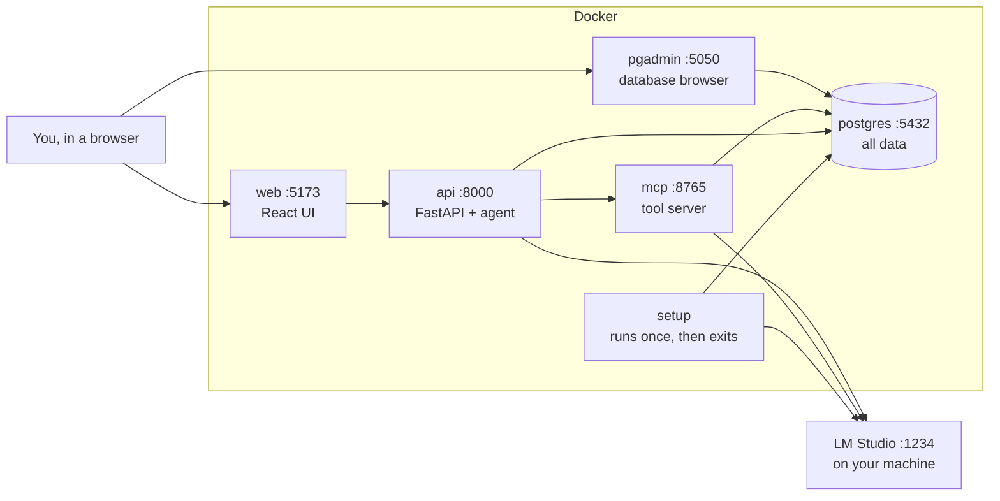

# Local setup

Everything runs on your machine. No AWS account is used and nothing costs money.

## What you need

| Tool | Why |
| --- | --- |
| [Docker Desktop](https://www.docker.com/products/docker-desktop/) | Runs the database, the API and the UI |
| [LM Studio](https://lmstudio.ai/) | Runs the AI models on your GPU |
| `qwen/qwen3-30b-a3b-2507` in LM Studio | The chat model |
| `text-embedding-nomic-embed-text-v1.5` in LM Studio | The embedding model, used for RAG |

LM Studio stays outside Docker on purpose. It needs direct access to your GPU, and it already
manages your models. Containers reach it at `host.docker.internal:1234`.

## Start it

**1. Start LM Studio's server.** Either use the Developer tab in LM Studio, or run:

```bash
lms server start
```

**2. Start everything else:**

```bash
docker compose up --build
```

The first run takes a few minutes to build the images. Later runs start in seconds. Add `-d` to
run in the background.

**3. Open the app:** <http://localhost:5173>. `http://127.0.0.1:5173` works too, but it's a separate site to your browser, so you sign in to each one separately.

The shop opens straight away, with no sign-in needed to browse or fill a cart.

**4. Sign in.** Use **Sign in** in the navbar, and click a demo account or create your own. **How it works** shows two green dots
when LM Studio and Postgres are connected.

**Coming from an older version?** Run `docker compose up --build -V web` once, because the frontend has new packages. `setup` adds
the shop's tables and products to your database, and your orders and accounts stay as they are.

## Accounts

| Level | Demo accounts | What they can do |
| --- | --- | --- |
| Customer | Arjun, Asha, Kabir, Meera, Neha, Priya, Ravi | See their own orders and chats, request refunds |
| Support | Support | See all orders, review refunds up to $200 |
| Admin | Admin | Review any refund, change levels, reset the demo |

Emails are `<name>@demo.shophelper.test`, and the password for all of them is `shophelper-demo`. That password is
public, so these accounts only exist on the local stack. Each demo customer owns one order, and a new sign-up starts
with 2 sample orders of their own.

Where things are:

| To do this | Go to |
| --- | --- |
| Shop | **Shop** in the navbar, or `/shop/all` |
| Get help | **Chat**, at the bottom of every page. You need to sign in |
| See your orders | The account menu, **Your orders** |
| Review refunds | The account menu, **Refund queue** (staff) |
| Mark an order delivered, so it can be refunded | The account menu, **All orders** (staff) |
| Change a user's level | The account menu, **Users** (admin) |
| See the agent's steps, RAG and tools | **How it works** |

To see two people at once, use a normal window and a private window. Use `localhost`, not `127.0.0.1`: browsers treat
them as different sites, and only `localhost` is allowed.

## What's running



| Service | Address | What it does |
| --- | --- | --- |
| `web` | <http://localhost:5173> | The React app, with hot reload |
| `api` | <http://localhost:8000/docs> | FastAPI and the agent. The link opens interactive API docs |
| `mcp` | `http://localhost:8765/mcp` | The tool server. Any MCP client can connect to it |
| `postgres` | `localhost:5432` | Database. User, password and database are all `shophelper` |
| `pgadmin` | <http://localhost:5050> | Browse and query the database. No login needed |
| `setup` | none | Creates tables, seeds orders, embeds the policies, then exits |

`setup` finishing with exit code 0 is normal, so `docker compose ps` won't list it as running.

Every port is bound to `127.0.0.1`, so nothing is reachable from your network. That matters
because the passwords are placeholders and pgAdmin has no login.

## See your data in pgAdmin

1. Open <http://localhost:5050>.
2. In the left panel, expand **Servers**, then **ShopHelper (local)**. It connects without a
   password.
3. Go to **Databases → shophelper → Schemas → public → Tables**.
4. Right-click a table, then **View/Edit Data → All Rows**.

For your own queries, select the `shophelper` database and open **Tools → Query Tool**.

| Table | What's in it | Written by |
| --- | --- | --- |
| `policy_chunks` | Pieces of the policy documents, with their embeddings | `setup` |
| `users` | Accounts, levels and password hashes | `setup`, then sign-ups |
| `auth_sessions` | Signed-in browsers, stored as token hashes | Login and logout |
| `login_attempts` | Recent failed logins, for lockout | Login |
| `orders` | Demo and sample orders as JSON, each with an `owner_id` | `setup`, sign-ups, refunds |
| `conversations` | Who owns each conversation | The API, each new chat |
| `chat_history` | The readable conversation, one row per message | The API, each turn |
| `refund_requests` | The staff queue, and who decided each refund | The API, when a refund pauses |
| `checkpoints`, `checkpoint_blobs`, `checkpoint_writes` | The agent's saved state | LangGraph |
| `checkpoint_migrations` | LangGraph's own schema version | LangGraph |

### Queries worth trying

How many chunks each document produced:

```sql
SELECT source, count(*) AS chunks
FROM policy_chunks
GROUP BY source
ORDER BY source;
```

Look at a chunk and confirm its embedding has 768 numbers:

```sql
SELECT source, chunk_index, content, vector_dims(embedding) AS dims
FROM policy_chunks
LIMIT 5;
```

Find the chunks most similar in meaning to the first refund chunk. This is the same math RAG
uses:

```sql
SELECT b.source, b.chunk_index,
       round((1 - (a.embedding <=> b.embedding))::numeric, 3) AS similarity
FROM policy_chunks a
JOIN policy_chunks b ON a.id <> b.id
WHERE a.source = 'refunds.md' AND a.chunk_index = 0
ORDER BY a.embedding <=> b.embedding
LIMIT 5;
```

Read inside the JSON orders. Run this after approving a refund to see it change:

```sql
SELECT o.order_id, u.display_name AS owner, o.data->>'item' AS item, o.data->>'status' AS status
FROM orders o
LEFT JOIN users u ON u.id = o.owner_id
ORDER BY o.order_id;
```

See a conversation, then how many state snapshots the agent saved for each session:

```sql
SELECT session_id, role, text, created_at FROM chat_history ORDER BY id DESC LIMIT 20;

SELECT thread_id, count(*) AS checkpoints
FROM checkpoints
GROUP BY thread_id
ORDER BY checkpoints DESC;
```

## Everyday commands

```bash
docker compose ps                     # what's running
docker compose logs -f api            # follow one service's logs
docker compose restart api            # restart one service
docker compose down                   # stop everything, keep the data
docker compose down -v                # stop everything and DELETE the data
docker compose up setup               # re-embed the policies after editing them
```

Code changes reload by themselves: `src/` restarts `api` and `mcp`, and `web/src/` updates the
browser. **Not** covered: changes to `pyproject.toml` or `docker-compose.yml`, which need
`docker compose up --build`, and changes to `package.json`, which need
`docker compose up --build -V web`. The `-V` matters: `web` keeps its `node_modules` in a volume,
and without the flag the old packages stay in place.

To undo refunds, sign in as Admin and use **Reset demo orders** on **All orders**. That restores the 7 demo orders, and keeps
anything you bought.

## Tests

```bash
uv run pytest                 # backend unit tests, no services needed
cd web && npm test            # frontend logic tests
scripts/evals_local.sh        # 37 real conversations and integration tests; needs the stack (about 3 minutes)
EVAL_RUNS=3 scripts/evals_local.sh   # repeat the suite; the default is 1 run
uv run pre-commit install    # once per clone: lint and format run before each commit
```

## Changing models

Set these in `.env`, then run `docker compose up -d`:

```bash
LOCAL_CHAT_MODEL=some/other-model
EMBEDDING_MODEL=some-other-embedding-model
```

The chat model can be anything in LM Studio that supports tool calling. Changing the embedding
model takes more work, because:

1. Stored vectors only make sense next to vectors from the same model.
2. The column size in [schema.sql](../../src/shophelper/core/schema.sql) must match the new model.
3. The `search_query:` prefixes in [rag.py](../../src/shophelper/rag/pipeline.py) are specific to nomic.

After editing those, run `docker compose down -v` and start again.

## Troubleshooting

| What you see | Cause | Fix |
| --- | --- | --- |
| `setup` exits with `Can't reach LM Studio` | Its server is off | `lms server start`, then `docker compose up` |
| `LM Studio doesn't have: [...]` | A model isn't downloaded, or its name differs | Run `lms ls` and compare the names |
| Red LM Studio dot in the UI | The server stopped after startup | `lms server start`. No Docker restart needed |
| First answer is very slow | LM Studio is loading the model into memory | Wait, or load it first with `lms load` |
| Answers are slower than expected | The 18.6 GB model doesn't fit in 16 GB of VRAM, so part runs on the CPU | Expected. See the numbers below |
| "Too many attempts" at login | 5 failed logins for that email | Wait 15 minutes, or run `docker compose exec postgres psql -U shophelper -c "DELETE FROM login_attempts"` |
| "Cross-site request refused" at login | You're on `127.0.0.1`, and only `localhost` is allowed | Use `localhost` |
| A chat stays "waiting" after a reset | Reset cancelled its refund request | Start a new conversation |
| Port already in use | Another program has that port | Stop it, or change the left number in `ports:` in `docker-compose.yml` |
| A script hangs connecting to `localhost:5432` | On Windows, `localhost` tries IPv6 first and stalls | Use `127.0.0.1` |
| `uv run uvicorn ...` on the host fails | Your `.env` still names AWS resources that were destroyed | Use Docker for local work. `.env` is only for AWS |
| `docker compose up --build` stalls downloading Python packages | Some ISPs have a very slow IPv4 route to PyPI, and containers have no IPv6. Compare `curl -4` and `curl -6` on a package URL | Only happens when `requirements.txt` changes. Try another network, or build through a local proxy as described in `memory/learnings.md` |
| The web page fails with `Failed to resolve import` after pulling new code | `web` still has its old `node_modules` volume | `docker compose up --build -V web` |
| You changed a policy but answers didn't | The chunks weren't rebuilt | `docker compose up setup` |

## What to expect from a local model

Measured on an RTX 5080 (16 GB) with `qwen3-30b-a3b-2507`:

| Measure | Result |
| --- | --- |
| Generation speed | About 45 tokens per second |
| First token of a reply | About 2.3 s for a direct answer, 3.5-5 s if tools run first |
| One embedding | About 15-25 ms |
| One tool call through MCP | About 30 ms |
| Eval suite | 37 of 37, one run |
